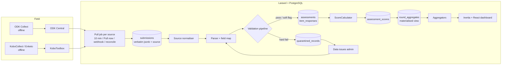
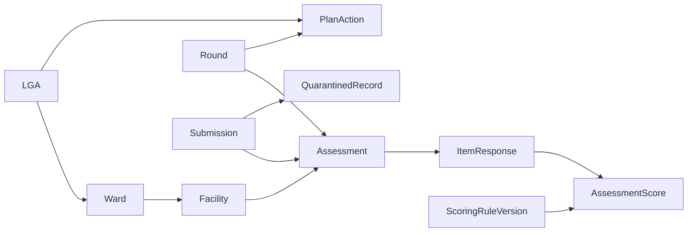
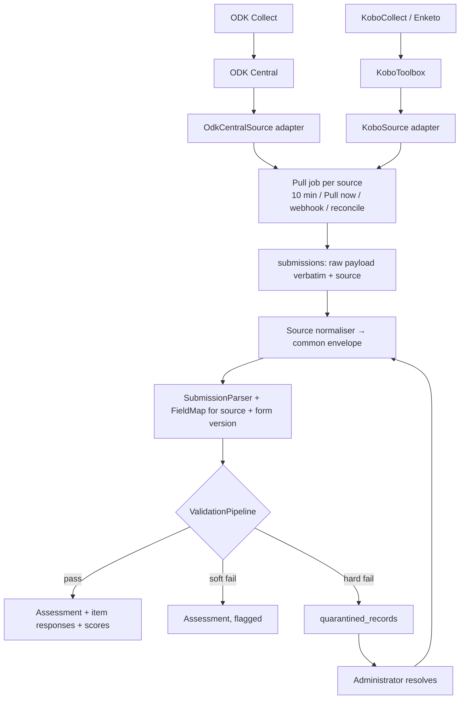

# ARCHITECTURE.md — Kaduna eDQA Portal

How the system is put together: layers, data flow, domain, schema, ingestion, validation,
scoring, API and page structure. Read the section for the area you are changing before you
change it. Coding style lives in `CONVENTION.md`; security in `SECURITY.md`; accessibility in
`ACCESSIBILITY.md`; servers and pipelines in `DEPLOY.md` (separate DevOps project).

## Contents
1. System overview · 2. Application layers · 3. Domain model · 4. Database · 5. Ingestion ·
6. Validation · 7. Scoring · 8. API · 9. Presentation layer · 10. Non-functional targets ·
11. Decisions, prototype deltas, open questions

---

## 1. System overview



**Governing principle:** a score that cannot be true never reaches a chart. Aggregators read only
`assessments`, `assessment_scores` and `round_aggregates` — never `submissions` or
`quarantined_records`. This separation is structural (separate tables + an architecture test),
not a query filter.

**Goals this architecture serves (from the PRD):**

| # | Goal | Where it is enforced |
|---|---|---|
| G1 | No invalid score ever charts | Validation pipeline (§6), CHECK constraints (§4), table separation |
| G2 | Submission on dashboard ≤ 15 min, no human step | Scheduled pull (§5), debounced aggregate refresh |
| G3 | Scores reproducible | Pure `ScoreCalculator`, verbatim payloads, rule versions (§7) |
| G4 | Exactly 23 LGAs | Seeded `lgas`, `LGA_UNKNOWN` rule, no insert path |
| G5 | Every page renders | Pages read local materialised data; no live external query at view time |
| G6 | Follow-up actionable | `plan_actions` (§9.2.6) |
| G7 | Corrections traceable | Activity log on every write (SECURITY.md §4) |
| G8 | Works on 3G | Server-rendered numbers, deferred charts, JS budget (§10) |

**Deployment:** containerised (Docker images, Compose on one host) — see §2 and `DEPLOY.md`.

**Data sources:** ODK Central and KoboToolbox, both pulled through one shared pipeline (§5).

**Out of scope for v1:** any source besides ODK Central and KoboToolbox, roles/permissions, writing back to ODK, Kobo or
DHIS2, sampling logic, mobile app, multi-state tenancy, DHIS2 comparison, public dashboard.

---

## 2. Application layers

```
app/
  Domain/                      ← all business logic
    Assessment/  Models, Actions, DTOs, Events
    Round/       Models, OpenRound, CloseRound, ReopenRound, MonthSlot
    Facility/    Models (Lga, Ward, Facility), Actions, CascadeExporter
    Ingestion/   Contracts/{SubmissionSource,PayloadNormalizer}, SourceRegistry,
                 SubmissionEnvelope, FieldMap, SubmissionParser, ProcessSubmissionsPage,
                 PullSubmissionsJob, BackfillSubmissionsJob, ReconcileSourceJob,
                 FetchAttachmentsJob, PullLock, ReprocessSubmission
      Odk/       OdkCentralSource, OdkCentralClient, SessionTokenCache, OdkPayloadNormalizer
      Kobo/      KoboSource, KoboClient, KoboPayloadNormalizer
    Validation/  Contracts/ValidationRule, Rules/*, ValidationPipeline, ValidationContext,
                 QuarantineAction, ResolveQuarantineAction
    Scoring/     ScoreCalculator, ScoreCard, RuleConfig, Bands, RuleVersion, RescoreRoundJob
    Reporting/   Aggregators/*, ReportFilter, Exporters/*
    Plan/        PlanAction model, Actions
  Http/
    Controllers/ thin — one per page; validate → Action/Aggregator → Resource
    Requests/    FormRequests (validation only)
    Resources/   Inertia/JSON shapes (no arithmetic)
    Middleware/  EnsureTwoFactorConfirmed, SecurityHeaders, VerifySourceWebhook (per-source strategy)
  Console/Commands/  edqa:source:check, edqa:pull, edqa:reconcile, edqa:backfill, edqa:backfill-report, edqa:rescore,
                     edqa:refresh-aggregates, edqa:admin:create, edqa:admin:disable
config/edqa.php, config/edqa_field_maps.php
database/sql/round_aggregates.sql
resources/js/Pages/{Dashboard,Admin}/*, Components/*, lib/*, types/*
lang/en/*.php
Dockerfile                    # targets: base, vendor, assets, app, worker, web, ci, dev
compose.dev.yml               # local development stack
docker/                       # entrypoint.sh, php/*.ini, fpm-pool.conf, caddy/Caddyfile*, postgres/init-dev.sql
database/sql/post-migrate-grants.sql
Makefile                      # make up / down / sh / test / artisan
```

**Dependency direction:** `Http → Domain`. Inside Domain: `Reporting → Scoring, Assessment,
Round, Facility` (read-only); `Ingestion → Validation → Scoring → Assessment`. `Reporting` must
not depend on `Ingestion` or `Validation` models (architecture test).

**Events and listeners:**

| Event | Listeners |
|---|---|
| `SubmissionIngested` | log counters on `pull_runs` |
| `SubmissionQuarantined` | bump quarantine badge cache |
| `AssessmentScored` | dispatch debounced `RefreshRoundAggregatesJob`, flush round cache tag |
| `QuarantineResolved` | dispatch `RescoreRoundJob` for the round |
| `RuleVersionPublished` | dispatch `RescoreRoundJob` per affected round |
| `RoundClosed` | refresh materialised view, snapshot |
| `PullFailed` | admin alert, digest entry (names the source) |
| `SourceDeletionDetected` | flag for administrator review; never auto-delete |

**Queues:** `default` (pull, process), `rescore`, `exports`, `low` (attachments).

**Runtime processes (containers).** The application ships as container images built from one
multi-stage `Dockerfile` (`DEPLOY.md` §6). One image runs every PHP role, chosen by the
entrypoint argument:

| Container | Role | Image | Notes |
|---|---|---|---|
| `web` | Caddy: TLS, static assets, FastCGI to `app` | `edqa-web` | Only container with published ports |
| `app` | PHP-FPM serving Inertia pages and `/api/*` | `edqa-app` | Stateless; can scale to 2+ |
| `worker-default` | `queue:work --queue=default` | `edqa-app` | Pulls (all sources), reconcile, submission processing |
| `worker-rescore` | `queue:work --queue=rescore` | `edqa-app` | Long jobs; generous stop grace period |
| `worker-exports` | `queue:work --queue=exports,low` | `edqa-worker` | Has Chromium for PDFs |
| `scheduler` | `schedule:work` | `edqa-app` | Exactly one instance |
| `migrate` | one-off: migrate + grants | `edqa-app` | Runs as `edqa_migrator` before each rollout |
| `postgres`, `redis` | data | official images | Internal network only |

Consequences for application code are listed in `CONVENTION.md` §12 (stateless containers, logs
to stderr, persistent files only under `storage/app`, config cached at start not build).

---

## 3. Domain model

### Entities and relationships



| Entity | Key facts |
|---|---|
| **LGA** | Exactly 23, seeded. No runtime insert. |
| **Ward** | Belongs to one LGA. |
| **Facility** | Belongs to one ward (and denormalised `lga_id`). `level` ∈ Primary/Secondary/Tertiary. `ownership` ∈ Public/Private. `is_active` — deactivate, never delete. |
| **Round** | `(year, quarter)` unique. Assessment window `window_start..window_end`. Status `open` or `closed`. |
| **Submission source** | A configured field-collection server + form: `odk` (ODK Central) or `kobo` (KoboToolbox). |
| **Submission** | One raw record from a source, verbatim, with `source_id`, `external_id` (the source's stable logical ID) and `instance_id` (this version; unique across sources). May be `superseded` by an edit at source. |
| **Assessment** | Created only from a submission that passed all hard rules. `(round_id, facility_id)` unique. |
| **ItemResponse** | One scored question: `dimension`, `month_slot`, `item_code`, `value`, `is_applicable`. |
| **AssessmentScore** | One row per `(assessment, dimension, month_slot)`. `score numeric(5,2)` or null when the slot is all-N/A. Records `rule_version_id`. |
| **QuarantinedRecord** | Failed submission, all failed rule codes + details, resolution state. |
| **ScoringRuleVersion** | Versioned JSON config (bands, item weights, N/A policy). `draft` until `published_at`. |
| **PlanAction** | Implementation-plan row: LGA, round, dimension, action text, owner, due date, status. |

### Current LGAs (seed list)

Birnin Gwari, Chikun, Giwa, Igabi, Ikara, Jaba, Jema'a, Kachia, Kaduna North, Kaduna South,
Kagarko, Kajuru, Kaura, Kauru, Kubau, Kudan, Lere, Makarfi, Sabon Gari, Sanga, Soba,
Zangon Kataf, Zaria.  **= 23.** Confirm codes against the national facility registry.

### Month-slot mapping

| Quarter | Slot 1 | Slot 2 | Slot 3 |
|---|---|---|---|
| Q1 | January | February | March |
| Q2 | April | May | June |
| Q3 | July | August | September |
| Q4 | October | November | December |

UI rule: show real month names when exactly one quarter is in view; otherwise "Month 1/2/3".
Implement once in `App\Domain\Round\MonthSlot::label(int $quarter, int $slot)` and mirror in
`resources/js/lib/months.ts`.

### Round lifecycle

```
          create                close (snapshot aggregates)
 (none) ────────▶ open ──────────────────────────▶ closed
                   ▲                                  │
                   └──────── reopen (reason) ─────────┘
```

- **open** — submissions whose visit date falls in the window bind to it.
- **closed** — no new submissions bind; aggregates are snapshotted into `round_aggregates`.
  A submission for a closed round quarantines under `ROUND_WINDOW` with detail "round closed".
- **reopen** — requires typed reason, audited, triggers rescore on next close.
- Windows must not overlap between rounds (validated on create/edit).

> The PRD also mentions a "publish state" (PRD §5) and "published rounds" (PRD §8). v1 treats **closed =
> published**. See §11 Decisions D-07.

### Submission lifecycle

```
received ─▶ parsed ─▶ validated ─┬─▶ accepted  (assessment + scores created)
                                 ├─▶ flagged   (accepted with soft flags)
                                 └─▶ quarantined ─┬─▶ reprocessed → accepted/flagged
                                                  └─▶ rejected (reason)
any ─▶ superseded   (an edit at source arrived: deprecatedID = this instance_id,
                     or same external_id with a new instance_id)
```

When a submission is superseded after it produced an assessment, the replacement is processed
and the assessment is updated in place (audited) — the `(round, facility)` uniqueness holds.

### Assessor identity

Assessors have no portal account. `assessor_name` and `device_id` come from the submission's
metadata on whichever source it came from
(`meta/username` or a form field, `deviceid`). Used for the `ASSESSOR_VOLUME` soft rule and for
display only.

---

## 4. Database — PostgreSQL 16

All timestamps `timestamptz`. All raw payloads `jsonb`. Every migration reversible.

### Tables

| Table | Columns | Constraints / notes |
|---|---|---|
| `users` | id, name, email UQ, password, two_factor_secret, two_factor_recovery_codes, two_factor_confirmed_at, is_active, remember_token, timestamps | Administrators only. No role column |
| `lgas` | id, name UQ, code UQ | Seeded with exactly 23 |
| `wards` | id, lga_id FK, name, code | UQ (lga_id, name) |
| `facilities` | id, code UQ, name, ward_id FK, lga_id FK, level, ownership, is_active, lat numeric(9,6)?, lng numeric(9,6)?, timestamps | `level` / `ownership` CHECK against enum values |
| `rounds` | id, year smallint, quarter smallint, window_start date, window_end date, status, closed_at?, reopened_reason?, timestamps | UQ (year, quarter); CHECK quarter 1–4; CHECK window_end ≥ window_start; status CHECK in ('open','closed') |
| `submission_sources` | id, key UQ, type, name, is_enabled, timestamps | `type` CHECK in ('odk_central','kobo'); seeded from config; credentials never stored here |
| `submissions` | id, source_id FK, external_id, instance_id UQ, deprecated_id?, form_ref, form_version, payload jsonb, submitted_at, source_updated_at?, received_at, processed_at?, status, superseded_by_id?, deleted_at_source? | Payload never mutated; index (source_id, external_id) |
| `assessments` | id, round_id FK, facility_id FK, submission_id FK, assessor_name, device_id?, started_at, ended_at, gps jsonb?, status, flags jsonb default '[]', timestamps | UQ (round_id, facility_id); CHECK ended_at ≥ started_at |
| `item_responses` | id, assessment_id FK cascade, dimension, month_slot smallint, item_code, value, is_applicable bool | CHECK month_slot 1–3; dimension CHECK |
| `assessment_scores` | id, assessment_id FK cascade, dimension, month_slot smallint, score numeric(5,2) NULL, rule_version_id FK, computed_at | CHECK score 0–100; UQ (assessment_id, dimension, month_slot, rule_version_id) |
| `quarantined_records` | id, submission_id FK, source_id FK, instance_id, round_id?, facility_ref?, lga_ref?, payload jsonb, failures jsonb, status, resolution, resolved_by?, resolved_at?, resolution_note?, timestamps | `failures` = `[{code, severity, detail}]` |
| `scoring_rule_versions` | id, version int UQ, config jsonb, created_by, published_at?, published_reason?, timestamps | Exactly one "current" = max published version |
| `plan_actions` | id, round_id, lga_id, dimension, action_text, assigned_to, due_date, status, notes?, timestamps | UQ (round_id, lga_id, dimension) |
| `source_syncs` | id, source_id UQ FK, cursor_at?, cursor_instance_id?, backfill_checkpoint int, last_success_at?, last_error?, last_reconciled_at?, submission_count, timestamps | The pull cursor, one per source |
| `pull_runs` | id, source_id FK, triggered_by?, trigger_type, started_at, finished_at?, fetched, accepted, flagged, quarantined, duplicates, cross_source_duplicates, error?, outcome | Powers pull history; `trigger_type` includes `reconcile` |
| `submission_attachments` | id, submission_id, filename, mime, size, source_url?, path?, fetched_at?, status | Deferred fetch during backfill |
| `activity_log` | Spatie standard | Append-only (see SECURITY.md) |
| `round_aggregates` | **materialised view** | See below |

> Note on `assessment_scores` uniqueness: the PRD lists UQ `(assessment_id, dimension, month_slot)`.
> Because published rounds keep old-version scores readable, include `rule_version_id` in the
> unique key. See §11 Decisions D-05.

### Constraints (write the failing test first)

```sql
ALTER TABLE assessment_scores ADD CONSTRAINT score_in_range   CHECK (score IS NULL OR (score >= 0 AND score <= 100));
ALTER TABLE assessments       ADD CONSTRAINT visit_dates_ordered CHECK (ended_at >= started_at);
ALTER TABLE item_responses    ADD CONSTRAINT month_slot_valid CHECK (month_slot BETWEEN 1 AND 3);
ALTER TABLE assessment_scores ADD CONSTRAINT score_slot_valid CHECK (month_slot BETWEEN 1 AND 3);
ALTER TABLE rounds            ADD CONSTRAINT quarter_valid    CHECK (quarter BETWEEN 1 AND 4);
ALTER TABLE rounds            ADD CONSTRAINT window_ordered   CHECK (window_end >= window_start);
```

A test inserts `347.66` directly via `DB::table('assessment_scores')->insert(...)` and asserts a
`QueryException` with SQLSTATE `23514` (check_violation).

### Indexes

| Index | Purpose |
|---|---|
| `assessments (round_id, facility_id)` UNIQUE | One assessment per facility per round |
| `submissions (instance_id)` UNIQUE | Idempotency |
| `submissions (deprecated_id)` | Edit chain lookup |
| `item_responses (assessment_id, dimension, month_slot)` | Scoring access path |
| `assessment_scores (assessment_id, dimension, month_slot, rule_version_id)` UNIQUE | |
| `submissions USING gin (payload jsonb_path_ops)` | Payload queries during reprocessing |
| `quarantined_records USING gin (failures)` | Group Data issues by rule code |
| `quarantined_records (status, round_id)` | Open-issues badge |
| `facilities (lga_id) WHERE is_active` | Cascade export |
| `round_aggregates (round_id, scope_type, scope_id, owner_type)` UNIQUE | Required for `REFRESH ... CONCURRENTLY` |

### `round_aggregates` materialised view

Columns: `round_id, scope_type ('state'|'lga'|'ward'|'facility'), scope_id, owner_type
('all'|'public'|'private'), level ('all'|...), availability, consistency, validity,
m1, m2, m3, overall, facility_count`.

Built from **accepted assessments only** (`assessments` joined to current-version
`assessment_scores`). Facility score first, then unweighted means of facility scores upward.
Use `COALESCE(scope_id, 0)` / sentinel values so the unique index has no NULLs.

```php
public function up(): void {
    DB::statement(file_get_contents(database_path('sql/round_aggregates.sql')));
    DB::statement('CREATE UNIQUE INDEX round_aggregates_key ON round_aggregates (round_id, scope_type, scope_id, owner_type, level)');
}
public function down(): void {
    DB::statement('DROP MATERIALIZED VIEW IF EXISTS round_aggregates');
}
```

The app runs as `edqa_app`, which does not own the view, so the migration also creates a
`SECURITY DEFINER` function owned by the migrator role:

```sql
CREATE FUNCTION refresh_round_aggregates() RETURNS void
LANGUAGE sql SECURITY DEFINER SET search_path = public AS
$$ REFRESH MATERIALIZED VIEW CONCURRENTLY round_aggregates $$;
```

The app calls `SELECT refresh_round_aggregates()` — never the raw statement. Migrations run in
the one-off `migrate` container, which receives `DB_USERNAME=edqa_migrator`; the app containers
connect as `edqa_app`. After migrating, the same container executes
`database/sql/post-migrate-grants.sql`. All of this is part of the contract with the DevOps
project (`DEPLOY.md` §1.3, §8).

Refresh with `SELECT refresh_round_aggregates();` on `AssessmentScored`
(debounced via a unique queued job), `RoundClosed`, and after rescore.

Filters not covered by the view (e.g. LGA + Level + Owner combined) are answered by Aggregator
SQL over `assessment_scores` with the indexes above; keep the p95 under 1.5 s and cache by round tag.

### Laravel specifics

- `$table->jsonb('payload')`; cast `'payload' => 'array'`.
- `$table->timestampsTz()`.
- Enums: string columns + CHECK, cast to PHP backed enums.
- `Model::preventLazyLoading(! app()->isProduction());`
- `Model::shouldBeStrict()` in local/testing.

### Data volume

5 years × 4 rounds × 2,200 facilities × 9 scores ≈ 400,000 score rows, ~40,000 submissions.
Comfortable for Postgres with these indexes.

---

## 5. Ingestion pipeline — ODK Central and KoboToolbox

Assessments arrive from **two field-collection sources**: **ODK Central** and **KoboToolbox**.
Both run XLSForm-based forms filled offline in ODK Collect or KoboCollect/Enketo. They are the
system of record for submissions; the portal pulls from them and never writes back.

Both sources go through **one** pipeline. Each source has an adapter that knows how to talk to
its API and how to turn its JSON into a common shape. Everything after that — storage, parsing,
validation, scoring — is shared, so there is still exactly one place where data can enter and be
checked.



### 5.0 Sources

| Key | Type | Talks to | Identity of a submission | Version field |
|---|---|---|---|---|
| `odk` | `odk_central` | ODK Central REST + OData API (session token) | `__id` (logical ID) + `meta/instanceID` (this version) | `__system/formVersion` |
| `kobo` | `kobo` | KoboToolbox KPI API v2 (`Authorization: Token …`) | `_id` (logical ID) + `meta/instanceID` (this version) | `__version__` (Kobo deployment version) |

- Each configured source is **one form** (an ODK project + form, or a Kobo asset UID). The schema
  allows more later; v1 configures at most one of each.
- Sources are declared in `config/edqa.php` → `sources`, with credentials from env only. A
  `submission_sources` table (key, type, name, is_enabled) gives each one a stable ID for foreign
  keys. A source with missing credentials is "not configured" and simply never pulls.
- **Adding a third source** (e.g. ODK Aggregate, SurveyCTO) means writing a new adapter that
  implements the same contracts, plus a decision record. It never means a shortcut path such as
  a file upload.
- **Built (Phase 2C step 1):**
  - **Schema** (migration `2026_10_28_000100_make_ingestion_source_aware`): every row stored
    before Phase 2C belongs to the `odk` source. `external_id` comes from the payload's `__id`.
  - **The cursor keeps two timestamps.** `edit_cursor_at` is kept beside `cursor_at`, because
    ODK's edits pass needs it (D-51 in the build-era numbering).
  - **One cursor per source.** `form_ref` records the form it follows; when the configured form
    changes, `SourceSync::forForm()` starts the cursor again. The migration refuses to merge two
    ODK cursor rows; a person has to delete the stale one first.
  - **Two switches per source:** the env flag (`ODK_ENABLED`, `KOBO_ENABLED`) for the operator,
    and `submission_sources.is_enabled` for the administrator. `edqa:sources:sync` sets
    `is_enabled` only when it creates a row.
  - **`SourceRegistry`** resolves a key to its config, row and adapter. KoboToolbox's adapter is
    refused until step 4, and the per-source normaliser arrives with step 2.
  - **Attachments** live in `storage/app/attachments/{source}/{instance}/`. The one-off
    `edqa:attachments:relocate` moves files from the old `odk` disk and is safe to run again.
- **Built (Phase 2C step 2):**
  - **Normaliser layer.** `Contracts\PayloadNormalizer` turns a raw payload into a
    `SubmissionEnvelope` (`SubmissionMeta` + `data`, as §5.2). `Odk\OdkPayloadNormalizer` holds
    every ODK-specific read: `__id`, `meta`, `__system`.
  - **The parser** (`App\Domain\Ingestion\SubmissionParser`) reads only the envelope. An
    architecture test keeps it, and `FieldMap`, free of any source's classes. Reprocessing reads a
    stored payload through its own source's normaliser (`ReadSubmission::fromStored`).
  - **`ParsedSubmission`** carries `source` and `externalId`.
  - **Field maps** are now named maps with `extends`, plus `sources` (source → version → map
    name). `FieldMap::for(source, version)` gives null for any unmapped pair (Kobo versions were
    mapped in step 4). Paths stay dot paths into the envelope's `data`; the Kobo normaliser
    (step 4) nests its `facility/lga` keys. UNKNOWN_FORM_VERSION names the source ("kobo form version vQ8x…
    has no field map").
  - **Edits (D-23 in the new numbering).** `SubmissionSource::changedSince(cursor)` is the pull's
    second pass. On ODK it filters `__system/submissionDate ge X or __system/updatedAt ge X` and
    sorts by `updatedAt asc, __id asc` (Central v2024.1+). With no edit cursor yet, it asks for the
    edited submissions only.
  - **D-51's two cursors are kept.** Ordering a single cursor across two fields can't page safely.
  - **`source_updated_at`** is stored from `__system/updatedAt`.
  - **Edits without `deprecatedID`.** A new row whose `external_id` the source already sent,
    under another instance ID, is treated as an edit of the latest unsuperseded version. Its
    `deprecated_id` is set to that version (the payload is untouched), and it takes the usual
    edit path.
  - **Fixtures** moved to `tests/Fixtures/sources/odk/` unchanged. The parsed fixtures gained only
    `source` and `external_id`.

### 5.1 Form contract (both sources)

The form must satisfy these on every source. The client should deploy **the same XLSForm** to
both where possible (open question Q-16). If a form doesn't comply, adapting it is a scoped task.

| Requirement | Why |
|---|---|
| Facility chosen by cascading select LGA → ward → facility, from a CSV media file generated by the portal and attached to the form on each source | Kills free-text names like `2019.00` |
| Scored question names match `^(avail|consist|valid)_m[1-3]_[a-z0-9_]+$` | Dimension and month slot parsed from the name; new questions need no code change |
| Scored questions are `select_one` with a fixed list (`yes` / `no` / `na`) | Scores computed from pass counts, never typed. Kills `347.66` at source |
| `round_year`, `round_quarter` are read-only calculated fields | Not typed by assessors |
| `meta/instanceID` required | Idempotency key |
| `start`, `end` metadata fields | Visit duration, `END_BEFORE_START`, `VISIT_TOO_SHORT` |
| GPS and register photo optional | Stored when present |

Choice mapping (configurable per field map): `yes` → pass, `no` → fail, `na` → not applicable.

### 5.2 Components (`app/Domain/Ingestion/`)

**Shared**

| Class | Responsibility |
|---|---|
| `Contracts\SubmissionSource` | `ping()`, `formVersions()`, `submissionsPage(since, top, skip)`, `changedSince(since)` (edits), `attachmentList()`, `downloadAttachment()` |
| `Contracts\PayloadNormalizer` | Raw source JSON → `SubmissionEnvelope` (common shape, below). Pure, deterministic |
| `SourceRegistry` | Resolves a source key to its adapter, normaliser, config and `submission_sources` row; knows which are configured and enabled |
| `SubmissionEnvelope` (DTO) | `meta` {source, externalId, instanceId, deprecatedId, submittedAt, updatedAt, formVersion, submitter, deviceId, attachments[{name, mime, url?}]} + `data` (answers nested by group path) |
| `FieldMap` | Resolves logical names → question paths for a (source, form version) |
| `SubmissionParser` | `SubmissionEnvelope` + `FieldMap` → `ParsedSubmission` |
| `ProcessSubmissionsPage` | One page from any source: insert raw rows, normalise, parse, handle edits, validate, score — one transaction |
| `PullSubmissionsJob(source, trigger)` | Incremental pull for one source |
| `BackfillSubmissionsJob(source)` | Cursor-from-zero pull, checkpointed per page, throttled |
| `ReconcileSourceJob(source, window)` | Sweep that catches edits and deletions an incremental pull can miss (§5.3) |
| `FetchAttachmentsJob` | Low-priority queue; downloads deferred attachments |
| `PullLock` | `Cache::lock("pull:{source}", 900)` — one pull per source at a time; different sources may pull in parallel |

**Per source**

| Source | Classes |
|---|---|
| ODK Central | `Odk\OdkCentralSource`, `Odk\OdkCentralClient`, `Odk\SessionTokenCache`, `Odk\OdkPayloadNormalizer` |
| KoboToolbox | `Kobo\KoboSource`, `Kobo\KoboClient`, `Kobo\KoboPayloadNormalizer` |

The normaliser is where the two APIs' differences are absorbed: ODK OData returns nested
objects per group and a `__system` block; Kobo returns flat keys like `facility/lga`, underscore
system fields (`_id`, `_submission_time`, `__version__`, `_attachments`, `_submitted_by`) and
timestamps without a timezone suffix (treat as UTC). After normalisation the parser cannot tell
the sources apart.

- **Built (Phase 2C step 4):** `Kobo\KoboPayloadNormalizer`, returned by
  `SourceRegistry::normaliser('kobo')`.
  - **Meta:** `_id` → externalId. The instance ID is `meta/instanceID`, else the nested
    `meta.instanceID`, else `"uuid:" + _uuid`; `meta/deprecatedID` likewise.
  - **Times:** a zoneless `_submission_time` is read as UTC; a time that carries a zone is read
    as written. updatedAt is always null.
  - **Other meta:** `__version__` → formVersion; `_submitted_by` and the form's `deviceid`.
  - **Attachments:** `_attachments` → attachments (`media_file_basename`, else the file's
    basename; `mimetype`; `download_url`). Deleted entries are skipped.
  - **Answers:** slash keys are nested into groups, and each repeat row is nested to the
    repeat's own path. Every underscore field, `meta/*`, `formhub/*` and `deviceid` stay out of
    the answers. The stored payload is untouched.
  - **Clashes:** a key that can't be nested (a malformed path such as `a//b`, or one that clashes
    with an answer or a group) stays flat under its full key. The one clash with nowhere flat to
    go, a top-level answer named like a group, keeps the group; the raw payload keeps both.
  - **Never throws**, like the parser (500-row property test).
  - **The parser** also reads the XForms text geopoint `"lat lng [alt [accuracy]]"`, as Kobo
    sends it. Out-of-range or malformed values give null.
  - **Source parity** (CONVENTION.md §8): every fixture has a Kobo KPI-v2-shaped row in
    `tests/Fixtures/sources/kobo/`. It parses to the ODK row's `ParsedSubmission` apart from
    source, external_id and form_version, and ends with the same outcome. There are two
    Kobo-only cases: a missing meta block, and a select_multiple-style "yes no" answer.
  - **Version uids:** the two Kobo `__version__` uids in the field maps are fictional
    (CONTRACT-ASSUMED) until the real deployments are listed (§5.5).

### 5.3 Pull mechanics

**Common to both sources**

- **Cursor:** one `source_syncs` row per source. `cursor_at` advances **only after the whole
  page commits**. A crash mid-page replays that page; uniqueness makes replay harmless. Use
  `>=` with the last timestamp plus instance-ID de-duplication, because timestamps tie.
- **Idempotency:** `submissions.instance_id` is unique **across all sources**. A repeat from
  the same source counts as a `duplicate`. The same instance ID arriving from the *other*
  source (e.g. data copied between servers) counts as `cross_source_duplicate`, is not
  inserted, and is shown on the Data sources page.
- **Edits:** both tools keep a stable logical ID and give each edited version a new
  `meta/instanceID` with `meta/deprecatedID` set. A new version — detected by `deprecatedID`
  **or** by a known `external_id` with a new instance ID — marks the old submission
  `superseded`, keeps it, and updates the existing assessment in place (audited). An open
  quarantined record for the old version auto-resolves as superseded.
- **Edits don't change the submission date** on either platform, so an incremental pull filtered
  only on submission time misses them. Each adapter's `changedSince()` uses the platform's
  last-modified field where its API supports filtering on it (ODK Central:
  `__system/updatedAt`), and `ReconcileSourceJob` sweeps the open round's window nightly and on
  demand, comparing (external ID, instance ID) pairs. Verify Kobo's filterable fields against
  the current KPI API docs; if no last-edited filter exists, the sweep is the edit path for Kobo.
- **Deletions at source** are reported by the sweep only (a submission we hold that the source
  no longer returns). They are **not** applied automatically: the record is flagged for an
  administrator, because deleting a published assessment is a decision, not a sync.
- **Attachments:** stored in `storage/app/attachments/{source}/{instance_id}/`, on first sight,
  never re-fetched; deferred during backfill. Download URLs are only followed when their host
  equals the configured source host (SSRF guard, SECURITY.md §6).
- **Retries:** 3 attempts, backoff `[30, 120, 600]`, honour `Retry-After` on 429; then `failed()`
  → error on the run + `source_syncs.last_error` + `PullFailed` + digest.
- **Progress:** each run writes a `pull_runs` row (with `source_id`) and updates counters as pages
  commit; the admin page polls `GET /api/pulls/{runId}`.
- **Schedule:** one scheduled pull per **configured and enabled** source, every 10 minutes,
  `withoutOverlapping()` per source; a nightly `ReconcileSourceJob` per source for the open round.
- **Latency target:** a submission on either source visible on the dashboard ≤ 15 minutes.

**ODK Central**

- `GET /v1/projects/{p}/forms/{f}.svc/Submissions?$filter=__system/submissionDate ge {cursor} or __system/updatedAt ge {cursor}&$top=500&$skip={n}&$count=true&$expand=*`
- Session token from `POST /v1/sessions`, cached until 30 min before expiry; refresh once on 401.

**KoboToolbox**

- `GET {base}/api/v2/assets/{uid}/data/?format=json&limit=…&start=…` with a `query` on
  `_submission_time` (`$gte` the cursor) and a sort on the same field.
- `Authorization: Token {KOBO_API_TOKEN}`; no session step.
- Base URL is configurable: the global server, the EU server, or a self-hosted KoboToolbox
  (open question Q-17).
- Check parameter names, page-size limits and rate limits against the current KPI API docs when
  building the adapter; record what was verified in the adapter's docblock.
- **Built (Phase 2C step 3):** `Kobo\KoboClient` and `Kobo\KoboSource`. They were checked
  against the KPI OpenAPI schema (`/api/v2/schema/`, api_v2 2.0.0, 28 Oct 2026), recorded in
  `KoboClient`'s docblock.
  - **Auth:** `Authorization: Token …`.
  - **Data:** `GET /api/v2/assets/{uid}/data/?format=json&query={"_submission_time":{"$gte":"…"}}&sort={"_submission_time":1,"_id":1}&start=&limit=`.
    The limit is at most 1000 a page. Times are UTC, to the second, with no zone.
  - **Paging** uses `start`/`limit`, and the answer's `next` URL is never followed.
  - **Versions:** `/versions/`, those with a `date_deployed`. **Account:** `/me/`.
  - **Rate limits:** none documented for these endpoints; 429/5xx are retried with Retry-After.
  - **No last-edited field on Kobo submissions**, so `KoboSource::changedSince` returns none
    without asking. The reconcile sweep (2C.5) is Kobo's edit path.
  - **Attachments** come from the row's `_attachments`. A `download_url` is followed only over
    https, on the configured host and port, with no credentials in the URL. Redirects are followed
    only while they stay there; anything else is `KoboUnsafeUrl`.
  - **Not confirmed by the docs:** whether the hosted servers' `download_url` redirects to file
    storage on another host. If it does, that host must be allowed deliberately; check on
    credentials day.
  - `edqa:source:check {source?} {--all} {--json}` replaces `edqa:odk:check`, which stays one
    release as an alias.
  - Shared code catches `Exceptions\SourceException`, the parent of both the ODK and Kobo families.

### 5.4 Webhooks (optional, per source)

`POST /webhooks/{source}` — outside the auth group, verified per source, and it **only**
dispatches `PullSubmissionsJob(source, Webhook)`; the body is never treated as data. The
scheduled pull always runs regardless.

- **ODK:** HMAC-SHA256 over the raw body with `ODK_WEBHOOK_SECRET` (SECURITY.md §6).
- **Kobo:** Kobo's REST Services can't sign requests, so a long random token is sent in a custom
  header (`X-EDQA-Webhook-Token`) and compared with `hash_equals`; HTTPS only.

### 5.5 Form versions and field maps

Every submission records its source and form version. Field maps are **named maps** that a
(source, version) pair points to, so the same XLSForm deployed on both platforms shares one map
even though each platform labels the version differently:

```php
return [
    'maps' => [
        'xls-2026.1' => [ /* full map — current form */
            'facility_code' => 'facility/facility_code',
            'lga_code'      => 'facility/lga',
            'ward_code'     => 'facility/ward',
            'round_year'    => 'round_year',
            'round_quarter' => 'round_quarter',
            'started_at'    => 'start',
            'ended_at'      => 'end',
            'assessor'      => 'assessor_name',
            'scored_prefix_pattern' => '/^(avail|consist|valid)_m([1-3])_([a-z0-9_]+)$/',
            'choices'       => ['yes' => 'pass', 'no' => 'fail', 'na' => 'na'],
        ],
        'xls-2021.3' => [ /* additive: only names that differ */
            'extends'       => 'xls-2026.1',
            'facility_code' => 'grp_fac/fac_id',
            'renames'       => ['avail_m1_nhmis_summary' => 'avail_m1_nhmis_form'],
        ],
    ],
    'sources' => [
        'odk'  => ['2026.1' => 'xls-2026.1', '2021.3' => 'xls-2021.3'],   // __system/formVersion
        'kobo' => ['vQ8xK2…' => 'xls-2026.1'],                            // __version__ uid
    ],
];
```

**Rule:** a (source, version) pair with no entry quarantines under `UNKNOWN_FORM_VERSION`, with
the source named in the detail. Never fall back to another version's map. Silent misparsing is
the worst outcome.

**Phase 0 task, per source:** list every deployed form version (ODK:
`GET /v1/projects/{p}/forms/{f}/versions`; Kobo: the asset's deployed versions from the KPI API),
download each XLSForm, and diff question names. That diff *is* the field map.

### 5.6 Initial backfill

Same adapters, normalisers, parser, validation and scoring — cursor set to zero, **run one
source at a time**.

- ~40,000 submissions in total across sources; at 500 per page, roughly 80 pages. Hours, not minutes.
- Checkpoint after every page into `source_syncs.backfill_checkpoint`. Restart resumes there.
- Attachments recorded, fetched later by `FetchAttachmentsJob` on the `low` queue.
- Historical rounds **created before the backfill runs**. Submissions outside every window →
  `ROUND_WINDOW`, never guessed into the nearest round.
- Throttle between pages per source (default 5 s); run out of hours on the first pass.
- Commands: `edqa:backfill {source} {--survey} {--from-page=} {--throttle=} {--dry-run}`.
- The **backfill report** breaks results down by source, round, year, rule and form version.
- If both sources hold history for the same quarters, expect `DUPLICATE_ASSESSMENT` and
  `cross_source_duplicate` counts; the report lists them so the client can decide which copy is
  authoritative (Q-15).

### 5.7 Reprocessing

`ReprocessSubmission` reads `submissions.payload` and runs it through **its own source's**
normaliser, never re-fetching. Used after a quarantine correction, a field-map fix, or a
scoring-rule publish. Idempotent.

### 5.8 When both sources report the same visit

One assessment per facility per round still holds, whichever tool it came from. If the same
facility is submitted for the same round on both sources, the first accepted one stands and the
other quarantines under `DUPLICATE_ASSESSMENT`, with the detail naming both sources and instance
IDs. The administrator decides in Data issues. If the client assigns sources by LGA or by period
(Q-15), that is configuration for a future soft rule, not a v1 behaviour.


---

## 6. Validation rules and quarantine

Every rule is a class implementing `App\Domain\Validation\Contracts\ValidationRule`, registered
in `config/edqa.php` under `validation.rules`. Adding a rule = adding a class + config line.

```php
interface ValidationRule
{
    public function code(): string;            // e.g. 'SCORE_RANGE'
    public function severity(): Severity;       // Hard | Soft
    /** @return list<RuleFailure> empty when passing */
    public function check(ParsedSubmission $s, ValidationContext $ctx): array;
}
```

`ValidationContext` provides the facility master list, rounds, prior assessment scores and
assessor-day counts — loaded once per page of submissions, not per rule (no N+1).

The pipeline runs **every** rule and collects **all** failures (not fail-fast), so the Data
issues page shows every reason at once.

### Rule catalogue (14 rules: 10 hard, 4 soft)

| # | Code | Sev | Passes when | Live-report defect it prevents |
|---|---|---|---|---|
| 1 | `UNKNOWN_FORM_VERSION` | Hard | Form version has a field map. **Runs first; if it fails, skip parse-dependent rules** | Old form parsed with the wrong map |
| 2 | `COLUMN_DRIFT` | Hard | Date fields parse as dates; ward is not a reserved word (`Quarterly`, month names, `null`, numeric) | `Ward = Quarterly`, `Start = FEBRUARY` |
| 3 | `LGA_UNKNOWN` | Hard | LGA resolves to one of the 23 | `null` LGA → 24 LGAs |
| 4 | `FACILITY_UNKNOWN` | Hard | Facility code matches an **active** master-list entry | Facility named `2019.00` |
| 5 | `FACILITY_LGA_MISMATCH` | Hard | Master-list LGA == submitted LGA | Wrong cascading-select pick |
| 6 | `ITEMS_INCOMPLETE` | Hard | All required items present for all 3 dimensions × 3 months | Missing dimension can't be averaged |
| 7 | `SCORE_RANGE` | Hard | Every derived score within 0–100 (defence in depth; DB CHECK is the backstop) | `347.66`, `392.42` |
| 8 | `END_BEFORE_START` | Hard | `ended_at ≥ started_at` | Basic integrity |
| 9 | `ROUND_WINDOW` | Hard | Visit date inside an **open** round's window | Q1 visit landing in Q2 |
| 10 | `DUPLICATE_ASSESSMENT` | Hard | No existing accepted assessment for (round, facility), excluding the one this submission supersedes | Double counting |
| 11 | `SCORE_JUMP` | Soft | Overall within 30 points of facility's previous round | Usually entry error |
| 12 | `ALL_PERFECT` | Soft | Not all nine scores exactly 100 | Form filled without visiting |
| 13 | `VISIT_TOO_SHORT` | Soft | `ended_at − started_at ≥ 20 min` | Rushed/fake visit |
| 14 | `ASSESSOR_VOLUME` | Soft | Assessor ≤ 6 facilities that day | Supervisor attention |

Soft thresholds (30 points, 20 min, 6 facilities) live in `config/edqa.php`.

> The PRD build order says "the thirteen rules from §7" but the PRD §7 table lists 14. Build all 14.
> See §11 Decisions D-06.

### Outcomes

- Any hard failure → `quarantined_records` row (payload copy, `failures` jsonb with every code +
  human-readable detail). No assessment, no item responses, no scores.
- Only soft failures → assessment created, `assessments.flags` lists the codes; shown with a
  "Flagged" tag in the facility drawer and Data issues (soft tab). Contributes to aggregates.
- All pass → assessment created, scored, `AssessmentScored` event.

Detail strings must be specific: `"availability_m1 derived score 347.66 exceeds 100"`,
`"lga was blank"`, `"ward 'Quarterly', start 'FEBRUARY'"`.

### Quarantine workflow (Data issues page)

1. Grouped by rule code, filterable by LGA and round; badge count on the admin tab.
2. Each row: source, instance ID, rule(s), facility reference, LGA, detail, and a **deep link to the submission on its source** (ODK Central or KoboToolbox).
3. Actions:
   - **Correct and reprocess** — edit the offending mapped field (stored as a correction overlay,
     never mutating `submissions.payload`), re-run the pipeline. Audited with old/new/reason.
   - **Reject** — typed reason required; excluded permanently; audited.
   - **Override soft flag** — typed justification; audited.
   - **Fix at source** — assessor edits on the source (ODK Central or KoboToolbox); the next pull or reconcile brings a new instance with
     `deprecatedID`; the quarantined record auto-resolves as `superseded`.
4. **Bulk resolve** rows failing the same rule the same way (one reason applies to all; one audit
   entry per record).
5. Every action writes an audit entry. Nothing is silently fixed.
6. Resolving triggers a rescore of the affected round.

### The guarantee

No aggregate — chart, scorecard, export — reads from `submissions` or `quarantined_records`.
Aggregators read only `assessments` / `assessment_scores` / `round_aggregates`. An architecture
test (Pest `arch()`) asserts `App\Domain\Reporting` does not depend on
`QuarantinedRecord` or `Submission` models.

---

## 7. Scoring engine

### Principles

1. Scores are always derived. A submitted "overall" or score field is ignored.
2. Every score records the `scoring_rule_version` that produced it.
3. Changing a rule never mutates history: it creates a new version and triggers a rescore; old
   scores stay readable for closed rounds.
4. Aggregates are SQL over `assessment_scores` (and the `round_aggregates` view), cached, and
   invalidated by round.
5. Store full precision (`numeric(5,2)`); round **only** at presentation.

### Computation (`ScoreCalculator`)

```
dimension_month_score = items_passed / items_applicable × 100
dimension_score       = mean of non-null month scores
overall_score         = mean(availability, consistency, validity)
```

- Items marked N/A are excluded from numerator **and** denominator.
- If every item in a dimension–month is N/A → that slot score is `NULL`, dimension score is the
  mean of the remaining slots, and the exclusion is recorded (`assessments.flags` gets
  `SLOT_ALL_NA:{dim}:{m}` as an informational note).
- If a whole dimension is null → `ITEMS_INCOMPLETE` (hard) should have caught it; the calculator
  throws `IncompleteAssessmentException` as a safeguard.
- Item weights (from the rule version config) default to 1. With weights:
  `Σ(weight × pass) / Σ(weight × applicable) × 100`.

Pure function: `ScoreCalculator::calculate(ItemResponseSet, RuleConfig): ScoreCard`. No DB
access inside — makes it trivially testable and deterministic (goal G3: two runs on identical
inputs produce identical outputs).

### Aggregation (Aggregators in `app/Domain/Reporting/Aggregators/`)

| Level | Method |
|---|---|
| Facility | Mean of its assessments in the round (normally one) |
| Ward | Unweighted mean of facility scores |
| LGA | Unweighted mean of facility scores |
| Owner type | Unweighted mean within Public / Private |
| State | Unweighted mean of all assessed facilities |

Config: `edqa.aggregation.weighting` = `'unweighted'` (default) | `'facility_count'`.
Every aggregator has a test and is the **only** place a number shown on a page is computed.

Aggregators (suggested):
`StateSummaryAggregator`, `DimensionAggregator`, `OwnerSplitAggregator`, `LgaTableAggregator`,
`FacilityScoresQuery`, `QuarterTrendAggregator`, `MonthSlotAggregator`, `CoverageAggregator`,
`AssessmentWindowAggregator`, `ImplementationPlanAggregator`.

All take a `ReportFilter` DTO (year, quarter, lga, level, owner) built from the URL query string.

### Reference figures (must pass as tests before building UI)

| Group | Avail | Consist | Valid | Mean | Shown |
|---|---|---|---|---|---|
| Public | 92 | 79 | 92 | 87.67 | 88 |
| Private | 75 | 62 | 84 | 73.67 | 74 (**PRD says 73**) |
| State (2,000 pub + 219 priv, unweighted over facilities) | | | | ≈ 86.3 | 86 |

> Note: 73.67 rounds to 74, not 73. The live tool shows 73 — likely because its underlying
> dimension values are unrounded (e.g. 74.7/61.9/83.8) or it truncates. Test against the
> **unrounded** figures from a known client round, and confirm the display rounding rule
> (half-up vs truncate) with the client. See §11 Decisions Q-09.
> Also: (2000×87.67 + 219×73.67)/2219 ≈ 86.29, not 86.5 — still displays 86.

### Bands

Config in the rule version, defaults:

| Band | Range | Tag |
|---|---|---|
| Strong | ≥ 90 | green |
| Acceptable | 80–89.99 | green-muted |
| Review | 70–79.99 | amber |
| Needs action | < 70 | red |

Bands drive table colour, status column, and which LGAs enter the implementation plan.
Changing a band never changes a stored score. Band logic lives server-side
(`App\Domain\Scoring\Bands`); the frontend receives the band key with each number and never
recomputes it.

### Rule versions

- `scoring_rule_versions.config` jsonb: `{ bands, item_weights, na_policy, choice_map }`.
- Edit → new **draft** version. **Publish** requires a typed reason and shows a **preview**:
  number of facilities and LGAs that would change band, per round. Then dispatches rescore.
- Current version = highest published. Closed rounds keep their existing scores readable; the
  dashboard reads the current version by default.

### Rescore

Triggered by: rule version publish, quarantine resolution, assessment correction, manual button.

- `RescoreRoundJob` queued, chunked by 200 assessments, reports progress (`job_batches` /
  Bus::batch).
- Reads item responses → `ScoreCalculator` → upserts `assessment_scores` for the target version.
- Ends with `REFRESH MATERIALIZED VIEW CONCURRENTLY round_aggregates` and cache flush for the round.
- Target: full round (~2,200 assessments) in < 5 minutes.

---

## 8. Internal API surface

Dashboard pages are Inertia; these JSON endpoints serve admin interactivity and exports only.
All require an authenticated, 2FA-confirmed administrator session (session cookie + CSRF).
No public API, no API tokens in v1.

| Method | Path | Purpose |
|---|---|---|
| GET | `/api/aggregates` | Scores by scope, honouring all five filters |
| GET | `/api/facilities` | Paginated (50), sortable, filterable facility scores |
| GET | `/api/facilities/{id}` | Detail: item responses, history, attachments, audit |
| GET | `/api/rounds` | Rounds and status |
| POST | `/api/rounds/{id}/close` | Close round, snapshot aggregates |
| POST | `/api/rounds/{id}/reopen` | Reopen (reason required) |
| GET | `/api/sources` | Every source: configured?, enabled?, reachable?, last success, cursor, last error, open-round counts |
| POST | `/api/sources/{key}/pull` | Manual pull for one source; returns `{ run_id }` (existing run if one is running) |
| POST | `/api/sources/pull-all` | Manual pull for every configured, enabled source; returns run ids |
| POST | `/api/sources/{key}/reconcile` | Run the edit/deletion sweep for the open round |
| GET | `/api/pulls/{runId}` | Progress: fetched, parsed, accepted, flagged, quarantined, duplicates, status |
| GET | `/api/quarantine` | Quarantined records, grouped or flat |
| POST | `/api/quarantine/{id}/resolve` | `{ action: correct|reject|override, fields?, reason }` |
| POST | `/api/quarantine/bulk-resolve` | Same rule, same resolution, many ids |
| GET | `/api/facility-list` | Master list for admin table |
| POST | `/api/facility-list/export-cascade` | Regenerate the cascading-select media file (same file for ODK Central and KoboToolbox) |
| POST | `/api/scoring-rules/{id}/preview` | Band-change preview before publish |
| POST | `/api/scoring-rules/{id}/publish` | Publish (reason required), triggers rescore |
| POST | `/api/exports` | Queue an export; returns `{ export_id }` |
| GET | `/api/exports/{id}` | Poll status; returns signed download URL when ready |
| POST | `/webhooks/{source}` | Optional, verified per source (§5.4), outside auth group; only enqueues a pull |

**There is no `POST /api/imports`.** Removing that route is the enforcement of "field-collection sources only".

### Conventions

- Controllers thin: validate via FormRequest → call Action/Aggregator → return JsonResource.
- Errors: Laravel default validation 422 shape; domain errors 409 with `{ code, message }`.
- Filters are query params: `year, quarter, lga, level, owner`, identical names to the dashboard
  URL so a view link can be turned into an export.
- Rate limits: see SECURITY.md §8.

---

## 9. Presentation layer

Visual design tokens are in `CONVENTION.md` §6; accessibility rules in `ACCESSIBILITY.md`. The prototype (`kaduna-edqa-prototype-v4.html`) is the visual reference only.

### 9.1 Layout shell

- Left **rail** (210px, `--color-rail`): KD seal, "eDQA e-tool / Kaduna State", nav:
  **Dashboard**, **Administration**. Footer: assessment count, "Support: HSDF".
  Collapses to a horizontal bar under 760px.
- **Status bar** above the top bar: sync state across sources (worst state wins; each source named) — green "Last pull 4 min ago · 2,184
  assessments · 12 in quarantine" / amber when > 30 min / red when last pull failed.
  (Replaces the prototype's "Sample data / Import data" bar.)
- Sticky **top bar**: page title + subtitle; **global filter bar** (Year, Quarter, LGA, Level,
  Owner) + Export button; tabs underneath.
- Filters live in the **URL query string** (Inertia `router.get` with `preserveState`,
  `preserveScroll`). Any view is bookmarkable and shareable.
- Content max-width 1280px, padding 22/26px.

### 9.2 Dashboard pages

#### 9.2.1 Home
- **Hero** (270px left / flexible right): Average quality score (64px display), sentence
  "Averaged across N facilities…", 2×2 minis: Facilities visited, Local governments, Facilities
  90+, Facilities under 70.
- Right: "The three dimensions" — horizontal bars for Availability, Consistency, Validity,
  Overall with a Strong-threshold marker; note naming the weakest dimension.
- **Public vs Private** split panel: big overall + 3 dimension minis each.
- **Quality score by quarter** line chart with dashed Strong line.
- **Weakest local governments** — six lowest, value tags.

#### 9.2.2 Facility view
- Segmented metric switcher: Availability / Consistency / Validity / Overall.
- Columns: Facility, LGA, Ward, Owner (tag), Assessed (round + date), Month 1/2/3 (heat, real
  month names when one quarter in view), Overall (band tag).
- **Sorted weakest first** by default. Server-side pagination 50/page, sortable on any column
  (TanStack Table in manual mode).
- Facility name opens the **detail drawer**.

#### 9.2.3 LGA view
- 23-tile grid: name, overall, facility count, left border in band colour, `aria-pressed`
  when selected; click toggles the LGA filter.
- Table: LGA, Facilities, Availability, Consistency, Validity, M1, M2, M3 (heat), Overall,
  Status label.
- Tab badge shows LGA count — must always be ≤ 23.

#### 9.2.4 Monitor
- Public / Private split (same component as Home).
- Facilities visited per LGA — ranked bar list (hand-built SVG/CSS), state-mean marker.
- Coverage by level (Primary / Secondary / Tertiary).
- Assessment window table: rounds in view, first visit, last visit, assessments recorded.

#### 9.2.5 Visuals
- Toggle Overall / Public / Private.
- Three grouped bar charts (Recharts), one per month slot, 4 series across quarters in view,
  x-labels = real month name + quarter.
- Four ranked horizontal bar charts by LGA (hand-built SVG): Overall, Availability,
  Consistency, Validity. Bar colour by band.

#### 9.2.6 Implementation plan
- Per LGA: overall (tag), weakest dimension, its score (heat), standard action, **owner
  (editable)**, **review date (editable)**, **status** (Not started / In progress / Done).
- Standard actions:
  - Availability — Restock HMIS tools; confirm current register set is in place
  - Consistency — On-site mentoring on reconciling the monthly summary against the register
  - Validity — Retraining on data element definitions and correct tool completion
- "Actions by type" summary + "What each action means" reference panel.
- Export to Excel workplan.
- Edits persist to `plan_actions` and are audited (prototype was read-only).

#### 9.2.7 Facility detail drawer
Right-side sheet: score card for current round, item-level responses grouped by dimension ×
month (pass / fail / N/A), round-over-round sparkline, soft flags, attachments (authenticated
URLs), correction audit trail, the source (ODK Central or KoboToolbox), instance ID and deep link.

### 9.3 Administration pages (five)

| Page | Replaces prototype tab | Content |
|---|---|---|
| **Data sources** | "Imports" + "Data sources" | One panel per source (ODK Central, KoboToolbox): configured/enabled, reachable, last success, fetched in last pull, round cumulative, last error (HTTP status + time), **Pull now** and **Reconcile** with live progress. **Pull all**. Combined pull history with a source column: time, source, trigger, retrieved, accepted, flagged, quarantined, duplicates, cross-source duplicates, duration, outcome. Deletions-at-source list for review |
| **Data issues** | "Data issues" | Rule list with counts (reuse prototype's issue rows + "why it exists" text), hard/soft tabs, filters LGA + round, rows with instance ID, rule, facility, LGA, `code`-styled detail; correct/reject/override inline; bulk resolve; source filter and deep link to the submission on its source |
| **Rounds** | — (new) | List, create (year, quarter, window), close, reopen with reason |
| **Facility list** | "Facility list" | Search, inline edit, deactivate (not delete), **Regenerate facility media file** (attach to the form on both sources) |
| **Scoring rules** | "Scoring rules" | Band thresholds, item weights, N/A policy; draft → preview band changes → publish with reason |

The admin tab shows a red badge with the open quarantine count.


---

## 10. Non-functional targets

| Area | Target |
|---|---|
| Dashboard response | p95 < 1.5 s server time, any page, all filters |
| First meaningful paint | < 3 s on throttled 3G |
| JS budget | ≤ 300 KB gzipped first load; code-split per page; charts load last |
| Ingestion latency | ≤ 15 min from a submission on either source to the dashboard |
| Rescore | one round (~2,200 assessments) < 5 min |
| Export | 10,000-row CSV < 30 s, queued with progress |
| Volume | ~40,000 submissions, ~400,000 score rows over 5 years |
| Concurrency | 50 simultaneous users |
| Availability | 99% monthly excl. maintenance window |
| Browsers | Chrome, Edge, Firefox, Safari — current + one prior |
| Responsive | usable from 360px; tables scroll horizontally |
| Accessibility | WCAG 2.1 AA (`ACCESSIBILITY.md`) |
| Localisation | English v1; all strings in language files |

How the 3G target is met: numbers arrive as Inertia props and render before hydration; heavy
blocks use Inertia 2 deferred props; charts are `React.lazy`; fonts self-hosted with
`font-display: swap`; tables paginate server-side at 50 rows.

---

## 11. Decisions, prototype deltas, open questions

### 11.1 Architecture decision records

| ID | Decision | Rationale |
|---|---|---|
| D-01 | Field-collection sources are the only way data enters, including history — **ODK Central and KoboToolbox** (amended by D-21) | One normaliser-parser-validation path; a second path is a second place validation can be bypassed |
| D-02 | One role: Administrator, 2FA mandatory | Saves ~1 week; audit trail becomes the control |
| D-03 | PostgreSQL 16 | jsonb + GIN, enforceable CHECKs, materialised views |
| D-04 | Unweighted aggregation (config flag) | Matches the live tool's published figures |
| D-05 | `assessment_scores` unique key includes `rule_version_id` | PRD requires old-version scores to remain readable after a rescore; the PRD's 3-column UQ would forbid that |
| D-06 | Build all **14** validation rules | PRD §19 says "thirteen"; §7 table lists 10 hard + 4 soft |
| D-07 | Round "published" = "closed" in v1 | PRD §5 mentions a publish state; §10.3 defines only open → closed |
| D-08 | Quarantine corrections stored as an overlay, not by editing `submissions.payload` | Payload must stay verbatim |
| D-09 | Fonts self-hosted | CSP and 3G performance |
| D-10 | Implementation plan owner/date/status editable, persisted in `plan_actions` | PRD §9.6; prototype was read-only |
| D-11 | Band classification server-side only | One source of truth; prototype's JS band logic is inconsistent |
| D-12 | Tests run on Postgres, never SQLite | Constraint and view behaviour must match production |
| D-13 | **Containerised with Docker**; one multi-stage `Dockerfile`, images promoted by digest; Docker Compose on a single host in staging/production; the same images in local dev and CI | Environment parity, one-command rollback, reproducible hosts, clean handover. Kubernetes rejected as disproportionate for 50 users (`DEPLOY.md` §2.2) |
| D-14 | cPanel/WHM hosting dropped as a fallback | Docker needs host control; cPanel's firewall and port ownership conflict with a container edge |
| D-15 | Caddy replaces Nginx as the web tier | Automatic TLS in a container, HTTP/3, precompressed Brotli for 3G, FastCGI retry during rolling restarts |
| D-16 | Laravel Sail rejected for local dev | Sail's image differs from production; `compose.dev.yml` uses our own `dev` target |
| D-21 | **KoboToolbox added as a second source** alongside ODK Central. Both implement `SubmissionSource` + `PayloadNormalizer`; everything after normalisation is shared. Change request against PRD §4 ("any source other than ODK" was out of scope) | Client collects on both platforms. One pipeline keeps the "single gate" guarantee |
| D-22 | `instance_id` unique across sources; a repeat from the other source is counted as `cross_source_duplicate`, not inserted | The same submission copied between servers must not count twice |
| D-23 | Edits detected by deprecatedID **or** same `external_id` with a new instance ID; incremental pulls use last-modified filters where the API allows, plus a nightly reconcile sweep | Neither platform changes the submission date on edit, so date-only cursors miss edits |
| D-24 | Deletions at source are flagged for an administrator, never applied automatically | Removing a published assessment is a decision, not a sync |
| D-25 | Field maps are named and referenced by (source, version) | The same XLSForm on two platforms carries different version labels but one map |
| D-26 | Kobo webhook verified by a shared token in a custom header, not HMAC | Kobo REST Services can't sign requests; the webhook only enqueues a pull anyway |

Add new decisions here with the next ID. Any new Composer/npm package needs a line.

### 11.2 Prototype vs PRD — the PRD wins

| Prototype shows | Build instead |
|---|---|
| CSV drag-drop import, template download, import history | Data sources page with Pull now per source and pull history |
| Data sources: KoboToolbox, DHIS2, Google Sheets, nightly schedule | ODK Central **and KoboToolbox** (D-21), every 10 min + manual + nightly reconcile; no DHIS2, no Google Sheets |
| Users & roles page with 4 roles, partner masking | No user management UI; single role |
| Scores entered as numbers per month | Computed from `select_one` item responses |
| Client-side scoring and filtering over all rows | Server-side aggregators + materialised view, paginated tables |
| Facility view capped at 60 rows | Server-side pagination, 50/page |
| Facility list "built from the loaded data" | Master list is the validation authority, edited in admin |
| Plan with fixed owners per dimension | Editable owner, due date, status |
| Status bar "Sample data / Import data" | Source sync status bar |

Keep from the prototype: visual design, layout, page set, chart types, weakest-first sort,
real month names for single-quarter views, LGA tile grid, Data issues "why it exists" copy.

### 11.3 PRD inconsistencies

1. PRD §15 says the data volume is "trivial for **MySQL**" — should read Postgres.
2. PRD §6 flowchart says "**Officer** resolves" — there is only Administrator.
3. PRD §5 reference math: Private 75/62/84 mean 73.67 displays as 74 with half-up rounding, not 73;
   state weighted figure is ≈ 86.3, not 86.5 (both still show 86). Test against unrounded client data.
4. PRD §19 "thirteen rules" vs 14 in §7 (D-06).
5. `assessment_scores` uniqueness vs rule-version history (D-05).
6. PRD §13 lists API path `/api/facility-list/exportcascade` — use `/export-cascade`.

### 11.4 Open questions for the client

| # | Question | Blocks |
|---|---|---|
| Q-01 | ODK Central (OData) or legacy ODK Aggregate? | Phase 2 |
| Q-02 | Does the form use a cascading facility select and `select_one` scored items? | Phase 2 estimate |
| Q-03 | How are dimensions scored today — pass rate or weighted rubric? | Phase 3 |
| Q-04 | Aggregation weighted or unweighted? | Every number |
| Q-05 | How many form versions exist and how far do names drift? | Backfill estimate |
| Q-06 | Who owns and signs off the facility master list, by when? | Phase 2+ |
| Q-07 | VPS acceptable (Postgres ≥ 14)? Who pays? | Deployment |
| Q-08 | How many administrator logins? (> 3 → revisit roles before launch) | Launch |
| Q-09 | Display rounding: half-up or truncate? (explains 73 vs 74) | Phase 3 tests |
| Q-10 | Round assessment windows for historical quarters — exact dates? | Backfill |
| Q-11 | Webhooks available on their ODK Central host? Kobo REST Services enabled on their Kobo account? | Optional latency |
| Q-15 | Why both ODK and Kobo? Split by LGA, by period (e.g. history on Kobo, current on ODK), by partner, or overlapping? Which is authoritative if the same facility+round appears on both? | Duplicate handling, backfill triage |
| Q-16 | Is the same XLSForm deployed on both platforms, and are versions kept in step? | Field-map effort |
| Q-17 | Which KoboToolbox server — global, EU, or self-hosted (URL)? Hosted servers sit outside Nigeria; any data-residency requirement? | Config, hosting, data protection |
| Q-18 | Can the client create a dedicated read-only Kobo account (view submissions only on the asset) for the API token? | Security |
| Q-12 | Standard action texts and default owners for the plan — confirm wording | Phase 6 |