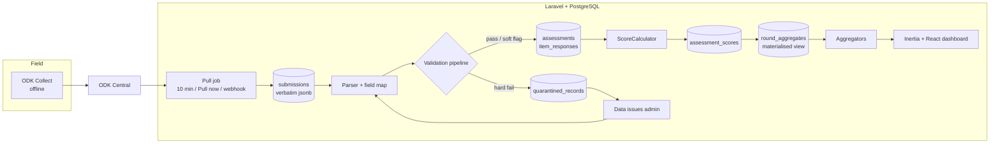
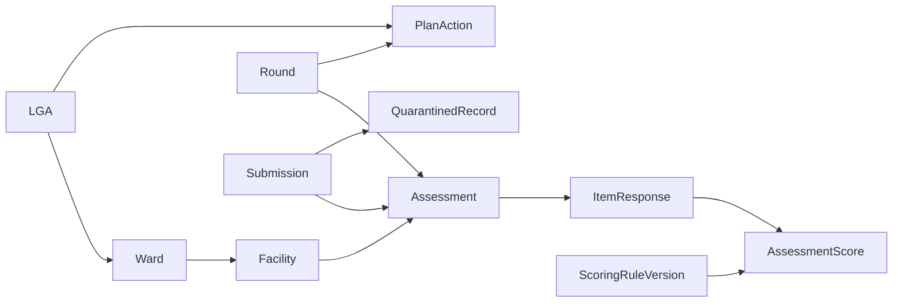
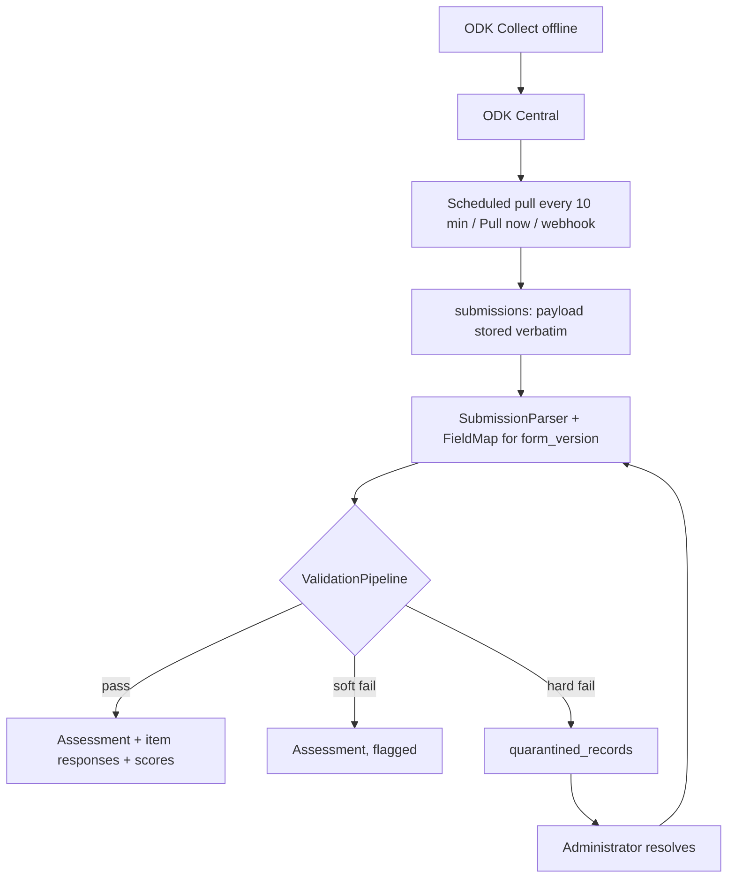

# ARCHITECTURE.md — Kaduna eDQA Portal

How the system is put together: layers, data flow, domain, schema, ingestion, validation,
scoring, API and page structure. Read the section for the area you are changing before you
change it. Coding style lives in `CONVENTION.md`; security in `SECURITY.md`; accessibility in
`ACCESSIBILITY.md`; servers and pipelines in `DEPLOY.md` (separate DevOps project).

## Contents
1. System overview · 2. Application layers · 3. Domain model · 4. Database · 5. Ingestion ·
6. Validation · 7. Scoring · 8. API · 9. Presentation layer · 10. Non-functional targets ·
11. Decisions, prototype deltas, open questions

---

## 1. System overview



**Governing principle:** a score that cannot be true never reaches a chart. Aggregators read only
`assessments`, `assessment_scores` and `round_aggregates` — never `submissions` or
`quarantined_records`. This separation is structural (separate tables + an architecture test),
not a query filter.

**Goals this architecture serves (from the PRD):**

| # | Goal | Where it is enforced |
|---|---|---|
| G1 | No invalid score ever charts | Validation pipeline (§6), CHECK constraints (§4), table separation |
| G2 | Submission on dashboard ≤ 15 min, no human step | Scheduled pull (§5), debounced aggregate refresh |
| G3 | Scores reproducible | Pure `ScoreCalculator`, verbatim payloads, rule versions (§7) |
| G4 | Exactly 23 LGAs | Seeded `lgas`, `LGA_UNKNOWN` rule, no insert path |
| G5 | Every page renders | Pages read local materialised data; no live external query at view time |
| G6 | Follow-up actionable | `plan_actions` (§9.2.6) |
| G7 | Corrections traceable | Activity log on every write (SECURITY.md §4) |
| G8 | Works on 3G | Server-rendered numbers, deferred charts, JS budget (§10) |

**Deployment:** containerised (Docker images, Compose on one host) — see §2 and `DEPLOY.md`.

**Out of scope for v1:** any source besides ODK Central, roles/permissions, writing back to ODK or
DHIS2, sampling logic, mobile app, multi-state tenancy, DHIS2 comparison, public dashboard.

---

## 2. Application layers

```
app/
  Domain/                      ← all business logic
    Assessment/  Models, Actions, DTOs, Events
    Round/       Models, OpenRound, CloseRound, ReopenRound, MonthSlot
    Facility/    Models (Lga, Ward, Facility), Actions, CascadeExporter
    Ingestion/Odk/  OdkClient, SessionTokenCache, FieldMap, SubmissionParser,
                    PullSubmissionsJob, BackfillOdkSubmissionsJob, FetchAttachmentsJob,
                    PullLock, ProcessSubmissionAction, ReprocessSubmissionAction
    Validation/  Contracts/ValidationRule, Rules/*, ValidationPipeline, ValidationContext,
                 QuarantineAction, ResolveQuarantineAction
    Scoring/     ScoreCalculator, ScoreCard, RuleConfig, Bands, RuleVersion, RescoreRoundJob
    Reporting/   Aggregators/*, ReportFilter, Exporters/*
    Plan/        PlanAction model, Actions
  Actions/Fortify/   2FA enable/confirm/regenerate (hashed recovery codes, D-24)
  Listeners/         AuditAuthenticationEvents
  Models/User.php    Laravel default location (administrators only)
  Support/           Auth/RecoveryCodes, Config/EnvFlag
  Http/
    Controllers/ thin — one per page; validate → Action/Aggregator → Resource
    Requests/    FormRequests (validation only)
    Resources/   Inertia/JSON shapes (no arithmetic)
    Middleware/  EnsureTwoFactorConfirmed, SecurityHeaders, VerifyOdkWebhookSignature
  Console/Commands/  edqa:pull, edqa:backfill, edqa:backfill-report, edqa:rescore,
                     edqa:refresh-aggregates, edqa:admin:create, edqa:admin:disable,
                     edqa:db:apply-grants (post-migrate-grants.sql; the migrate role runs it)
config/edqa.php, config/edqa_field_maps.php
database/sql/round_aggregates.sql
resources/js/pages/{dashboard,admin,auth,settings}/*, components/*, layouts/*, lib/*, types/*,
  routes/ + actions/ + wayfinder/ (generated by Wayfinder, not hand-edited)
lang/en/*.php
Dockerfile                    # targets: base, vendor, assets, app, worker, web, ci, dev
compose.dev.yml               # local development stack
docker/                       # entrypoint.sh, php/*.ini, fpm-pool.conf, caddy/Caddyfile*, postgres/init-dev.sql
database/sql/post-migrate-grants.sql
Makefile                      # make help lists every target
```

**Dependency direction:** `Http → Domain`. Inside Domain: `Reporting → Scoring, Assessment,
Round, Facility` (read-only); `Ingestion → Validation → Scoring → Assessment`. `Reporting` must
not depend on `Ingestion` or `Validation` models (architecture test).

**Events and listeners:**

| Event | Listeners |
|---|---|
| `SubmissionIngested` | log counters on `odk_pull_runs` |
| `SubmissionQuarantined` | bump quarantine badge cache |
| `AssessmentScored` | dispatch debounced `RefreshRoundAggregatesJob`, flush round cache tag |
| `QuarantineResolved` | debounced `RequestRescoreJob` for the round → `RescoreRound` |
| `RuleVersionPublished` | debounced `RequestRescoreJob` per **open** round (D-32) → `RescoreRound` |
| `AssessmentCorrected` | debounced `RequestRescoreJob` for the round → `RescoreRound` |
| `RoundClosed` | none yet: `CloseRound` refreshes the view itself before dispatching (digest, snapshot exports later) |
| `PullFailed` | admin alert, digest entry |

**Queues:** `default` (pull, process), `rescore`, `exports`, `low` (attachments).

**Runtime processes (containers).** The application ships as container images built from one
multi-stage `Dockerfile` (`DEPLOY.md` §6). One image runs every PHP role, chosen by the
entrypoint argument:

| Container | Role | Image | Notes |
|---|---|---|---|
| `web` | Caddy: TLS, static assets, FastCGI to `app` | `edqa-web` | Only container with published ports |
| `app` | PHP-FPM serving Inertia pages and `/api/*` | `edqa-app` | Stateless; can scale to 2+ |
| `worker-default` | `queue:work --queue=default` | `edqa-app` | ODK pull, submission processing |
| `worker-rescore` | `queue:work --queue=rescore` | `edqa-app` | Long jobs; generous stop grace period |
| `worker-exports` | `queue:work --queue=exports,low` | `edqa-worker` | Has Chromium for PDFs |
| `scheduler` | `schedule:work` | `edqa-app` | Exactly one instance |
| `migrate` | one-off: migrate + grants | `edqa-app` | Runs as `edqa_migrator` before each rollout |
| `postgres`, `redis` | data | official images | Internal network only |

Consequences for application code are listed in `CONVENTION.md` §12 (stateless containers, logs
to stderr, persistent files only under `storage/app`, config cached at start not build).

---

## 3. Domain model

### Entities and relationships



| Entity | Key facts |
|---|---|
| **LGA** | Exactly 23, seeded. No runtime insert. |
| **Ward** | Belongs to one LGA. |
| **Facility** | Belongs to one ward (and denormalised `lga_id`). `level` ∈ Primary/Secondary/Tertiary. `ownership` ∈ Public/Private. `is_active` — deactivate, never delete. |
| **Round** | `(year, quarter)` unique. Assessment window `window_start..window_end`. Status `open` or `closed`. |
| **Submission** | One ODK record, verbatim. `instance_id` unique. May be `superseded` by an ODK edit. |
| **Assessment** | Created only from a submission that passed all hard rules. `(round_id, facility_id)` unique. |
| **ItemResponse** | One scored question: `dimension`, `month_slot`, `item_code`, `value`, `is_applicable`. |
| **AssessmentScore** | One row per `(assessment, dimension, month_slot)`. `score numeric(5,2)` or null when the slot is all-N/A. Records `rule_version_id`. |
| **QuarantinedRecord** | Failed submission, all failed rule codes + details, resolution state. |
| **ScoringRuleVersion** | Versioned JSON config (bands, item weights, N/A policy). `draft` until `published_at`. |
| **PlanAction** | Implementation-plan row: LGA, round, dimension, action text, owner, due date, status. |

### Current LGAs (seed list)

Birnin Gwari, Chikun, Giwa, Igabi, Ikara, Jaba, Jema'a, Kachia, Kaduna North, Kaduna South,
Kagarko, Kajuru, Kaura, Kauru, Kubau, Kudan, Lere, Makarfi, Sabon Gari, Sanga, Soba,
Zangon Kataf, Zaria.  **= 23.** Confirm codes against the national facility registry.

### Month-slot mapping

| Quarter | Slot 1 | Slot 2 | Slot 3 |
|---|---|---|---|
| Q1 | January | February | March |
| Q2 | April | May | June |
| Q3 | July | August | September |
| Q4 | October | November | December |

UI rule: show real month names when exactly one quarter is in view; otherwise "Month 1/2/3".
Implement once in `App\Domain\Round\MonthSlot::label(int $quarter, int $slot)` and mirror in
`resources/js/lib/months.ts`.

### Round lifecycle

```
          create                close (snapshot aggregates)
 (none) ────────▶ open ──────────────────────────▶ closed
                   ▲                                  │
                   └──────── reopen (reason) ─────────┘
```

- **open** — submissions whose visit date falls in the window bind to it.
- **closed** — no new submissions bind; aggregates are snapshotted into `round_aggregates`.
  A submission for a closed round quarantines under `ROUND_WINDOW` with detail "round closed".
- **close** (`CloseRound`) — pins the version the round is scored under (`rule_version_id`, D-32),
  refreshes `round_aggregates` at once (the snapshot), dispatches `RoundClosed`, audited. Refused
  while any counted assessment has no scores under that version (a rescore still running).
- **reopen** (`ReopenRound`) — requires typed reason, audited, sets `reopened_reason`; the pin is
  left until the next close re-pins. An open round reads the current version, so the round is
  rescored at once when asked (`rescore: true`) and always when its pin is no longer current
  (Q-29).
- **create / edit window** (`CreateRound`, `UpdateRoundWindow`) — one round per year and quarter;
  the window starts inside the quarter and ends by its last day plus
  `edqa.rounds.window_grace_days` (45; past the quarter is allowed with a warning); windows of two
  rounds never share a day; an edit never leaves an accepted visit outside the window, and a
  closed round's window cannot be edited. All audited (`created`, `window_updated`).
- Windows must not overlap between rounds (validated on create/edit, under a table lock; not a
  database constraint, so ROUND_WINDOW's "two windows" check still guards older data).

> The PRD also mentions a "publish state" (PRD §5) and "published rounds" (PRD §8). v1 treats **closed =
> published**. See §11 Decisions D-07.

### Submission lifecycle

```
received ─▶ parsed ─▶ validated ─┬─▶ accepted  (assessment + scores created)
                                 ├─▶ flagged   (accepted with soft flags)
                                 └─▶ quarantined ─┬─▶ reprocessed → accepted/flagged
                                                  └─▶ rejected (reason)
any ─▶ superseded   (ODK edit arrived with deprecatedID = this instance_id)
```

When a submission is superseded after it produced an assessment, the replacement is processed
and the assessment is updated in place (audited) — the `(round, facility)` uniqueness holds.

### Assessor identity

Assessors have no portal account. `assessor_name` and `device_id` come from ODK metadata
(`meta/username` or a form field, `deviceid`). Used for the `ASSESSOR_VOLUME` soft rule and for
display only.

---

## 4. Database — PostgreSQL 16

All timestamps `timestamptz`. All raw payloads `jsonb`. Every migration reversible.

### Tables

| Table | Columns | Constraints / notes |
|---|---|---|
| `users` | id, name, email UQ, password, two_factor_secret, two_factor_recovery_codes, two_factor_confirmed_at, is_active, remember_token, timestamps | Administrators only. No role column |
| `lgas` | id, name UQ, code UQ | Seeded with exactly 23 |
| `wards` | id, lga_id FK, name, code | UQ (lga_id, name) |
| `facilities` | id, code UQ, name, ward_id FK, lga_id FK, level, ownership, is_active, lat numeric(9,6)?, lng numeric(9,6)?, timestamps | `level` / `ownership` CHECK against enum values |
| `rounds` | id, year smallint, quarter smallint, window_start date, window_end date, status, closed_at?, reopened_reason?, timestamps | UQ (year, quarter); CHECK quarter 1–4; CHECK window_end ≥ window_start; status CHECK in ('open','closed') |
| `submissions` | id, instance_id UQ, deprecated_id?, form_id, form_version, payload jsonb, submitted_at, received_at, processed_at?, status, superseded_by_id? | Payload never mutated |
| `assessments` | id, round_id FK, facility_id FK, submission_id FK, assessor_name, device_id?, started_at, ended_at, gps jsonb?, status, flags jsonb default '[]', timestamps | UQ (round_id, facility_id); CHECK ended_at ≥ started_at |
| `item_responses` | id, assessment_id FK cascade, dimension, month_slot smallint, item_code, value, is_applicable bool | CHECK month_slot 1–3; dimension CHECK |
| `assessment_scores` | id, assessment_id FK cascade, dimension, month_slot smallint, score numeric(5,2) NULL, rule_version_id FK, computed_at | CHECK score 0–100; UQ (assessment_id, dimension, month_slot, rule_version_id) |
| `quarantined_records` | id, submission_id FK, instance_id, round_id?, facility_ref?, lga_ref?, payload jsonb, failures jsonb, status, resolution, resolved_by?, resolved_at?, resolution_note?, timestamps | `failures` = `[{code, severity, detail}]` |
| `scoring_rule_versions` | id, version int UQ, config jsonb, created_by?, published_at?, published_reason?, timestamps | Exactly one "current" = max published version. `created_by` is null only for version 1, seeded before any administrator exists |
| `plan_actions` | id, round_id, lga_id, dimension, action_text, assigned_to, due_date, status, notes?, timestamps | UQ (round_id, lga_id, dimension) |
| `odk_form_syncs` | id, project_id, form_id, last_pulled_at?, last_instance_id?, backfill_skip int, last_error?, submission_count, timestamps | The pull cursor |
| `odk_pull_runs` | id, triggered_by?, trigger_type, started_at, finished_at?, fetched, accepted, quarantined, duplicates, error?, outcome | Powers pull history |
| `odk_attachments` | id, submission_id, filename, mime?, size?, path?, fetched_at?, status (`pending`, `fetched`, `rejected`, `failed`, CHECK), reason?; unique (submission_id, filename) | Recorded by the pull, fetched on `low` (D-52) |
| `activity_log` | Spatie standard | Append-only (see SECURITY.md) |
| `round_aggregates` | **materialised view** | See below |

> Note on `assessment_scores` uniqueness: the PRD lists UQ `(assessment_id, dimension, month_slot)`.
> Because published rounds keep old-version scores readable, include `rule_version_id` in the
> unique key. See §11 Decisions D-05.

### Constraints (write the failing test first)

```sql
ALTER TABLE assessment_scores ADD CONSTRAINT score_in_range   CHECK (score IS NULL OR (score >= 0 AND score <= 100));
ALTER TABLE assessments       ADD CONSTRAINT visit_dates_ordered CHECK (ended_at >= started_at);
ALTER TABLE item_responses    ADD CONSTRAINT month_slot_valid CHECK (month_slot BETWEEN 1 AND 3);
ALTER TABLE assessment_scores ADD CONSTRAINT score_slot_valid CHECK (month_slot BETWEEN 1 AND 3);
ALTER TABLE rounds            ADD CONSTRAINT quarter_valid    CHECK (quarter BETWEEN 1 AND 4);
ALTER TABLE rounds            ADD CONSTRAINT window_ordered   CHECK (window_end >= window_start);
```

A test inserts `347.66` directly via `DB::table('assessment_scores')->insert(...)` and asserts a
`QueryException` with SQLSTATE `23514` (check_violation).

### Indexes

| Index | Purpose |
|---|---|
| `assessments (round_id, facility_id)` UNIQUE | One assessment per facility per round |
| `submissions (instance_id)` UNIQUE | Idempotency |
| `submissions (deprecated_id)` | Edit chain lookup |
| `item_responses (assessment_id, dimension, month_slot)` | Scoring access path |
| `assessment_scores (assessment_id, dimension, month_slot, rule_version_id)` UNIQUE | |
| `submissions USING gin (payload jsonb_path_ops)` | Payload queries during reprocessing |
| `quarantined_records USING gin (failures)` | Group Data issues by rule code |
| `quarantined_records (status, round_id)` | Open-issues badge |
| `facilities (lga_id) WHERE is_active` | Cascade export |
| `round_aggregates (round_id, scope_type, scope_id, owner_type, level)` UNIQUE | Required for `REFRESH ... CONCURRENTLY` |

### `round_aggregates` materialised view

Columns: `round_id, scope_type ('state'|'lga'|'ward'|'facility'), scope_id, owner_type
('all'|'public'|'private'), level ('all'|...), availability, consistency, validity,
m1, m2, m3, overall, facility_count`.

Built from **accepted assessments only** (`assessments` joined to current-version
`assessment_scores`). Facility score first, then unweighted means of facility scores upward.
Use `COALESCE(scope_id, 0)` / sentinel values so the unique index has no NULLs.

```php
public function up(): void {
    DB::statement(file_get_contents(database_path('sql/round_aggregates.sql')));
    DB::statement('CREATE UNIQUE INDEX round_aggregates_key ON round_aggregates (round_id, scope_type, scope_id, owner_type, level)');
}
public function down(): void {
    DB::statement('DROP MATERIALIZED VIEW IF EXISTS round_aggregates');
}
```

The app runs as `edqa_app`, which does not own the view, so the migration also creates a
`SECURITY DEFINER` function owned by the migrator role:

```sql
CREATE OR REPLACE FUNCTION refresh_round_aggregates() RETURNS void
LANGUAGE plpgsql SECURITY DEFINER SET search_path = public AS $$
BEGIN
    -- The view is created WITH NO DATA, and CONCURRENTLY can't refresh an unpopulated view.
    IF (SELECT ispopulated FROM pg_matviews WHERE matviewname = 'round_aggregates') THEN
        REFRESH MATERIALIZED VIEW CONCURRENTLY round_aggregates;
    ELSE
        REFRESH MATERIALIZED VIEW round_aggregates;
    END IF;
END $$;
REVOKE ALL ON FUNCTION refresh_round_aggregates() FROM PUBLIC;  -- EXECUTE is granted to edqa_app only
```

The view's definition and its assumptions (A1–A8) are in `database/sql/round_aggregates_v4.sql`
(v1 `round_aggregates.sql`, v2 per-round versions D-32, v3 accepted/flagged assessments only,
v4 each dimension per month slot for the Visuals month charts, D-46; each migration's `down()`
restores the previous file). **The aggregators are the specification:**
`RoundAggregatesReconciliationTest` checks every view row against them to 1e-9 on seeded random
datasets (D-33).

The app calls `SELECT refresh_round_aggregates()` — never the raw statement. Migrations run in
the one-off `migrate` container, which receives `DB_USERNAME=edqa_migrator`; the app containers
connect as `edqa_app`. After migrating, the same container executes
`database/sql/post-migrate-grants.sql`. All of this is part of the contract with the DevOps
project (`DEPLOY.md` §1.3, §8).

Refresh with `SELECT refresh_round_aggregates();` through `RefreshRoundAggregatesJob`
(`ShouldBeUniqueUntilProcessing`, unique per round for 60 s, delayed 60 s, then flushes the round
cache): dispatched by `RefreshAggregatesAfterScore` on `AssessmentScored`, by a round's status
changing to closed, and (when it exists) by `RescoreRoundJob`.

Aggregators read the view when the answer is one round and the filter maps onto a view row
(scope state or the filtered LGA, owner type, level) and the view is populated and enabled
(`edqa.aggregation.read_view`): Dimension, OwnerSplit, LgaTable, WeakestLgas, Coverage, and
QuarterTrend (one row per round). Everything else (several rounds, state summary counts, month
slots per dimension, facility lists, assessment window) is Aggregator SQL over
`assessment_scores` with the indexes above; keep the p95 under 1.5 s and cache by round tag.
`ViewPathTest` proves both paths return identical results.

### Laravel specifics

- `$table->jsonb('payload')`; cast `'payload' => 'array'`.
- `$table->timestampsTz()`.
- Enums: string columns + CHECK, cast to PHP backed enums.
- `Model::preventLazyLoading(! app()->isProduction());`
- `Model::shouldBeStrict()` in local/testing.

### Data volume

5 years × 4 rounds × 2,200 facilities × 9 scores ≈ 400,000 score rows, ~40,000 submissions.
Comfortable for Postgres with these indexes.

---

## 5. ODK ingestion pipeline

ODK Central is the system of record for field submissions. The portal pulls; it never pushes.



### 5.1 ODK form contract

The form must satisfy these. If the current form does not, adapting it is a Phase 1 task.

| Requirement | Why |
|---|---|
| Facility chosen by cascading select LGA → ward → facility, from a CSV media file generated by the portal | Kills free-text names like `2019.00` |
| Scored question names match `^(avail|consist|valid)_m[1-3]_[a-z0-9_]+$` | Dimension and month slot parsed from the name; new questions need no code change |
| Scored questions are `select_one` with a fixed list (`yes` / `no` / `na`) | Scores computed from pass counts, never typed. Kills `347.66` at source |
| `round_year`, `round_quarter` are read-only calculated fields | Not typed by assessors |
| `meta/instanceID` required | Idempotency key |
| `start`, `end` metadata fields | Visit duration, `END_BEFORE_START`, `VISIT_TOO_SHORT` |
| GPS and register photo optional | Stored when present |

Choice mapping (configurable per form version): `yes` → pass, `no` → fail, `na` → not applicable.

### 5.2 Components (`app/Domain/Ingestion/Odk/`)

| Class | Responsibility |
|---|---|
| `SubmissionSource` (contract, `Ingestion\Contracts`) | ping, form versions, a submissions page, attachment list and download; `OdkCentralSource` implements it (an Aggregate adapter could too, Q-01) (built, D-49) |
| `OdkCentralClient` | HTTP wrapper. Auth, OData paging, attachment download, retries/timeouts (built, D-49) |
| `SessionTokenCache` | `POST /v1/sessions`; caches token, encrypted, until 30 min before expiry (built, D-49) |
| `PullLock` | `Cache::lock('odk-pull', 900)` — manual press during a scheduled run queues behind it |
| `PullSubmissionsJob` | Incremental pull. Same job for scheduler, Pull now and webhook |
| `BackfillOdkSubmissionsJob` | Cursor-from-zero pull, checkpointed per page, throttled |
| `FetchAttachmentsJob` | `low` queue, 3 tries (60/300/900 s): one submission's pending files through `FetchAttachments` (built, D-52) |
| `SubmissionParser` | Payload + `FieldMap` → `ParsedSubmission` DTO; never throws on bad data (built, D-48) |
| `FieldMap` | Resolves logical names → question paths for a form version, additive over the default (built, D-48) |
| `ProcessSubmissionAction` | Parse → validate → create assessment / quarantine, in one transaction |

### 5.3 Pull mechanics

- **Endpoint:** `GET /v1/projects/{p}/forms/{f}.svc/Submissions?$filter=__system/submissionDate ge {lastPulledAt}&$orderby=__system/submissionDate asc&$top=500&$skip={n}&$count=true&$expand=*`
- **Two passes, two cursors (Q-32, D-51):** new submissions on `__system/submissionDate` from
  `odk_form_syncs.last_pulled_at`; then edits on `__system/updatedAt` from `last_edit_at` (an
  edit keeps its `submissionDate`, so the first pass never sees it). Each pass is ordered by its
  own field, so its cursor is safe to advance.
- **Cursor:** inclusive (`ge`) from the newest timestamp seen, plus instance-ID de-duplication in
  the run, so rows sharing a timestamp are never lost; a page that is all one timestamp steps on
  with `$skip`. It advances **only as the last statement of the page's transaction**. A crash
  mid-page rolls the whole page back, cursor and counters included, and the next pull replays it.
  Stored in the app's zone to the second (D-30): rounding down only re-fetches a row or two.
- **One page, one transaction:** raw rows inserted verbatim with
  `INSERT … ON CONFLICT (instance_id) DO NOTHING RETURNING` (rows not returned are duplicates);
  the new ones parsed from the stored payload; edits of quarantined submissions resolved by
  `MarkSuperseded`; the batch run through `ProcessParsedBatch` with one `ValidationContext`; the
  run's counters; the cursor. About 21 queries a page plus 31 a submission (its assessment, items
  and nine audited scores), asserted.
- **Idempotency:** `submissions.instance_id` unique. Duplicate → dropped and counted in
  `odk_pull_runs.duplicates`. Re-running a pull inserts nothing.
- **Edits:** a record with `meta/deprecatedID` marks the deprecated submission `superseded`,
  keeps it, and processes the replacement (updating the existing assessment in place, audited).
- **Attachments (D-52):** for each new row with `__system.attachmentsExpected > 0`, the pull asks
  Central's attachment list (under the root `__id`) **before** the page's transaction, records the
  files `pending` in it, and after commit queues `FetchAttachmentsJob` on `low`. A backfill only
  records; `edqa:attachments:fetch-pending {--limit=500} {--sync}` catches up (pending and failed).
  Files go to the private `odk` disk at `{instance}/{filename}` (`storage/app/odk`; the instance
  ID with anything outside `[A-Za-z0-9._-]` as `_`), via `odk/.incoming`, never fetched again
  once there. Checked before they move in: a name that is not a plain safe file name is rejected
  undownloaded (never renamed); over `edqa.odk.attachments.max_bytes` (10 MB) or a sniffed type
  off the SECURITY.md §7 allow-list → rejected with the reason and deleted. An ODK error leaves
  the file pending for the job's retry, then `failed`.
- **Lock:** `PullLock` (`Cache::lock('odk-pull', 900)`): one pull at a time. A second waits up to
  `edqa.odk.pull.lock_wait_seconds` (600) and then pulls, finding little new; waiting longer, the
  job goes back on the queue. `PullSubmissionsJob::$timeout` is 900, so the queue's `retry_after`
  must be longer than 900 s or a long pull is handed to a second worker (`config/queue.php`: 960).
- **Retries:** 3 attempts, exponential backoff (`$backoff = [30, 120, 600]`); each attempt is its
  own run row (outcome `failed`, the error). Then `failed()` → `odk_form_syncs.last_error` and
  `PullFailed` (admin alert + digest). Not configured → the run is `skipped_not_configured`,
  not a failure. A successful pull clears `last_error` and GETs `HEARTBEAT_ODK_PULL_URL` (if set;
  its failure is only logged).
- **Dry run:** `edqa:pull --dry-run {--limit=200}` fetches from the stored cursor, parses and
  validates in memory, prints the outcomes by rule code and writes nothing. `edqa:pull` alone
  is one synchronous manual pull (audited, SECURITY.md §4).
- **Progress:** each run writes an `odk_pull_runs` row and updates counters as pages commit;
  the admin page polls `GET /api/odk/pull/{runId}` every 2 s.
- **Schedule:** `Schedule::job(new PullSubmissionsJob(PullTrigger::Scheduled))->everyTenMinutes()->withoutOverlapping();`,
  registered in `routes/console.php` only when ODK is configured.
- **Latency target:** submission visible on the dashboard ≤ 15 minutes with no human step.

### 5.4 Webhook (optional)

`POST /webhooks/odk` — HMAC-verified (see SECURITY.md §6). It only dispatches
`PullSubmissionsJob(PullTrigger::Webhook)`; it never trusts the webhook body as data. The
scheduled pull always runs regardless.

### 5.5 Form versions and field maps

Every submission records `form_version` (`__system/formVersion`). The parser resolves names via
`config/edqa_field_maps.php`:

```php
return [
    'default' => '2026.1',
    'versions' => [
        '2026.1' => [ /* full map — current form; dot paths through nested groups */
            'facility_code' => 'facility.facility_code',
            'lga_code'      => 'facility.lga',
            'ward_code'     => 'facility.ward',
            'round_year'    => 'round_year',
            'round_quarter' => 'round_quarter',
            'started_at'    => 'start',
            'ended_at'      => 'end',
            'assessor'      => 'assessor_name',
            'gps'           => 'gps',
            'scored_prefix_pattern' => '/^(avail|consist|valid)_m([1-3])_([a-z0-9_]+)$/',
            'renames'       => [],
        ],
        '2025.2' => [ /* additive: only what differs */
            'facility_code' => 'fac.fac_code',
            'renames' => ['avail_m1_nhmis_form' => 'avail_m1_nhmis_summary'], // this version's name => the default's
        ],
    ],
];
```

**Rule:** a `form_version` with no entry quarantines under `UNKNOWN_FORM_VERSION`. Never fall
back to the default map for an unknown version. Silent misparsing is the worst outcome.

Built (Phase 2B step 1, D-48):

- **Paths and renames.** `FieldMap::resolve()` merges an additive version over the default, and
  paths are dot paths into the OData entry. `renames` map a version's question name to the
  default's.
- **Scored questions** are every leaf whose name, after renames, matches the pattern, wherever
  its group sits.
- **Answers** are mapped with the published rule version's `choice_map` (Q-25); the field map has
  no `choices`.
- **What the parser does with bad data.** `SubmissionParser` never throws:
  - an unknown version gives minimal fields;
  - a time is read only when it is strict ISO 8601, with the raw text kept;
  - an answer the map does not know is `invalid`, which ITEMS_INCOMPLETE quarantines;
  - a number in a scored question is a typed score, kept in `rawNumericScores` by question name
    (Q-16).
- **Fixtures:** `tests/Fixtures`. Every map path is `CONTRACT-ASSUMED` until the real form is
  audited.

**Phase 0 task:** list every form version in ODK Central (`GET /v1/projects/{p}/forms/{f}/versions`),
download each XLSForm, diff question names. That diff *is* the field map.

### 5.6 Initial backfill

Same client, parser, validation and scoring — cursor set to zero.

- ~40,000 submissions ÷ `$top=500` ≈ 80 pages. Measured in hours.
- Checkpoint after every page into `odk_form_syncs.backfill_skip`. Restart resumes at that page.
- Attachments deferred to `FetchAttachmentsJob` on the `low` queue.
- Historical rounds **created before the backfill runs**. Submissions outside every window →
  `ROUND_WINDOW`, never guessed into the nearest round.
- Throttle: configurable sleep between pages (default 5 s); run out of hours on first pass.
- Command: `php artisan edqa:backfill {--from-page=} {--throttle=5}`.
- Produces the **backfill report** afterwards: per round/year — pulled, accepted, quarantined by
  rule. `php artisan edqa:backfill-report --format=xlsx`.

### 5.7 Reprocessing

`ReprocessSubmissionAction` reads `submissions.payload` (never ODK). Used after a quarantine
correction, a field-map fix, or a scoring rule publish. Idempotent.

---

## 6. Validation rules and quarantine

Every rule is a class implementing `App\Domain\Validation\Contracts\ValidationRule`, registered
in `config/edqa.php` under `validation.rules`. Adding a rule = adding a class + config line.

```php
interface ValidationRule
{
    public function code(): string;            // e.g. 'SCORE_RANGE'
    public function severity(): Severity;       // Hard | Soft
    /** @return list<RuleFailure> empty when passing */
    public function check(ParsedSubmission $s, ValidationContext $ctx): array;
}
```

`ValidationContext` provides the facility master list, rounds, prior assessment scores and
assessor-day counts — loaded once per page of submissions, not per rule (no N+1).

The pipeline runs **every** rule and collects **all** failures (not fail-fast), so the Data
issues page shows every reason at once.

### Rule catalogue (14 rules: 10 hard, 4 soft)

| # | Code | Sev | Passes when | Live-report defect it prevents |
|---|---|---|---|---|
| 1 | `UNKNOWN_FORM_VERSION` | Hard | Form version has a field map. **Runs first; if it fails, skip parse-dependent rules** | Old form parsed with the wrong map |
| 2 | `COLUMN_DRIFT` | Hard | Date fields parse as dates; ward is not a reserved word (`Quarterly`, month names, `null`, numeric) | `Ward = Quarterly`, `Start = FEBRUARY` |
| 3 | `LGA_UNKNOWN` | Hard | LGA resolves to one of the 23 | `null` LGA → 24 LGAs |
| 4 | `FACILITY_UNKNOWN` | Hard | Facility code matches an **active** master-list entry | Facility named `2019.00` |
| 5 | `FACILITY_LGA_MISMATCH` | Hard | Master-list LGA == submitted LGA | Wrong cascading-select pick |
| 6 | `ITEMS_INCOMPLETE` | Hard | All required items present for all 3 dimensions × 3 months | Missing dimension can't be averaged |
| 7 | `SCORE_RANGE` | Hard | Every derived score within 0–100 (defence in depth; DB CHECK is the backstop) | `347.66`, `392.42` |
| 8 | `END_BEFORE_START` | Hard | `ended_at ≥ started_at` | Basic integrity |
| 9 | `ROUND_WINDOW` | Hard | Visit date inside an **open** round's window | Q1 visit landing in Q2 |
| 10 | `DUPLICATE_ASSESSMENT` | Hard | No existing accepted assessment for (round, facility), excluding the one this submission supersedes | Double counting |
| 11 | `SCORE_JUMP` | Soft | Overall within 30 points of facility's previous round | Usually entry error |
| 12 | `ALL_PERFECT` | Soft | Not all nine scores exactly 100 | Form filled without visiting |
| 13 | `VISIT_TOO_SHORT` | Soft | `ended_at − started_at ≥ 20 min` | Rushed/fake visit |
| 14 | `ASSESSOR_VOLUME` | Soft | Assessor ≤ 6 facilities that day | Supervisor attention |

Soft thresholds (30 points, 20 min, 6 facilities) live in `config/edqa.php`.

> The PRD build order says "the thirteen rules from §7" but the PRD §7 table lists 14. Build all 14.
> See §11 Decisions D-06.

### Outcomes

- Any hard failure → `quarantined_records` row (payload copy, `failures` jsonb with every code +
  human-readable detail). No assessment, no item responses, no scores.
- Only soft failures → assessment created, `assessments.flags` lists the codes; shown with a
  "Flagged" tag in the facility drawer and Data issues (soft tab). Contributes to aggregates.
- All pass → assessment created, scored, `AssessmentScored` event.

Detail strings must be specific: `"availability_m1 derived score 347.66 exceeds 100"`,
`"lga was blank"`, `"ward 'Quarterly', start 'FEBRUARY'"`.

### Quarantine workflow (Data issues page)

1. Grouped by rule code, filterable by LGA and round; badge count on the admin tab.
2. Each row: ODK instance ID, rule(s), facility reference, LGA, detail, **deep link to ODK Central**.
3. Actions:
   - **Correct and reprocess** — edit the offending mapped field (stored as a correction overlay,
     never mutating `submissions.payload`), re-run the pipeline. Audited with old/new/reason.
   - **Reject** — typed reason required; excluded permanently; audited.
   - **Override soft flag** — typed justification; audited.
   - **Fix at source** — assessor edits in ODK Central; next pull brings a new instance with
     `deprecatedID`; the quarantined record auto-resolves as `superseded`.
4. **Bulk resolve** rows failing the same rule the same way (one reason applies to all; one audit
   entry per record).
5. Every action writes an audit entry. Nothing is silently fixed.
6. Resolving triggers a rescore of the affected round.

### The guarantee

No aggregate — chart, scorecard, export — reads from `submissions` or `quarantined_records`.
Aggregators read only `assessments` / `assessment_scores` / `round_aggregates`. An architecture
test (Pest `arch()`) asserts `App\Domain\Reporting` does not depend on
`QuarantinedRecord` or `Submission` models.

---

## 7. Scoring engine

### Principles

1. Scores are always derived. A submitted "overall" or score field is ignored.
2. Every score records the `scoring_rule_version` that produced it.
3. Changing a rule never mutates history: it creates a new version and triggers a rescore; old
   scores stay readable for closed rounds.
4. Aggregates are SQL over `assessment_scores` (and the `round_aggregates` view), cached, and
   invalidated by round. `RoundCache` hides the store: with tags (Redis, array) entries carry
   `edqa` and `round:{id}` tags; without (database, file) a per-round generation number is folded
   into the key and a flush bumps it. Entries expire after six hours as a safety net; the flushes
   (`AssessmentScored`, `QuarantineResolved`, a publish, a round saved, a finished rescore) do the
   real work. Only the aggregators' DTOs and enums may be unserialized from the cache (D-36).
5. Store full precision (`numeric(5,2)`); round **only** at presentation.

### Computation (`ScoreCalculator`)

```
dimension_month_score = items_passed / items_applicable × 100
dimension_score       = mean of non-null month scores
overall_score         = mean(availability, consistency, validity)
```

- Items marked N/A are excluded from numerator **and** denominator.
- If every item in a dimension–month is N/A → that slot score is `NULL`, dimension score is the
  mean of the remaining slots, and the exclusion is recorded (`assessments.flags` gets
  `SLOT_ALL_NA:{dim}:{m}` as an informational note).
- If a whole dimension is null → `ITEMS_INCOMPLETE` (hard) should have caught it; the calculator
  throws `IncompleteAssessmentException` as a safeguard.
- Item weights (from the rule version config) default to 1. With weights:
  `Σ(weight × pass) / Σ(weight × applicable) × 100`.

Pure function: `ScoreCalculator::calculate(ItemResponseSet, RuleConfig): ScoreCard`. No DB
access inside — makes it trivially testable and deterministic (goal G3: two runs on identical
inputs produce identical outputs).

### Aggregation (Aggregators in `app/Domain/Reporting/Aggregators/`)

| Level | Method |
|---|---|
| Facility | Mean of its assessments in the round (normally one) |
| Ward | Unweighted mean of facility scores |
| LGA | Unweighted mean of facility scores |
| Owner type | Unweighted mean within Public / Private |
| State | Unweighted mean of all assessed facilities |

Config: `edqa.aggregation.weighting` = `'unweighted'` (default) | `'facility_count'`.
Every aggregator has a test and is the **only** place a number shown on a page is computed.

Aggregators (suggested):
`StateSummaryAggregator`, `DimensionAggregator`, `OwnerSplitAggregator`, `LgaTableAggregator`,
`FacilityScoresQuery`, `QuarterTrendAggregator`, `MonthSlotAggregator`, `CoverageAggregator`,
`AssessmentWindowAggregator`, `ImplementationPlanAggregator`.

All take a `ReportFilter` DTO (year, quarter, lga, level, owner) built from the URL query string.

### Reference figures (must pass as tests before building UI)

| Group | Avail | Consist | Valid | Mean | Shown |
|---|---|---|---|---|---|
| Public | 92 | 79 | 92 | 87.67 | 88 |
| Private | 75 | 62 | 84 | 73.67 | 74 (**PRD says 73**) |
| State (2,000 pub + 219 priv, unweighted over facilities) | | | | ≈ 86.3 | 86 |

> Note: 73.67 rounds to 74, not 73. The live tool shows 73 — likely because its underlying
> dimension values are unrounded (e.g. 74.7/61.9/83.8) or it truncates. Test against the
> **unrounded** figures from a known client round, and confirm the display rounding rule
> (half-up vs truncate) with the client. See §11 Decisions Q-09.
> Also: (2000×87.67 + 219×73.67)/2219 ≈ 86.29, not 86.5 — still displays 86. From the unrounded
> means (263/3 and 221/3) it is 574399/6657 = 86.28496, which is what `ReferenceFiguresTest`
> asserts (1 dp display 86.3, headline 86).

### Bands

Config in the rule version, defaults:

| Band | Range | Tag |
|---|---|---|
| Strong | ≥ 90 | green |
| Acceptable | 80–89.99 | green-muted |
| Review | 70–79.99 | amber |
| Needs action | < 70 | red |

Bands drive table colour, status column, and which LGAs enter the implementation plan.
Changing a band never changes a stored score. Band logic lives server-side
(`App\Domain\Scoring\Bands`); the frontend receives the band key with each number and never
recomputes it.

`Bands::classify` bands the value **as displayed**: rounded to 1 dp in the configured mode, so a
cell showing "90.0" is always Strong (Q-26, default built). The thresholds come from the rule
version the number was read under (D-32).

### Presentation (`ScoreValue`)

Every number leaves the server as one shape, `ScoreValue` `{ value, display, headline, band,
bandLabel }`: `value` at full precision (null for no data), `display` to 1 dp (tables),
`headline` to 0 dp (hero figures), `band` and its translated label. `App\Domain\Scoring\Presentation`
is the only place rounding happens: `edqa.presentation.rounding` = `half_up` (default) or
`truncate` (the live tool's 73, Q-09). No data is `—` / "No data", never zero.

### Rule versions

- `scoring_rule_versions.config` jsonb: `{ bands, item_weights, na_policy, choice_map }`.
- Edit → new **draft** version (one at a time; only the four config keys change, and a config the
  calculator cannot apply is refused). **Publish** requires a typed reason and shows a
  **preview** (`RuleVersionPreviewAggregator`): facilities and LGAs that would change band, per
  open round, computed from item responses and writing nothing. Then `RuleVersionPublished`
  rescores every open round (debounced, §7 Rescore).
- Current version = highest published. Which version a round is read and written under is
  decided in one place, `RuleVersionForRound` (D-32): an **open** round the current version, a
  **closed** round the version pinned when it closed. SQL that needs the same answer
  (`FacilityScoresSql`, `round_aggregates`, the SCORE_JUMP prior query) applies the same rule.
- Flow: ingest and rescore write under the round's version → `CloseRound` pins it (refused while
  any counted assessment lacks scores under it) → a later publish rescores open rounds only, the
  closed round's scores and figures untouched → `ReopenRound` (reason required) puts it back on
  the current version, rescoring it at once when the pin is no longer current (Q-29) → the next
  close re-pins.

### Rescore

Triggered by: rule version publish, quarantine resolution, assessment correction, manual button.

- `RescoreRound::start()` refuses a closed round (`RescoreRefused`, 409 `round_closed`; D-32),
  records a `rescore_runs` row (trigger, requester, reason, rule version, progress) and audits
  `rescore_requested` on the round, then dispatches a `Bus::batch` of `RescoreRoundJob` on the
  `rescore` queue: one job per `edqa.rescore.chunk_size` (200) accepted/flagged assessments.
- Each chunk (`RescoreAssessments`) is one transaction: item responses → `RuleConfig::outcome()`
  (Q-25) → `ScoreCalculator` under the run's version → one `INSERT … ON CONFLICT DO UPDATE …
  WHERE score IS DISTINCT FROM` on (assessment, dimension, month, version). Unchanged rows are not
  touched (no `computed_at` churn); every inserted or changed row is audited in bulk, shaped as
  the model's own entries. SCORE_JUMP, ALL_PERFECT and the SLOT_ALL_NA notes are recomputed
  (`ScoreFlags`, shared with the validation rules); other soft flags are kept, a flag overridden
  through `OverrideSoftFlag` is never raised again, status follows. The run counts each chunk once
  (`completed_chunks`), so a retry or second delivery never double-counts. An assessment that can
  no longer be scored loses that version's rows (audited) and counts as `unscorable`.
- The batch's `then`/`finally` callbacks (`FinishRescore`) close the run (failed while any chunk
  is failed, succeeded once all pass, including after a retry), dispatch
  `RefreshRoundAggregatesJob` and flush the round cache.
- Automatic triggers go through `RequestRescoreJob` (unique per round, delayed
  `edqa.rescore.debounce_seconds`), so a bulk resolution rescores the round once. Manual:
  `edqa:rescore {round?} {--all-open}` and `POST /api/rounds/{id}/rescore`.
- Target: full round (~2,200 assessments) in < 5 minutes. Measured (`make test-slow`, dev
  container, 198,000 items): 4.0 s first run, 1.3 s for a repeat that writes nothing.

---

## 8. Internal API surface

Dashboard pages are Inertia; these JSON endpoints serve admin interactivity and exports only.
All require an authenticated administrator session (session cookie + CSRF), 2FA-confirmed unless `EDQA_REQUIRE_2FA=false` (D-26).
No public API, no API tokens in v1.

| Method | Path | Purpose |
|---|---|---|
| GET | `/api/aggregates` | Scores by scope, honouring all five filters |
| GET | `/api/facilities` | Paginated (50), sortable, filterable facility scores |
| GET | `/api/facilities/{id}` | Detail for the drawer: master record, score card, item responses, history, flags, attachments, audit, ODK link. `?round=`, else the latest round in view by `?year=&quarter=` (D-42); 404 for an unknown facility |
| GET | `/api/rounds` | Rounds and status, window, pinned version and the version read now |
| POST | `/api/rounds` | Create `{ year, quarter, window_start, window_end }`; 201 with `warnings` |
| PATCH | `/api/rounds/{id}` | Move the window `{ window_start, window_end }`; returns `warnings` |
| POST | `/api/rounds/{id}/close` | Close round, pin version, snapshot aggregates |
| POST | `/api/rounds/{id}/reopen` | Reopen `{ reason, rescore? }` (reason required); returns the `rescore` run if one started |
| POST | `/api/rounds/{id}/rescore` | Rescore (reason required, audited); 202 with `{ batch_id, run_id, … }`; 409 for a closed round |
| GET | `/api/rescores/{batchId}` | Progress: chunks (total, processed, failed), assessments, changed scores and flags, status |
| POST | `/api/odk/pull` | Manual pull; returns `{ run_id }` |
| GET | `/api/odk/pull/{runId}` | Progress: fetched, parsed, accepted, quarantined, status |
| GET | `/api/odk/status` | Connection state, last success, cursor position |
| GET | `/api/quarantine` | Quarantined records, grouped or flat |
| POST | `/api/quarantine/{id}/resolve` | `{ action: correct|reject|override, fields?, reason }` |
| POST | `/api/quarantine/bulk-resolve` | Same rule, same resolution, many ids |
| GET | `/api/facility-list` | Master list for admin table |
| POST | `/api/facility-list/export-cascade` | Regenerate ODK cascading-select media |
| POST | `/api/scoring-rules/{id}/preview` | Band-change preview before publish |
| POST | `/api/scoring-rules/{id}/publish` | Publish (reason required), triggers rescore |
| POST | `/api/exports` | Queue an export; returns `{ export_id }` |
| GET | `/api/exports/{id}` | Poll status; returns signed download URL when ready |
| POST | `/webhooks/odk` | Optional, HMAC-signed, outside auth group |

**There is no `POST /api/imports`.** Removing that route is the enforcement of "ODK only".

### Conventions

- Controllers thin: validate via FormRequest → call Action/Aggregator → return JsonResource.
- Errors: Laravel default validation 422 shape; domain errors 409 with `{ code, message }`.
- Filters are query params: `year, quarter, lga, level, owner`, identical names to the dashboard
  URL so a view link can be turned into an export.
- Rate limits: see SECURITY.md §8.

---

## 9. Presentation layer

Visual design tokens are in `CONVENTION.md` §6; accessibility rules in `ACCESSIBILITY.md`. The prototype (`kaduna-edqa-prototype-v4.html`) is the visual reference only.

### 9.1 Layout shell

- Left **rail** (210px, `--color-rail`): KD seal, "eDQA e-tool / Kaduna State", nav:
  **Dashboard**, **Administration**. Footer: assessment count, "Support: HSDF".
  Collapses to a horizontal bar under 760px.
- **Status bar** above the top bar: ODK sync state — green "Last pull 4 min ago · 2,184
  assessments · 12 in quarantine" / amber when > 30 min / red when last pull failed.
  (Replaces the prototype's "Sample data / Import data" bar.)
- Sticky **top bar**: page title + subtitle; **global filter bar** (Year, Quarter, LGA, Level,
  Owner) + Export button; tabs underneath.
- Filters live in the **URL query string** (Inertia `router.get` with `preserveState`,
  `preserveScroll`). Any view is bookmarkable and shareable.
- Built (Phase 4 step 1): `/` and `/dashboard` redirect to `/dashboard/home` keeping the query;
  pages at `/dashboard/{home,facility,lga,monitor,visuals,plan}`, one thin controller each in
  `App\Http\Controllers\Dashboard`, heavy blocks as Inertia deferred props. `ShareDashboardContext`
  resolves the `ReportFilter` once per request (`ReportFilter::resolve`: a filter that cannot be
  chosen in the filter bar falls back to "all", and the browser is redirected to the cleaned URL,
  other parameters kept) and shares `filters`, `filterOptions` (`FilterOptionsQuery`) and the
  `summary` the shell shows. `shell` (assessment count, ODK sync state from `ShellStatusAggregator`,
  open quarantine count from `QuarantineQuery`) is shared with every signed-in page. Filter
  changes are debounced 300 ms and announced; a page change moves focus to the h1. The top bar is
  sticky from 760px only, and `scroll-padding-top` follows its measured height (WCAG 2.4.11).
- Content max-width 1280px, padding 22/26px.

### 9.2 Dashboard pages

#### 9.2.1 Home
- **Hero** (270px left / flexible right): Average quality score (64px display), sentence
  "Averaged across N facilities…", 2×2 minis: Facilities visited, Local governments, Facilities
  90+, Facilities under 70.
- Right: "The three dimensions" — horizontal bars for Availability, Consistency, Validity,
  Overall with a Strong-threshold marker; note naming the weakest dimension.
- **Public vs Private** split panel: big overall + 3 dimension minis each.
- **Quality score by quarter** line chart with dashed Strong line.
- **Weakest local governments** — six lowest, value tags.
- Built (Phase 4 step 2, D-39):
  - The trend ignores the year and quarter filters: it always draws every round, so a quarter
    is seen against its neighbours. It keeps the LGA, level and owner filters, and marks the
    rounds the rest of the page covers ("in view"). Its one-line takeaway is computed on the
    server (`QuarterTrendAggregator::takeaway`).
  - With an LGA chosen, "Weakest local governments" becomes that LGA's six weakest **wards**
    (`WeakestWardsAggregator`), since one LGA ranked against itself says nothing.

#### 9.2.2 Facility view
- Segmented metric switcher: Availability / Consistency / Validity / Overall.
- Columns: Facility, LGA, Ward, Owner (tag), Assessed (round + date), Month 1/2/3 (heat, real
  month names when one quarter in view), Overall (band tag).
- **Sorted weakest first** by default. Server-side pagination 50/page, sortable on any column
  (TanStack Table in manual mode).
- Facility name opens the **detail drawer**.

#### 9.2.3 LGA view
- 23-tile grid: name, overall, facility count, left border in band colour, `aria-pressed`
  when selected; click toggles the LGA filter.
- Table: LGA, Facilities, Availability, Consistency, Validity, M1, M2, M3 (heat), Overall,
  Status label.
- Tab badge shows LGA count — must always be ≤ 23.

#### 9.2.4 Monitor
- Public / Private split (same component as Home).
- Facilities visited per LGA — ranked bar list (hand-built SVG/CSS), state-mean marker.
- Coverage by level (Primary / Secondary / Tertiary).
- Assessment window table: rounds in view, first visit, last visit, assessments recorded.

#### 9.2.5 Visuals
- Toggle Overall / Public / Private.
- Three grouped bar charts (Recharts), one per month slot, 4 series across quarters in view,
  x-labels = real month name + quarter.
- Four ranked horizontal bar charts by LGA (hand-built SVG): Overall, Availability,
  Consistency, Validity. Bar colour by band.
- Built (Phase 4 step 7, D-44): the toggle is `?owner_view=`, apart from the owner filter and
  locked to it while that filter is set; each chart's caption is a server takeaway; legends are
  text; every chart has a table.

#### 9.2.6 Implementation plan
- Per LGA: overall (tag), weakest dimension, its score (heat), standard action, **owner
  (editable)**, **review date (editable)**, **status** (Not started / In progress / Done).
- Standard actions:
  - Availability — Restock HMIS tools; confirm current register set is in place
  - Consistency — On-site mentoring on reconciling the monthly summary against the register
  - Validity — Retraining on data element definitions and correct tool completion
- "Actions by type" summary + "What each action means" reference panel.
- Export to Excel workplan.
- Edits persist to `plan_actions` and are audited (prototype was read-only).
- Built read-only (Phase 4 step 8, D-45); owner, date and status editing and the Excel workplan
  are Phase 6. The threshold rule:
  - An LGA gets an action when its overall is below the lower bound of the band in
    `edqa.plan.action_below` (default Acceptable). The bound is read from the round's rule
    version and compared on the displayed value, as bands are, so no row shows "Acceptable" with
    an action.
  - At or above the bound: "No action needed". No score in view: neither.
  - The action is for the weakest dimension; a tie goes alphabetically (availability,
    consistency, validity).
  - A stored `plan_actions` row for the plan's round (the latest in view) replaces the
    generated one.
  - The prototype gave every LGA an action.

#### 9.2.7 Facility detail drawer
Right-side sheet: score card for current round, item-level responses grouped by dimension ×
month (pass / fail / N/A), round-over-round sparkline, soft flags, attachments (authenticated
URLs), correction audit trail, ODK instance ID with deep link.
- Built (Phase 4 step 5, D-42): opened from any facility name (the Facility view table).
  - The open facility is `?facility={id}`, added and removed on the client (`router.replace`, no
    request), so the view can be shared and a shared link opens the drawer.
  - The URL holds only the facility. The round comes from the page's `?year=&quarter=` filters,
    which the drawer passes to `GET /api/facilities/{id}`: the latest round in view in which the
    facility was assessed (the round its table row shows), else the latest round in view, with
    no assessment. `?round=` on the API picks one explicitly.
  - Full-screen sheet under 760px. The sparkline has a sentence and a table with the same
    figures; item results are an icon and a word.
  - Attachments (D-52): a fetched image is a thumbnail (alt: file, facility, round) linking to
    the full size, any other fetched file a download link, both through
    `GET /attachments/{submission}/{filename}`; one not fetched says why in words.

### 9.3 Administration pages (five)

| Page | Replaces prototype tab | Content |
|---|---|---|
| **ODK pull** | "Imports" + "Data sources" | Connection status dot, last success, fetched in last pull, round cumulative, last error (HTTP status + time). **Pull now** with live progress (fetched → parsed → accepted → quarantined). Pull history table: time, trigger, retrieved, accepted, quarantined, duration, outcome |
| **Data issues** | "Data issues" | Rule list with counts (reuse prototype's issue rows + "why it exists" text), hard/soft tabs, filters LGA + round, rows with instance ID, rule, facility, LGA, `code`-styled detail; correct/reject/override inline; bulk resolve; ODK deep link |
| **Rounds** | — (new) | List, create (year, quarter, window), close, reopen with reason |
| **Facility list** | "Facility list" | Search, inline edit, deactivate (not delete), **Regenerate ODK cascade file** |
| **Scoring rules** | "Scoring rules" | Band thresholds, item weights, N/A policy; draft → preview band changes → publish with reason |

The admin tab shows a red badge with the open quarantine count.


---

## 10. Non-functional targets

| Area | Target |
|---|---|
| Dashboard response | p95 < 1.5 s server time, any page, all filters |
| First meaningful paint | < 3 s on throttled 3G |
| JS budget | ≤ 300 KB gzipped first load; code-split per page; charts load last |
| Ingestion latency | ≤ 15 min from ODK submission to dashboard |
| Rescore | one round (~2,200 assessments) < 5 min |
| Export | 10,000-row CSV < 30 s, queued with progress |
| Volume | ~40,000 submissions, ~400,000 score rows over 5 years |
| Concurrency | 50 simultaneous users |
| Availability | 99% monthly excl. maintenance window |
| Browsers | Chrome, Edge, Firefox, Safari — current + one prior |
| Responsive | usable from 360px; tables scroll horizontally |
| Accessibility | WCAG 2.1 AA (`ACCESSIBILITY.md`) |
| Localisation | English v1; all strings in language files |

How the 3G target is met: numbers arrive as Inertia props and render before hydration; heavy
blocks use Inertia deferred props; charts are `React.lazy`; fonts self-hosted with
`font-display: swap`; tables paginate server-side at 50 rows.

Measured in Phase 4 step 9 (D-46, D-47): server p95 within 1.5 s on every page and endpoint over
five years of data (slowest 265 ms); first-load JS 129 KB. "Render before hydration" needs
server-side rendering, which is not built: on Slow 3G the pages paint at ~4.3 s (LCP ~6.5 s),
over the 3 s target (Q-31).

---

## 11. Decisions, prototype deltas, open questions

### 11.1 Architecture decision records

| ID | Decision | Rationale |
|---|---|---|
| D-01 | ODK Central is the only data source, including history | One parser, one validation path; a second path is a second place validation can be bypassed |
| D-02 | One role: Administrator, 2FA mandatory | Saves ~1 week; audit trail becomes the control |
| D-03 | PostgreSQL 16 | jsonb + GIN, enforceable CHECKs, materialised views |
| D-04 | Unweighted aggregation (config flag) | Matches the live tool's published figures |
| D-05 | `assessment_scores` unique key includes `rule_version_id` | PRD requires old-version scores to remain readable after a rescore; the PRD's 3-column UQ would forbid that |
| D-06 | Build all **14** validation rules | PRD §19 says "thirteen"; §7 table lists 10 hard + 4 soft |
| D-07 | Round "published" = "closed" in v1 | PRD §5 mentions a publish state; §10.3 defines only open → closed |
| D-08 | Quarantine corrections stored as an overlay, not by editing `submissions.payload` | Payload must stay verbatim |
| D-09 | Fonts self-hosted | CSP and 3G performance |
| D-10 | Implementation plan owner/date/status editable, persisted in `plan_actions` | PRD §9.6; prototype was read-only |
| D-11 | Band classification server-side only | One source of truth; prototype's JS band logic is inconsistent |
| D-12 | Tests run on Postgres, never SQLite | Constraint and view behaviour must match production |
| D-13 | **Containerised with Docker**; one multi-stage `Dockerfile`, images promoted by digest; Docker Compose on a single host in staging/production; the same images in local dev and CI | Environment parity, one-command rollback, reproducible hosts, clean handover. Kubernetes rejected as disproportionate for 50 users (`DEPLOY.md` §2.2) |
| D-14 | cPanel/WHM hosting dropped as a fallback | Docker needs host control; cPanel's firewall and port ownership conflict with a container edge |
| D-15 | Caddy replaces Nginx as the web tier | Automatic TLS in a container, HTTP/3, precompressed Brotli for 3G, FastCGI retry during rolling restarts |
| D-16 | Laravel Sail rejected for local dev | Sail's image differs from production; `compose.dev.yml` uses our own `dev` target |
| D-17 | **React 19**, not the React 18 in the PRD | The official starter kit and Inertia 3 ship React 19 (19.3 at scaffold) with the React Compiler; staying on 18 would mean maintaining a fork of the kit. No PRD feature depends on the difference |
| D-18 | **Laravel 13 + Inertia 3**, not Laravel 12 + Inertia 2 | Laravel 12's security support ends ~Feb 2027, at go-live; 13 is supported to ~Mar 2028. The current kit targets 13; its last Laravel 12 version was frozen in Mar 2026. Knock-on: **Pest 4** (Pest 3 needs PHPUnit 11; Laravel 13 uses PHPUnit 12), and **ESLint 9** (`eslint-plugin-jsx-a11y` does not support ESLint 10 yet) |
| D-19 | Wayfinder generates typed route helpers (`resources/js/{actions,routes,wayfinder}`, git-ignored) | Its Vite plugin runs `php artisan wayfinder:generate` at the start of every build. The Docker `assets` stage has no PHP (`DEPLOY.md` §6.2): generate the files in the `vendor` stage, copy them into `assets`, and point the plugin's `command` option at a no-op there |
| D-20 | Starter kit trimmed to what one role with mandatory 2FA needs | Removed: registration, passkeys (a login path around TOTP 2FA), profile edit, delete account, appearance/dark mode, welcome and demo dashboard pages, Sail, `laravel/pao`, `vite-plus` (plain Vite + ESLint + Vitest instead). Kept: Fortify login, password reset, email verification, TOTP 2FA, password confirmation, settings → Security. Packages this adds to the stack: `laravel/fortify`, `laravel/wayfinder`, `larastan/larastan`, `pestphp/pest` + `-plugin-laravel` + `-plugin-arch`; npm: Radix UI primitives, `lucide-react`, `sonner`, `input-otp`, `clsx`/`tailwind-merge`/`class-variance-authority` (kit UI), `eslint` + `typescript-eslint`/`react`/`react-hooks`/`jsx-a11y` plugins, `vitest` |
| D-21 | **Node 24** (`node:24-bookworm-slim`) instead of Node 20 for the `assets` stage, the dev `vite` service and the `worker` image | Node 20 reached end of life in Apr 2026; Vite 8 needs ≥ 20.19. The `worker` copies Node and a pinned Puppeteer from the Node image rather than Debian's `nodejs` package (v18, also end of life). `/usr/bin/node` is symlinked so `BROWSERSHOT_NODE_BINARY` from `DEPLOY.md` §15.2 still works |
| D-22 | Assets precompressed at build with `vite-plugin-compression2` (`.br` + `.gz`) | `DEPLOY.md` §6.1/§10: Caddy serves them with `precompressed br gzip`; Brotli matters on 3G. New npm dev dependency |
| D-23 | Fonts from `@fontsource/archivo` (500/600/700) and `@fontsource/ibm-plex-sans` (400/500/600), bundled by Vite | CONVENTION.md §6 and D-09: self-hosted, so the CSP has no external host (SECURITY.md §8). Replaces the kit's build-time Bunny Fonts download. New npm dependencies |
| D-24 | 2FA recovery codes stored as SHA-256 hashes and shown once, overriding Fortify's encrypted, re-displayable codes | SECURITY.md §2. Custom Fortify actions (enable, confirm, regenerate) and challenge request; Fortify's "show codes" endpoint returns 404. A fast hash suffices: each code carries ~119 bits of randomness. A used code is consumed, not replaced |
| D-25 | The starter kit's UI primitives (shadcn/Radix) and sidebar shell removed | Replaced by our own tokens and components (AppShell, Rail, TopBar, TextField, ErrorSummary). Removed npm packages: 13 `@radix-ui/*`, `class-variance-authority`, `clsx`, `tailwind-merge`, `input-otp`, `lucide-react`, `sonner`, `tw-animate-css`. Re-add a primitive only when a page needs it |
| D-26 | 2FA requirement made switchable: `EDQA_REQUIRE_2FA` (config `edqa.auth.require_two_factor`) | Owner decision, 2026-10-03: no 2FA wanted for now. Amends D-02. Unset or empty means required (fail-safe, as `SESSION_SECURE_COOKIE`); the local `.env` sets false. When off, the `two-factor.confirmed` middleware passes everyone, 2FA can still be set up from Security settings, and an account that has it is still challenged. Tests force it on. New env key for `edqa-infra` (DEPLOY.md §1.3) |
| D-27 | `item_weights` keyed `"<dimension>.<item_code>"`, the same weight in every month slot; unlisted items weigh 1; weights must be positive. The calculator divides before multiplying (`passed / applicable × 100`) and sums items in item-code order | §7 gave no key format. Divide-first keeps a weighted all-pass slot at exactly 100 (× 100 first gave 100.00000000000001, caught by the 1,000-set property test); fixed summing order keeps the result independent of item order (G3). Rule version 1 has no weights, so no stored number changes |
| D-28 | A visit's round is decided by its visit date: `startedAt`, falling back to `submittedAt` when the start did not parse, as a local (Africa/Lagos) day. The date must fall inside exactly one round's window and that round must be open. When the form gives both `round_year` and `round_quarter` and they name a different round, `ROUND_WINDOW` quarantines; a form that gives neither (or only one) is placed by date alone | Owner decision, 2026-10-08 (answers Q-24). Never guess the nearest round (hard rule 12): no window, two overlapping windows, a closed round and a disagreeing form each quarantine with their own detail |
| D-29 | For `ASSESSOR_VOLUME` an assessor is the name (case and spacing ignored) plus the device ID when present. A visit with no device ID is matched to other no-device visits under that name only. Counted: distinct facilities per local day across accepted assessments, the batch's accepted submissions and the visit being checked. Soft-rule thresholds are never written into rule text: the "why" strings take `:points`, `:minutes`, `:maximum` from `edqa.validation.soft_rules` | Owner spec, 2026-10-08. Two people with the same name on different phones are counted apart; the same facility twice in a day counts once |
| D-30 | The Postgres session runs in the app time zone (`config/database.php` `timezone` = `APP_TIMEZONE`, Africa/Lagos), and `ProcessParsedSubmission` converts ODK's times to that zone before writing | Bug found in Phase 2A step 6: Laravel writes timestamps without an offset, and the session was UTC, so every stored time (every `now()`, every visit) was an hour off and a 23:30 visit landed on the next local day. Residual risk: any other code that writes a Carbon in a different zone through Eloquent or the query builder must convert it first. Dev data written before this fix is off by an hour: `make fresh` |
| D-31 | Quarantine resolution: a rejected record is `status = resolved, resolution = rejected` (the schema's CHECK has no `rejected` status); soft flags are overridden on the assessment (`POST /api/assessments/{id}/flags/{code}/override`), not through `/api/quarantine/{id}/resolve`, which takes `correct` or `reject`; bulk resolution needs every record to have the same set of hard-failure codes; corrections are snake_case keys of the parsed snapshot (`lga_ref`, `ward_ref`, `facility_ref`, `raw_start`, `raw_end`, `round_year`, `round_quarter`) and a corrected start or end is re-parsed. Each action writes one explicit audit entry (event, old, new, reason) and suppresses the model's own | Phase 2A step 8. A quarantined record never has soft flags to override: flags live on accepted assessments |
| D-32 | **Rule versions are pinned to rounds.** An open round uses the current published version; closing a round pins the version it was scored with (`rounds.rule_version_id`, CHECK `rounds_closed_has_rule_version`); a closed round is never rescored unless it is reopened (with a reason); `RuleVersionPublished` therefore asks for a rescore of **open** rounds only. Every read or write of a score goes through `RuleVersionForRound` (or, in SQL, the per-round version in `round_aggregates_v2.sql` and the SCORE_JUMP prior query), never "the highest published version" directly. One draft at a time (`scoring_rule_versions_one_draft`) | Owner decision, Phase 3 step 1 (requested as "D-18", which was already taken). Supersedes §7's "the dashboard reads the current version by default" for closed rounds. Without the per-round read, publishing v2 would drop every closed round out of the aggregates and blind SCORE_JUMP. Refined in Phase 3: `RescoreRound` (step 5) rescores open rounds after a publish and refuses a closed one; `CloseRound` (step 6) pins the version and is refused while any counted assessment lacks scores under it; `ReopenRound` returns the round to the current version and rescores it when the pin is no longer current (Q-29, D-35) |
| D-33 | **`round_aggregates` is a cache of the aggregators, reconciled to 1e-9.** v3 counts accepted/flagged assessments only (v2 counted every status, so a withdrawn visit inflated `facility_count`). Aggregators read the view for one round when the filter maps onto a view row, and their own SQL otherwise. The view is refreshed by a debounced `RefreshRoundAggregatesJob` (unique per round, 60 s), so a dashboard answer can lag a new score by up to about a minute, then the round cache flushes. `edqa.aggregation.read_view=false` turns the view path off. In tests the job is faked globally (`tests/Pest.php`), because on the sync queue it would rebuild the view on every score | Phase 3 step 4. The aggregators are the specification; the view is an optimisation that must agree with them |
| D-34 | **Rescore is chunked, idempotent and debounced.** `RescoreRound` refuses closed rounds (D-32); progress is kept in `rescore_runs` (the admin history; `job_batches` is the queue's own and is pruned). A chunk writes only rows whose value changes and audits each one (inserted or changed; Q-20 still open on volume). Score-based soft flags are recomputed by the same pure checks the rules use (`ScoreFlags`); an administrator's override, found by its `flag_overridden` audit entry, is permanent. Automatic triggers are collapsed per round by `RequestRescoreJob`; a manual request needs a reason. An assessment a new version can no longer score loses that version's rows instead of keeping stale ones. **Known limit:** after a publish each open round is rescored on its own, so a later open round's SCORE_JUMP may compare against an earlier open round not yet rescored under the new version (no prior score, so no flag); rescoring that round again settles it | Phase 3 step 5. Measured: 2,200 assessments in 4.0 s |
| D-35 | **Round lifecycle actions.** `CreateRound`, `UpdateRoundWindow`, `CloseRound`, `ReopenRound` each write one explicit audit entry (`created`, `window_updated`, `closed`, `reopened` with the reason) and suppress the model's own. Close pins the version and refreshes `round_aggregates` synchronously (the snapshot; the Round::saved hook that queued a refresh is gone) and is refused while any counted assessment lacks scores under that version, so a round is never pinned to scores it does not have. Window edits are refused on a closed round. Overlap is enforced in the actions under a table lock, not by an exclusion constraint, because older data and ROUND_WINDOW's ambiguity test rely on overlapping windows being representable | Phase 3 step 6 |
| D-36 | **The report cache unserializes only an allow-list.** Laravel 13 refuses to unserialize any class from the cache unless listed (`cache.serializable_classes`, against gadget chains). The list is `RoundCache::SERIALIZABLE`: the aggregators’ readonly DTOs and the enums inside them, never an Eloquent model (`RoundSelection` caches each round’s raw columns and hydrates them, no query). Found by `make fresh` on Redis: the array store the tests use never serializes, so `SerializingCacheTest` now runs every aggregator through the file store | Phase 3 step 7. Before this, every cached dashboard answer on Redis or the database store came back as `__PHP_Incomplete_Class` |
| D-37 | **Frontend test dependencies (dev only):** `@testing-library/react`, `@testing-library/dom`, `@testing-library/user-event`, `jsdom`, `vitest-axe` and `axe-core`. Vitest runs in jsdom; every component test finds elements by role or label and runs axe (`resources/js/test/render.tsx`). vitest-axe 0.1 types its matcher for an old Vitest, so `resources/js/test/vitest-axe.d.ts` declares it for Vitest 5. Components read translations from an `I18nProvider` the layouts fill from the shared Inertia prop, so they render in a test without an Inertia app. None of these ship in the bundle | Phase 4 step 0. ACCESSIBILITY.md asks for automated checks; axe-core is already what eslint-plugin-jsx-a11y depends on |
| D-38 | **End-to-end and budget harness.** Playwright (`@playwright/test` 1.64.1, `@axe-core/playwright`, `otplib`, all dev only) in its own compose service (profile `e2e`, image pinned to the same 1.64.1 by digest: bump both together), run by `make e2e` against the running dev stack. Inside the container a small TCP forwarder (`tests/e2e/support/forwarder.mjs`, its own process) makes localhost:8080 and :5173 reach `web` and `vite`, so the browser sees the developer's origins (APP_URL, CSP, the Vite dev server). It signs in as `E2eAdminSeeder`'s administrator (local and testing only; fixed password and TOTP secret, public in the repo, never in DatabaseSeeder). `checkA11y(page)` fails on serious or critical axe violations against WCAG 2.2 AA; viewports 360×740 and 1280×800. `npm run size` / `make size` sums the gzipped JS of the first visit to /dashboard/home (app entry, the page and their static imports) against 300 KB | Phase 4 step 1. First measure: 117.8 KB |
| D-39 | **Home (Phase 4 step 2).** `recharts` 3.10 added for the trend (in the §2 stack; loaded lazily, so outside the first-load budget). The trend uses `ReportFilter::withoutRound()`: every round, with the LGA, level and owner filters, and `trend.selected` marks the rounds the summaries cover (the prototype collapsed to one point). Its one-line takeaway is computed by `QuarterTrendAggregator::takeaway()` (a comparison of aggregates, so not in a component). `StateSummary` carries the rule version's `strongAt` and `weakBelow`, so no threshold is written in the UI. With an LGA chosen, `WeakestWardsAggregator` gives its wards. `ShareDashboardContext` compares queries as sets: Inertia reports page URLs with sorted keys, which a key-order redirect turned into a 302 on every deferred reload. Vite's watcher ignores `public/build`, `tests`, `database` and `docs`: polling them on the Windows bind mount kept it at ~70% CPU idle and slowed module requests to ~20 s | Phase 4 step 2 |
| D-40 | **LGA view (Phase 4 step 3).** The tile grid (`tiles`) leaves the LGA filter out, so another LGA can always be chosen; the chosen tile is pressed (`aria-pressed`) and toggles the filter in place (focus stays on it, the result is announced). The table (`lgas`) is in the filter's scope. Both come from `LgaTableAggregator`, driven by the lgas table, so never more than 23 rows whatever is in quarantine. The table sorts on the client (at most 23 rows of server figures; `lib/sortRows` only compares, no data last), default overall highest first as in the prototype. Month headings are the real months when the rounds in view share one quarter, else "Month 1/2/3" with a hidden "of the quarter" | Phase 4 step 3 |
| D-41 | **Facility view (Phase 4 step 4).** `@tanstack/react-table` pinned to ^8.21 (v9 changed the API; it is in the §2 stack) and used in manual mode only for the column model and sort state; rows arrive sorted and paged from `FacilityScoresQuery`. `?metric=`, `?sort=`, `?dir=`, `?page=` are read against whitelists (`Metric` enum, `FacilitySort::COLUMNS`, asc/desc): anything else falls back to the default, weakest first by the chosen measure, never into SQL. 50 rows per page, fixed; `per_page` is ignored. Measure, sort and page change through partial reloads (`only: ['facilities']`), so the shell, the filters and focus stay put and the new order is announced. The count says "facilities", not "assessments": a row is one facility's latest assessment in the rounds in view (Q-28). The facility name becomes the drawer button in step 4.5. Components using TanStack opt out of the React Compiler (`'use no memo'`) | Phase 4 step 4 |
| D-42 | **Facility detail drawer (Phase 4 step 5).** `GET /api/facilities/{id}` (`FacilityDetailAggregator`) takes `?round=` and the dashboard's `?year=&quarter=`: without a round it opens on the latest round in view the facility was assessed in (the round its table row shows), else the latest in view with no assessment, so a click and a shared link agree. Item results follow `ScoreCalculator`: not applicable, or `na` in the round's choice map, is N/A; else the mapped pass/fail. Item labels come from `lang/en/items.php`, empty until the form XML (Q-02); no label shows the code. The audit trail covers the facility's assessments and item responses, newest first, at most 100 entries; derived score rows are left out (9 entries per assessment for each rule version it is scored under, all noise), and IP and user agent never leave `activity_log`. The ODK instance ID and attachments come through `Ingestion\Queries\AssessmentSourceQuery`, so Reporting still never reads `submissions` (hard rule 6); it reads only the submission an accepted assessment points at. The deep link is `{ODK_CENTRAL_URL}/#/projects/{ODK_PROJECT_ID}/forms/{form_id}/submissions/{instance_id}` (config `edqa.odk.url`, `edqa.odk.project_id`, from the existing env keys), null while either is unset (Q-30). The drawer is ours, not a library: a portal with role=dialog, aria-modal, focus to the heading, Tab wrapped inside, Esc/Close/backdrop close, focus back to the opener (or the h1 for a shared link); full-screen under 760px. The open facility is `?facility={id}`, changed with `router.replace` (no request) | Phase 4 step 5 |
| D-43 | **Monitor (Phase 4 step 6).** `RankedBars` is an `<ol>`: each row's name and count are text, the bar, the repeated number and the state-mean line are `aria-hidden`, and the mean is said in words above the list ("State mean: 19.1 facilities visited per local government"). Bar lengths are relative to the longest row: layout, not a figure. `Coverage` gains `stateMeanDisplay` (1 dp, plain half-up: a mean count of facilities, not a score, so Q-09 does not apply), so no component rounds; `RoundCache::SCHEMA` 3. The prototype's assessment-window panel summarised across rounds (rounds in view, earliest and latest visit, total), which would mean counting and comparing in a component (hard rule 5); the table instead has one row per round from `AssessmentWindowAggregator`: round, window, first visit, last visit, assessments recorded. As built in Phase 3 it lists the rounds of `RoundSelection::series()`: with no year chosen that is every round, while the other blocks show the latest round | Phase 4 step 6 |
| D-44 | **Visuals (Phase 4 step 7).** `?owner_view=public|private` narrows both blocks through `ReportFilter::withOwner()` and leaves the global owner filter alone; while that filter is set the view follows it and the switch is `aria-disabled` (still focusable, so the reason linked by `aria-describedby` is reachable), with the reason in text. Anything else in `owner_view` reads as Overall. The month charts are one lazy `MonthGroupChart` shared by all three, so Recharts arrives once and stays out of the first load (it shares a chunk with `TrendChart`); no tooltip, a text legend in the fixed series order (`lib/series.ts`, apart from the chart so the legend does not pull Recharts in), and each Figure's caption is a takeaway from `MonthSlotAggregator::takeaways()` (latest quarter's overall for the slot, change on the quarter before, lowest dimension: comparisons of aggregates, so on the server). `MonthSlotPoint` gains `chartLabel` ("April (Q2 2026)"); `RoundCache::SCHEMA` 4. The four LGA rankings reuse `RankedBars`, now drawing each bar as a small SVG (viewBox 0–100, `preserveAspectRatio="none"`, height in rem inside an HTML row, so it grows with zoom and is never clipped) coloured by band, with the score and band printed by a ScoreTag; highest first as in the prototype, no data last (`lib/sortRows`, ordering only) | Phase 4 step 7 |
| D-45 | **Implementation plan, read-only (Phase 4 step 8).** `ImplementationPlanAggregator` works from `LgaTableAggregator`'s rows (the LGA view's figures) for the plan's round, the latest in view. An LGA whose overall is below the lower bound of the band in `edqa.plan.action_below` (default `acceptable`; the bound read from the rule version, compared on the displayed value as `Bands::classify` does, so a row never shows "Acceptable" with an action) gets the standard action for its weakest dimension; a tie goes to the first in alphabetical order (availability, consistency, validity), compared on full precision. At or above the bound: "No action needed"; no score in view: neither. Stored `plan_actions` rows for the round replace the generated row for that LGA, every stored dimension listed, even for an LGA now above the bound, marked "Saved plan" and reviewed on their stored date; generated rows review "After {round}". Action texts and meanings are in `lang/en/plan.php`; default owners are role keys in `edqa.plan.default_owners`, labelled there (hard rule 10). "Actions by type" counts the rows in the aggregator. Not cached: stored rows change outside the round cache. The prototype gave every LGA an action; the threshold is the Phase 4 brief's. Editing, statuses and the Excel workplan: Phase 6 | Phase 4 step 8 |
| D-46 | **Server performance (Phase 4 step 9).** `edqa:seed:perf` (local and testing only; `Database\Seeders\PerformanceSeeder`) fills every quarter of five years ending at the latest round with one scored assessment per active facility (~44,000), in set-based SQL, keeping what exists. Its scores are derived from the generated items in SQL with ScoreCalculator's formula, so it refuses a weighted or non-standard rule version (use `edqa:rescore`), and `SeedPerformanceDataTest` re-scores every assessment with the real calculator to prove they agree; bulk SQL bypasses the audit log (synthetic local data). `ServerTimingTest` (slow group) times every dashboard page's first response and deferred reload, and the GET API endpoints, over ten filter combinations each on that dataset: in-process, warm classes, cold round cache. Before: every p95 within 1.5 s, the Visuals deferred load at 1,263 ms (the month series recomputed every round from 391k score rows; sorts spilled to disk). Fix: `round_aggregates` v4 adds `{dimension}_m{slot}` (A8), reconciled with `MonthSlotAggregator`'s SQL to 1e-9, and the month series reads the view for any number of rounds: 48 ms. Raising `work_mem` gained ~20% and was not adopted (a role setting is a server-contract change for little). Report: `storage/app/perf/server-timing.md` | Phase 4 step 9 |
| D-47 | **Client performance measurement (Phase 4 step 9).** `lighthouse` 13.5 and `chrome-launcher` 1.2 (dev only), run by `make lighthouse` in the playwright service with its Chromium against a production build: Vite stopped and `public/hot` removed, PHP as in production for the run (`opcache.validate_timestamps=0`, config and routes cached; the dev setting re-checks every file on the Windows bind mount, ~6 s a request, which Lighthouse would charge to the page), then restored. Slow 3G is simulated at 400 ms RTT, 400 Kbps, CPU ×4, 360 × 740; median of three runs. Report: `storage/app/perf/lighthouse.md`. Charts are shown to load after numbers in `tests/e2e/audit.spec.ts` (page clock: figures paint before any chart; the chart code is fetched only after the data) | Phase 4 step 9 |
| D-48 | **ODK parser, field maps and fixtures (Phase 2B step 1).** `App\Domain\Ingestion\Odk\FieldMap` merges an additive version over the default (`array_replace`, the version's own `renames`); an unknown, blank or near-miss version is null, never the default. Paths are dot paths through the OData entry's nested groups; `__id`, `__system` and `meta` are ODK's own and read directly. `renames` are [this version's name => the default's]. `SubmissionParser::parse()` never throws on bad data (a 500-payload property test): an unknown version gives minimal fields (identity, version, submission time, device); a time is read only when strict ISO 8601 with in-range parts (a lenient parse reads "FEBRUARY" as a date and hides COLUMN_DRIFT), with `rawStart`/`rawEnd` keeping the text; an unreadable submission time becomes 1970-01-01 UTC, which ROUND_WINDOW holds; scored questions are found by the pattern after renames, wherever their group; answers map through the published rule version's `choice_map` (Q-25), and the field map no longer has `choices`; an unknown answer is `invalid` (`ItemResponseData::INVALID`, not applicable), and ITEMS_INCOMPLETE quarantines **any** invalid answer, since one among valid answers would otherwise score as a fail; a null answer is skipped (missing); a number or numeric text in a scored question is a typed score, kept in `rawNumericScores` keyed by question name and never an item (Q-16). Fixtures: Phase 2A built its cases in code, so its JSON fixtures were created here: `tests/Fixtures/{odk,parsed}/{valid,broken}`, 23 cases, written by `generate.mjs` from a spec and never by the parser, run against `Tests\Support\FixtureWorld`. Every map path is `CONTRACT-ASSUMED`. Checked against the ODK Central OData docs: geopoints are GeoJSON (lon, lat, alt) and Central omits GPS accuracy (read only if present); the docs name only some `__system` keys (submitterId, submissionDate, updatedAt, reviewState), so `deviceId` and `formVersion` under `__system` are assumed from Central's `$metadata` until checked on a live server | Phase 2B step 1. The real maps wait for the form XML (§11.5) |
| D-49 | **ODK Central client (Phase 2B step 2).** Ingestion talks to a `SubmissionSource` contract (`Ingestion\Contracts`): `ping()`, `formVersions()`, `submissionsPage(since, top, skip)` → `SubmissionPage {rows, totalCount, hasMore}`, `attachmentList()`, `downloadAttachment()` to a sink. `OdkCentralSource` implements it over `OdkCentralClient`; an ODK Aggregate adapter (Q-01) would implement the same. Settings: `config/edqa.php` `odk` (`url`, `email`, `password`, `project_id`, `form_id`, `page_size`, `timeouts`, `retry`, `token_refresh_minutes`), read from env there only, through `OdkConfig`; any of the five missing, or a URL that is not https, is "not configured": nothing is sent and every method throws `OdkNotConfigured` naming the env keys (never values), and `edqa:odk:check` says so. The drawer's link reads `edqa.odk.url` (was `base_url`). The session token (`POST /v1/sessions`) is cached **encrypted** (`Crypt`) until 30 min before it expires; a 401 drops it, makes one new session and retries once, a second 401 is `OdkAuthFailed`, as is a refused sign-in or a 403 (no Project Viewer role). TLS verified, connect 10 s, 60 s a request. Retries (3 attempts) only on 429, 5xx and connection errors, waiting 1 s × 2^n or the server's `Retry-After`, **capped at 30 s** a wait (the job's own backoff, §5.3, handles longer outages); other 4xx are not retried. Waits go through `Illuminate\Support\Sleep`, so tests fake the clock. Exceptions: `OdkNotConfigured`, `OdkAuthFailed`, `OdkUnreachable`, `OdkUnexpectedResponse`, each with the HTTP status and a `status()` kind, never a secret. Query values are encoded with RFC 3986 (`$filter=__system/submissionDate gt 2026-04-14T08:50:00.250Z`, UTC with milliseconds). Logs on the `edqa` channel: method, endpoint with IDs replaced by placeholders, status, attempt, time, retries; never the password, token or a payload (asserted). `edqa:odk:check [--json]` signs in, reads the project and form, and lists every published version with whether it has a field map | Phase 2B step 2. No network in tests (`Http::fake`, stray requests refused) |
| D-50 | **Mock ODK Central (Phase 2B step 3).** `docker/odk-mock/`: PHP's built-in server on the dev PHP image (no new image), `router.php` over a pure `odk_mock_handle()` so tests drive the real `OdkCentralSource` through it with `Http::fake`. It serves only what the source calls: sessions, current user, project, form, versions, the OData feed (`$filter` on `__system/submissionDate` or `updatedAt`, `$top`, `$skip`, `$count`), the attachment list and download. Read-only; wrong credentials 401. Data: JSON in `storage/app/odk-mock/` (`edqa.odk.mock_path`), written by `edqa:odk-mock:generate {--count} {--broken} {--round} {--form-version} {--seed}` (`--form-version` because the console reserves `--version`) through the version's field map, for active facilities with no visit in the round (so no accidental duplicates), at most four visits per assessor a day; a mix of broken (ten kinds, one each in turn), flagged, edited and valid visits and two generated JPEGs; seeded. **Edits follow Central:** one feed row per `__id`, its latest version; an edit keeps `__id` and `submissionDate`, takes a new `meta.instanceID` with `meta.deprecatedID`, sets `updatedAt` and `edits`; staged edits appear after `--apply-edits` (Q-32). Compose service `odk-mock` (profile `odk`, `127.0.0.1:8090`), `make odk-mock-up`, `make odk-mock-seed n=200`. **New env key** `ODK_ALLOW_INSECURE_LOCAL`: an http `ODK_CENTRAL_URL` is accepted only with it true **and** `APP_ENV=local`; set in any other environment it is itself a configuration problem, so ODK is "not configured" there (server contract: must be absent in staging and production) | Phase 2B step 3 |
| D-51 | **The pull (Phase 2B step 4).** `PullSubmissions` (the orchestrator) under `PullLock`, run by `PullSubmissionsJob` (queue `default`, 3 tries, backoff 30/120/600 s, timeout 900 s) and by `edqa:pull`. Two passes with their own cursors: `submissionDate ge last_pulled_at` then `updatedAt ge last_edit_at` (new column), each `$orderby` its field (Q-32: replaces the single OR-filter cursor proposed there, which could skip an edit after a crash because the feed cannot be ordered by "the newer of two fields"). Inclusive cursor + instance-ID de-dup within the run; a page of one timestamp steps on with `$skip`. One transaction a page, cursor last; raw insert `ON CONFLICT (instance_id) DO NOTHING RETURNING`; new rows parsed **from the stored payload** (jsonb reorders keys, so every later reparse sees the same order). Run rows gain `flagged` and a CHECKed `outcome` (`succeeded`, `failed`, `skipped_not_configured`); each attempt is its own row; the final failure sets `odk_form_syncs.last_error` and raises `PullFailed`. Heartbeat GET on success only (`edqa.heartbeats.odk_pull` from the existing `HEARTBEAT_ODK_PULL_URL`). `edqa:pull --dry-run` writes nothing. `CorrectAndReprocess` now rebuilds from `submissions.payload` through the parser plus corrections; the parsed snapshot stays for audit only (both agree for every broken fixture, tested). **Server contract:** the queue's `retry_after` must exceed 900 s: `config/queue.php` now defaults it to 960 (was 90) for Redis and database; `REDIS_QUEUE_RETRY_AFTER`, if set on a server, must stay above 900 | Phase 2B step 4 |
| D-52 | **Attachments (Phase 2B step 5).** Recorded, fetched, served. The OData feed does not name files, so the pull calls `attachmentList(__id)` for each new row expecting some, outside the page transaction (no HTTP while it holds locks), and inserts `pending` rows with the submissions (`RecordAttachments`, `insertOrIgnore` on the new unique key); `FetchAttachmentsJob` (`low`) is dispatched after commit. `FetchAttachments` downloads to `odk/.incoming/{uuid}`, then checks size (`edqa.odk.attachments.max_bytes`, 10 MB, config only: no env key) and type, sniffed with `finfo` against `edqa.odk.attachments.allowed_mimes` (SECURITY.md §7). Text types are told apart by extension among the sniffed text types, and GeoJSON must parse as GeoJSON. Rejected files are deleted, their row `rejected` with the reason (`unsafe_name`, `too_large`, `type_not_allowed`); ODK errors keep the row pending with the error kind and rethrow, so the job retries only what is missing; after the last try, `failed`. **Names are refused, not sanitised:** a name must be a plain file name (`[A-Za-z0-9][A-Za-z0-9._ ()-]{0,199}`, no `..`), so the stored name is ODK's own and the route can match it exactly (NUL and invalid UTF-8 are first made U+FFFD, since Postgres would cut the name at a NUL and make it look safe). Disk `odk` (`storage/app/odk`, `serve: false`). `GET /attachments/{submission}/{filename}` in the auth group (throttle 120/min): `AttachmentFileQuery` finds the fetched row for that submission and exact name; it serves the stored path, never one built from the request; 404 otherwise. `Content-Type` is the sniffed type, `X-Content-Type-Options: nosniff`, `Cache-Control: private, max-age=3600`, inline for images and attachment otherwise; every view is audited (`viewed`, the administrator, the file). Attachment rows are raw input, like submissions: not audited. The drawer's attachment props gain `reason` and `url` (fetched only). Settles Q-18 for attachments | Phase 2B step 5 |

Add new decisions here with the next ID. Any new Composer/npm package needs a line.

### 11.2 Prototype vs PRD — the PRD wins

| Prototype shows | Build instead |
|---|---|
| CSV drag-drop import, template download, import history | ODK pull page with Pull now and pull history |
| Data sources: KoboToolbox, DHIS2, Google Sheets, nightly schedule | ODK only, every 10 min + manual |
| Users & roles page with 4 roles, partner masking | No user management UI; single role |
| Scores entered as numbers per month | Computed from `select_one` item responses |
| Client-side scoring and filtering over all rows | Server-side aggregators + materialised view, paginated tables |
| Facility view capped at 60 rows | Server-side pagination, 50/page |
| Facility list "built from the loaded data" | Master list is the validation authority, edited in admin |
| Plan with fixed owners per dimension | Editable owner, due date, status |
| Status bar "Sample data / Import data" | ODK sync status bar |

Keep from the prototype: visual design, layout, page set, chart types, weakest-first sort,
real month names for single-quarter views, LGA tile grid, Data issues "why it exists" copy.

### 11.3 PRD inconsistencies

1. PRD §15 says the data volume is "trivial for **MySQL**" — should read Postgres.
2. PRD §6 flowchart says "**Officer** resolves" — there is only Administrator.
3. PRD §5 reference math: Private 75/62/84 mean 73.67 displays as 74 with half-up rounding, not 73;
   state weighted figure is ≈ 86.3, not 86.5 (both still show 86). Test against unrounded client data.
4. PRD §19 "thirteen rules" vs 14 in §7 (D-06).
5. `assessment_scores` uniqueness vs rule-version history (D-05).
6. PRD §13 lists API path `/api/facility-list/exportcascade` — use `/export-cascade`.

### 11.4 Open questions for the client

| # | Question | Blocks |
|---|---|---|
| Q-01 | ODK Central (OData) or legacy ODK Aggregate? | Phase 2 |
| Q-02 | Does the form use a cascading facility select and `select_one` scored items? | Phase 2 estimate |
| Q-03 | How are dimensions scored today — pass rate or weighted rubric? | Phase 3 |
| Q-04 | Aggregation weighted or unweighted? | Every number |
| Q-05 | How many form versions exist and how far do names drift? | Backfill estimate |
| Q-06 | Who owns and signs off the facility master list, by when? | Phase 2+ |
| Q-07 | VPS acceptable (Postgres ≥ 14)? Who pays? | Deployment |
| Q-08 | How many administrator logins? (> 3 → revisit roles before launch) | Launch |
| Q-09 | Display rounding: half-up or truncate? (explains 73 vs 74) **Built as a switch:** `edqa.presentation.rounding`, default `half_up`; `truncate` reproduces the live tool's 73. `App\Domain\Scoring\Presentation` is the only place it is applied, so the answer is one config line. **Decide together with Q-26** (banding on the displayed value): this switch also moves band edges, since 89.95 is Strong under half-up and Acceptable under truncate | Phase 3 tests, bands |
| Q-10 | Round assessment windows for historical quarters — exact dates? | Backfill |
| Q-11 | Webhooks available on their ODK Central host? | Optional latency |
| Q-12 | Standard action texts and default owners for the plan — confirm wording | Phase 6 |
| Q-13 | The portal reports ownership as Public or Private only. Where do faith-based, mission and NGO facilities belong? (Registry values that are neither are left unclassified by `facility_reconcile.py`) | Facility seed, owner filters |
| Q-14 | Who issues codes for facilities the client marks ADD in the reconciliation: the national registry, or the portal? Every master-list facility needs a unique code (`facilities.code` UQ) | Facility seed (step 4) |
| Q-15 | Which LGA and ward code lists are authoritative? The form's choice lists, the registry and the seed must use the same codes (§3 "confirm codes against the registry") | Cascade file, `LGA_UNKNOWN` |
| Q-16 | If a historical form version recorded typed scores instead of per-item answers, those submissions cannot be scored under hard rule 2. Leave them quarantined and report the gap, or exclude those rounds from the backfill? (Arises only if `field_diff.py` finds such a version) **Interim (owner, 2026-10-08):** a submission with `rawNumericScores` and no items quarantines under `ITEMS_INCOMPLETE`; typed values are range-checked by `SCORE_RANGE` but never used as scores, and no path accepts them | Backfill (step 14) |
| Q-17 | Which SMTP relay sends the digest and password-reset mail, and does the hosting provider allow outbound SMTP? (Several block it by default) | Password reset (step 5), digest (step 13), hosting |
| Q-18 | Allowed values for `assessments.status`, `odk_pull_runs.outcome` and `odk_attachments.status`. No enum is documented, so these columns are plain strings with no CHECK yet (factories use `accepted`, none, `pending`). Proposed: assessment `accepted`/`flagged`. **Settled:** pull `succeeded`/`failed`/`skipped_not_configured` (NULL while running, D-51); attachment `pending`/`fetched`/`rejected`/`failed` (D-52), both CHECKed. Assessments remain | CHECK constraints (CONVENTION.md §3), step 8 |
| Q-19 | Confirm the inferred quarantine values: `QuarantineStatus` `open`/`resolved`; `QuarantineResolution` `reprocessed` / `rejected` / `superseded` ("fixed at source"). Derived from the §6 workflow, not listed anywhere | Data issues page (step 11) |
| Q-20 | Should `assessment_scores` log every create (as SECURITY.md §4 reads) or corrections only, like `item_responses`? Every create means ~9 audit rows per assessment per rescore: several hundred thousand rows at backfill | Audit volume, backfill (step 14) |
| Q-21 | Should production require 2FA? The project owner switched it off for now (D-26, `EDQA_REQUIRE_2FA`). D-02 relied on 2FA to protect a single all-powerful role, and `SECURITY.md` is the client-facing data protection statement, so the client should accept the choice in writing either way | Go-live (`SECURITY.md` §15) |
| Q-22 | The password policy checks new passwords against Have I Been Pwned (`uncompromised()`), which needs outbound HTTPS from the server to `api.pwnedpasswords.com`. Does the hosting allow it? If not, creating an admin and changing a password fail | Hosting, `edqa:admin:create` on the server |
| Q-23 | Does the client ever need an administrator account deleted (for example a data protection request), or is disabling enough? Disabling keeps the audit trail attributable; deleting would leave audit entries without a named actor. Only `edqa:admin:disable` exists | `SECURITY.md` §2 wording, data protection statement |
| Q-24 | Which decides a visit's round: the visit date (the round whose window holds it, as `ROUND_WINDOW` reads) or the form's own `round_year` / `round_quarter` answers? And when both exist and disagree, quarantine or trust one? **Answered (owner, 2026-10-08): the visit date decides; a disagreeing declared round quarantines. See D-28** | — |
| Q-25 | Where does the raw-choice mapping live, and what does `item_responses.value` hold? The field map has `choices` (yes→pass) and so does each scoring rule version (`choice_map`). Processing stores the parser's mapped outcome (`pass` / `fail` / `na`), so a `choice_map` change in a new rule version could not be re-applied on rescore; the factories and demo seed store raw `yes` / `no` / `na`. Proposed: store the raw choice, map with the rule version's `choice_map` at scoring time, and drop `choices` from the field map. **Interim (Phase 3 step 1):** `RuleConfig::outcome()` reads either form: a value in the version's `choice_map` is mapped, otherwise an outcome passes through, and anything else is refused. The map wins on `na` (both a choice and an outcome), so a version that remaps N/A applies to every stored N/A; applicability follows the mapped outcome. **Phase 2B step 1:** the parser maps with the published rule version's `choice_map` and the field map's `choices` is gone (D-48); what `item_responses.value` stores (still the mapped outcome) is unchanged and still open | Rescore (Phase 3), item storage |
| Q-26 | Is a score banded on its full-precision value or on the value people see? **Default built:** on the value as the table shows it, rounded to 1 dp in the Q-09 mode (`Bands::classify`). Why: on full precision, 89.96 displays as "90.0" yet would be labelled Acceptable, a contradiction on screen; banding the shown value means a "90.0" is always Strong. The cost: a facility at 89.95 is Strong under half-up but Acceptable under truncate, so Q-09's answer also moves band edges. Confirm, or band on full precision and accept the occasional "90.0 Acceptable" | Bands, implementation plan (which LGAs enter it) |
| Q-27 | What does `edqa.aggregation.weighting = 'facility_count'` mean? The reference figures define `unweighted` as every facility counting once (state ≈ 86.29). Weighting LGA or owner means by their facility count gives exactly that same number, so the alternative must be something else, most likely each LGA counting equally (state = mean of the 23 LGA means) or each owner type equally ((87.67 + 73.67) / 2 = 80.67 for the state). **Built:** `unweighted` only; `facility_count` is refused (`UnsupportedWeighting`) until this is answered | Every aggregate (refines Q-04) |
| Q-28 | When a filter spans several rounds (a year with no quarter), what is a facility's score? **Default built:** the mean of its accepted assessments in those rounds (the single-round rule, generalised), then unweighted upward; banded under the latest round's rule version. With no filter the summaries show the latest round, and the trend and Visuals show every round | Home, LGA, Facility and Monitor pages with a year-only filter |
| Q-29 | When a closed round is reopened after a newer rule version was published, which version should it use? **Default built:** D-32 as written: an open round reads the current version, so reopening rescores it under that version at once (otherwise it would read a version it has no scores under and show no data), and the next close pins the current version. The alternative keeps the reopened round on its pinned version, so a late correction does not also apply new rules to an old quarter. That changes the old quarter's published figures, so the client should choose | Round reopen, closed-round figures |
| Q-30 | The facility drawer links to the submission in ODK Central as `{base}/#/projects/{project}/forms/{form}/submissions/{instance}`, Central's web route at the time of writing. **Confirm** against the client's Central version when credentials arrive (§11.5); the link is hidden until `ODK_CENTRAL_URL` and `ODK_PROJECT_ID` are set | Facility drawer |
| Q-31 | **Owner decision.** §10's "first meaningful paint < 3 s on throttled 3G" is not met on Slow 3G (400 Kbps, 400 ms RTT): LCP ≈ 6.5 s, FCP ≈ 4.3 s on Home, Facility view and Visuals with the server answering in 0.3–0.6 s (D-47). The pages render on the client, so nothing paints before ~150 KB (HTML, CSS, the 129 KB first-load JS) arrives, ≈ 3 s of transfer alone; the five web fonts (98 KB) then hold LCP back another ~2 s. §10's own method ("numbers … render before hydration") needs **Inertia server-side rendering**: a Node SSR process beside PHP-FPM in the `app` image and in compose, a new server-contract item for `edqa-infra` (DEPLOY.md §1.3). Smaller levers, together not enough for 3 s: fewer font weights (a design change), `font-display: optional`. **Proposed:** SSR in Phase 7 hardening, with the budget re-measured; until then the measured figures stand as an exception (docs/accessibility-audit-phase4.md) | Performance budget, infra |
| Q-32 | **Edits and the pull cursor: decided in D-51, to confirm on a live server.** In ODK Central an edit keeps the submission's `__id` and `submissionDate`; only `__system.updatedAt` (and `edits`, `meta.instanceID`, `meta.deprecatedID`) change, so a cursor on `submissionDate` alone never sees an edit. The pull now makes a second pass on `__system/updatedAt ge last_edit_at` with `$orderby=__system/updatedAt asc`. **To confirm with credentials:** that Central accepts `$orderby` and `$filter` on `__system/updatedAt` (documented for OData, unproven on the client's version), and that an edit appears with a new `meta.instanceID` and `deprecatedID`. The mock behaves this way (D-50) | Pull (step 4), edits |


### 11.5 Deferred until credentials

Phase 1 (v0.1.0) was built and tested without access to the client's systems. These items wait
for credentials or infrastructure. Each starts once its blocker is supplied:

| Item | Waiting for | Step |
|---|---|---|
| Live ODK Central connection: client, pull job, webhook, attachments | ODK Central URL, a Project Viewer service account, project and form IDs (Q-01, Q-11) | 8 |
| Real field maps for each form version | The form XML for every published version, run through `discovery/form_versions.py` and `field_diff.py` (Q-02, Q-05) | 8 |
| Historical backfill and backfill report | The ODK connection above, and round windows for past quarters (Q-10, Q-16) | 14 |
| DevOps: the CI pipeline (tests in the `ci` image, Trivy, image push; also `npm run size`, the 300 KB first-load budget, and the frontend checks `tsc`, `eslint`, `vitest`), the `edqa-infra` project, server provisioning | Hosting decision and server access (Q-07), CI and registry accounts | 1 (CI part), go-live |
| Deploys to staging and production, and the server-side checks in `SECURITY.md` §15 | The servers above | Go-live |
| Validate aggregates against a real published client round (step 9 acceptance: "aggregates match a known client round"). Phase 3 proves the aggregators against the §7 reference figures and reconciles the view with them; it cannot prove them against the client's own numbers | The ODK connection above, one round the client has published with its Looker figures, and answers to Q-09, Q-26 and Q-27 | 9 (re-run), 14 |

Until then the local stack runs on synthetic seed data (`DemoAssessmentSeeder`, scored by the real
rescore in `DemoScoringSeeder`; `edqa:report:summary` prints its figures), and nothing in
the code assumes a live ODK host.