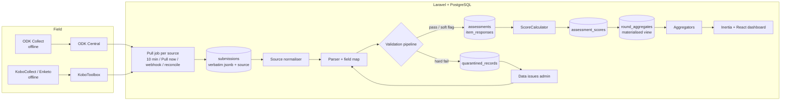
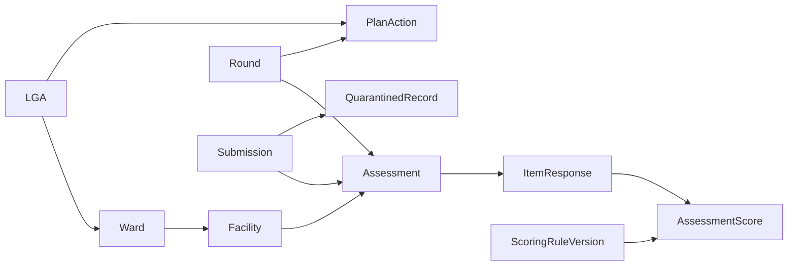
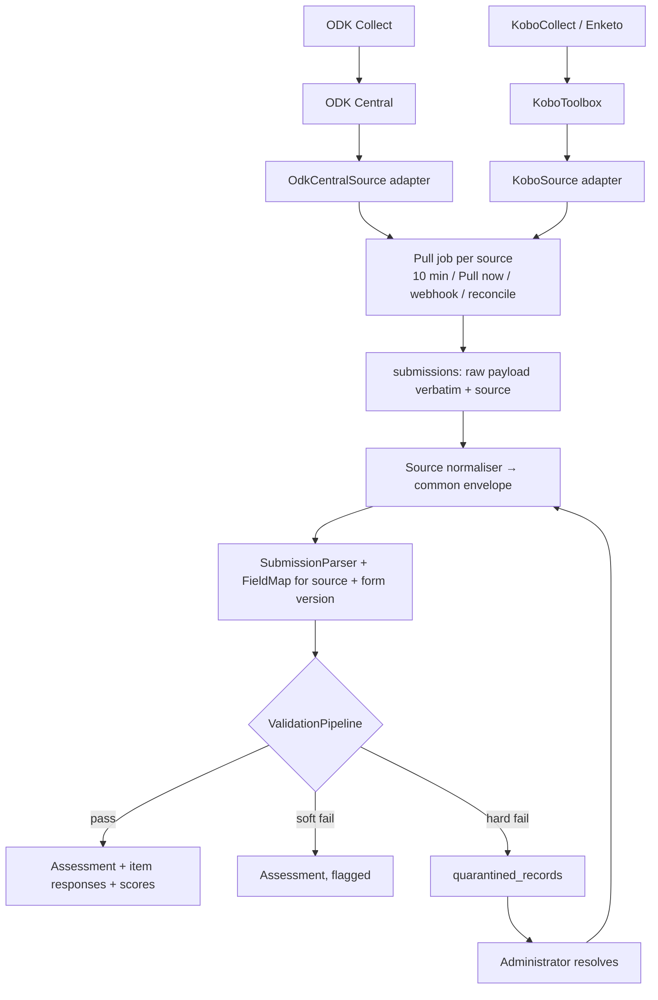

# ARCHITECTURE.md — Kaduna eDQA Portal

How the system is put together: layers, data flow, domain, schema, ingestion, validation,
scoring, API and page structure. Read the section for the area you are changing before you
change it. Coding style lives in `CONVENTION.md`; security in `SECURITY.md`; accessibility in
`ACCESSIBILITY.md`; servers and pipelines in `DEPLOY.md` (separate DevOps project).

## Contents
1. System overview · 2. Application layers · 3. Domain model · 4. Database · 5. Ingestion ·
6. Validation · 7. Scoring · 8. API · 9. Presentation layer · 10. Non-functional targets ·
11. Decisions, prototype deltas, open questions

---

## 1. System overview



**Governing principle:** a score that cannot be true never reaches a chart. Aggregators read only
`assessments`, `assessment_scores` and `round_aggregates` — never `submissions` or
`quarantined_records`. This separation is structural (separate tables + an architecture test),
not a query filter.

**Goals this architecture serves (from the PRD):**

| # | Goal | Where it is enforced |
|---|---|---|
| G1 | No invalid score ever charts | Validation pipeline (§6), CHECK constraints (§4), table separation |
| G2 | Submission on dashboard ≤ 15 min, no human step | Scheduled pull (§5), debounced aggregate refresh |
| G3 | Scores reproducible | Pure `ScoreCalculator`, verbatim payloads, rule versions (§7) |
| G4 | Exactly 23 LGAs | Seeded `lgas`, `LGA_UNKNOWN` rule, no insert path |
| G5 | Every page renders | Pages read local materialised data; no live external query at view time |
| G6 | Follow-up actionable | `plan_actions` (§9.2.6) |
| G7 | Corrections traceable | Activity log on every write (SECURITY.md §4) |
| G8 | Works on 3G | Server-rendered numbers, deferred charts, JS budget (§10) |

**Deployment:** containerised (Docker images, Compose on one host) — see §2 and `DEPLOY.md`.

**Data sources:** ODK Central and KoboToolbox, both pulled through one shared pipeline (§5).

**Out of scope for v1:** any source besides ODK Central and KoboToolbox, roles/permissions, writing back to ODK, Kobo or
DHIS2, sampling logic, mobile app, multi-state tenancy, DHIS2 comparison, public dashboard.

---

## 2. Application layers

```
app/
  Domain/                      ← all business logic
    Assessment/  Models, Actions, DTOs, Events
    Round/       Models, OpenRound, CloseRound, ReopenRound, MonthSlot
    Facility/    Models (Lga, Ward, Facility), Actions, CascadeExporter
    Ingestion/   Contracts/{SubmissionSource,PayloadNormalizer}, SourceRegistry,
                 SubmissionEnvelope, FieldMap, SubmissionParser, ProcessSubmissionsPage,
                 PullSubmissionsJob, BackfillSubmissionsJob, ReconcileSourceJob,
                 FetchAttachmentsJob, PullLock, ReprocessSubmission
      Odk/       OdkCentralSource, OdkCentralClient, SessionTokenCache, OdkPayloadNormalizer
      Kobo/      KoboSource, KoboClient, KoboPayloadNormalizer
    Validation/  Contracts/ValidationRule, Rules/*, ValidationPipeline, ValidationContext,
                 QuarantineAction, ResolveQuarantineAction
    Scoring/     ScoreCalculator, ScoreCard, RuleConfig, Bands, RuleVersion, RescoreRoundJob
    Reporting/   Aggregators/*, ReportFilter, Exporters/*
    Plan/        PlanAction model, Actions
  Http/
    Controllers/ thin — one per page; validate → Action/Aggregator → Resource
    Requests/    FormRequests (validation only)
    Resources/   Inertia/JSON shapes (no arithmetic)
    Middleware/  EnsureTwoFactorConfirmed, SecurityHeaders, VerifySourceWebhook (per-source strategy)
  Console/Commands/  edqa:source:check, edqa:pull, edqa:reconcile, edqa:backfill, edqa:backfill-report, edqa:rescore,
                     edqa:refresh-aggregates, edqa:admin:create, edqa:admin:disable
config/edqa.php, config/edqa_field_maps.php
database/sql/round_aggregates.sql
resources/js/Pages/{Dashboard,Admin}/*, Components/*, lib/*, types/*
lang/en/*.php
Dockerfile                    # targets: base, vendor, assets, app, worker, web, ci, dev
compose.dev.yml               # local development stack
docker/                       # entrypoint.sh, php/*.ini, fpm-pool.conf, caddy/Caddyfile*, postgres/init-dev.sql
database/sql/post-migrate-grants.sql
Makefile                      # make up / down / sh / test / artisan
```

**Dependency direction:** `Http → Domain`. Inside Domain: `Reporting → Scoring, Assessment,
Round, Facility` (read-only); `Ingestion → Validation → Scoring → Assessment`. `Reporting` must
not depend on `Ingestion` or `Validation` models (architecture test).

**Events and listeners:**

| Event | Listeners |
|---|---|
| `SubmissionIngested` | log counters on `pull_runs` |
| `SubmissionQuarantined` | bump quarantine badge cache |
| `AssessmentScored` | dispatch debounced `RefreshRoundAggregatesJob`, flush round cache tag |
| `QuarantineResolved` | dispatch `RescoreRoundJob` for the round |
| `RuleVersionPublished` | dispatch `RescoreRoundJob` per affected round |
| `RoundClosed` | refresh materialised view, snapshot |
| `PullFailed` | admin alert, digest entry (names the source) |
| `SourceDeletionDetected` | flag for administrator review; never auto-delete |

**Queues:** `default` (pull, process), `rescore`, `exports`, `low` (attachments).

**Runtime processes (containers).** The application ships as container images built from one
multi-stage `Dockerfile` (`DEPLOY.md` §6). One image runs every PHP role, chosen by the
entrypoint argument:

| Container | Role | Image | Notes |
|---|---|---|---|
| `web` | Caddy: TLS, static assets, FastCGI to `app` | `edqa-web` | Only container with published ports |
| `app` | PHP-FPM serving Inertia pages and `/api/*` | `edqa-app` | Stateless; can scale to 2+ |
| `worker-default` | `queue:work --queue=default` | `edqa-app` | Pulls (all sources), reconcile, submission processing |
| `worker-rescore` | `queue:work --queue=rescore` | `edqa-app` | Long jobs; generous stop grace period |
| `worker-exports` | `queue:work --queue=exports,low` | `edqa-worker` | Has Chromium for PDFs |
| `scheduler` | `schedule:work` | `edqa-app` | Exactly one instance |
| `migrate` | one-off: migrate + grants | `edqa-app` | Runs as `edqa_migrator` before each rollout |
| `postgres`, `redis` | data | official images | Internal network only |

Consequences for application code are listed in `CONVENTION.md` §12 (stateless containers, logs
to stderr, persistent files only under `storage/app`, config cached at start not build).

---

## 3. Domain model

### Entities and relationships



| Entity | Key facts |
|---|---|
| **LGA** | Exactly 23, seeded. No runtime insert. |
| **Ward** | Belongs to one LGA. |
| **Facility** | Belongs to one ward (and denormalised `lga_id`). `level` ∈ Primary/Secondary/Tertiary. `ownership` ∈ Public/Private. `is_active` — deactivate, never delete. |
| **Round** | `(year, quarter)` unique. Assessment window `window_start..window_end`. Status `open` or `closed`. |
| **Submission source** | A configured field-collection server + form: `odk` (ODK Central) or `kobo` (KoboToolbox). |
| **Submission** | One raw record from a source, verbatim, with `source_id`, `external_id` (the source's stable logical ID) and `instance_id` (this version; unique across sources). May be `superseded` by an edit at source. |
| **Assessment** | Created only from a submission that passed all hard rules. `(round_id, facility_id)` unique. |
| **ItemResponse** | One scored question: `dimension`, `month_slot`, `item_code`, `value`, `is_applicable`. |
| **AssessmentScore** | One row per `(assessment, dimension, month_slot)`. `score numeric(5,2)` or null when the slot is all-N/A. Records `rule_version_id`. |
| **QuarantinedRecord** | Failed submission, all failed rule codes + details, resolution state. |
| **ScoringRuleVersion** | Versioned JSON config (bands, item weights, N/A policy). `draft` until `published_at`. |
| **PlanAction** | Implementation-plan row: LGA, round, dimension, action text, owner, due date, status. |

### Current LGAs (seed list)

Birnin Gwari, Chikun, Giwa, Igabi, Ikara, Jaba, Jema'a, Kachia, Kaduna North, Kaduna South,
Kagarko, Kajuru, Kaura, Kauru, Kubau, Kudan, Lere, Makarfi, Sabon Gari, Sanga, Soba,
Zangon Kataf, Zaria.  **= 23.** Confirm codes against the national facility registry.

### Month-slot mapping

| Quarter | Slot 1 | Slot 2 | Slot 3 |
|---|---|---|---|
| Q1 | January | February | March |
| Q2 | April | May | June |
| Q3 | July | August | September |
| Q4 | October | November | December |

UI rule: show real month names when exactly one quarter is in view; otherwise "Month 1/2/3".
Implement once in `App\Domain\Round\MonthSlot::label(int $quarter, int $slot)` and mirror in
`resources/js/lib/months.ts`.

### Round lifecycle

```
          create                close (snapshot aggregates)
 (none) ────────▶ open ──────────────────────────▶ closed
                   ▲                                  │
                   └──────── reopen (reason) ─────────┘
```

- **open** — submissions whose visit date falls in the window bind to it.
- **closed** — no new submissions bind; aggregates are snapshotted into `round_aggregates`.
  A submission for a closed round quarantines under `ROUND_WINDOW` with detail "round closed".
- **reopen** — requires typed reason, audited, triggers rescore on next close.
- Windows must not overlap between rounds (validated on create/edit).

> The PRD also mentions a "publish state" (PRD §5) and "published rounds" (PRD §8). v1 treats **closed =
> published**. See §11 Decisions D-07.

### Submission lifecycle

```
received ─▶ parsed ─▶ validated ─┬─▶ accepted  (assessment + scores created)
                                 ├─▶ flagged   (accepted with soft flags)
                                 └─▶ quarantined ─┬─▶ reprocessed → accepted/flagged
                                                  └─▶ rejected (reason)
any ─▶ superseded   (an edit at source arrived: deprecatedID = this instance_id,
                     or same external_id with a new instance_id)
```

When a submission is superseded after it produced an assessment, the replacement is processed
and the assessment is updated in place (audited) — the `(round, facility)` uniqueness holds.

### Assessor identity

Assessors have no portal account. `assessor_name` and `device_id` come from the submission's
metadata on whichever source it came from
(`meta/username` or a form field, `deviceid`). Used for the `ASSESSOR_VOLUME` soft rule and for
display only.

---

## 4. Database — PostgreSQL 16

All timestamps `timestamptz`. All raw payloads `jsonb`. Every migration reversible.

### Tables

| Table | Columns | Constraints / notes |
|---|---|---|
| `users` | id, name, email UQ, password, two_factor_secret, two_factor_recovery_codes, two_factor_confirmed_at, is_active, remember_token, timestamps | Administrators only. No role column |
| `lgas` | id, name UQ, code UQ | Seeded with exactly 23 |
| `wards` | id, lga_id FK, name, code | UQ (lga_id, name) |
| `facilities` | id, code UQ, name, ward_id FK, lga_id FK, level, ownership, is_active, lat numeric(9,6)?, lng numeric(9,6)?, timestamps | `level` / `ownership` CHECK against enum values |
| `rounds` | id, year smallint, quarter smallint, window_start date, window_end date, status, closed_at?, reopened_reason?, timestamps | UQ (year, quarter); CHECK quarter 1–4; CHECK window_end ≥ window_start; status CHECK in ('open','closed') |
| `submission_sources` | id, key UQ, type, name, is_enabled, timestamps | `type` CHECK in ('odk_central','kobo'); seeded from config; credentials never stored here |
| `submissions` | id, source_id FK, external_id, instance_id UQ, deprecated_id?, form_ref, form_version, payload jsonb, submitted_at, source_updated_at?, received_at, processed_at?, status, superseded_by_id?, deleted_at_source? | Payload never mutated; index (source_id, external_id) |
| `assessments` | id, round_id FK, facility_id FK, submission_id FK, source_id (from the submission), assessor_name, device_id?, started_at, ended_at, gps jsonb?, status, flags jsonb default '[]', timestamps | UQ (round_id, facility_id); CHECK ended_at ≥ started_at; FK (submission_id, source_id) → submissions (id, source_id) ON UPDATE CASCADE; trigger `assessments_take_source` sets source_id from the submission on every insert and on any change to submission_id or source_id |
| `item_responses` | id, assessment_id FK cascade, dimension, month_slot smallint, item_code, value, is_applicable bool | CHECK month_slot 1–3; dimension CHECK |
| `assessment_scores` | id, assessment_id FK cascade, dimension, month_slot smallint, score numeric(5,2) NULL, rule_version_id FK, computed_at | CHECK score 0–100; UQ (assessment_id, dimension, month_slot, rule_version_id) |
| `quarantined_records` | id, submission_id FK, source_id FK, instance_id, round_id?, facility_ref?, lga_ref?, payload jsonb, failures jsonb, status, resolution, resolved_by?, resolved_at?, resolution_note?, timestamps | `failures` = `[{code, severity, detail}]` |
| `scoring_rule_versions` | id, version int UQ, config jsonb, created_by, published_at?, published_reason?, timestamps | Exactly one "current" = max published version |
| `plan_actions` | id, round_id, lga_id, dimension, action_text, assigned_to, due_date, status, notes?, timestamps | UQ (round_id, lga_id, dimension) |
| `source_syncs` | id, source_id UQ FK, cursor_at?, cursor_instance_id?, backfill_checkpoint int, last_success_at?, last_error?, last_reconciled_at?, submission_count, timestamps | The pull cursor, one per source |
| `pull_runs` | id, source_id FK, triggered_by?, trigger_type, started_at, finished_at?, fetched, accepted, flagged, quarantined, duplicates, cross_source_duplicates, error?, outcome | Powers pull history; `trigger_type` includes `reconcile` |
| `submission_attachments` | id, submission_id, filename, mime, size, source_url?, path?, fetched_at?, status | Deferred fetch during backfill |
| `activity_log` | Spatie standard | Append-only (see SECURITY.md) |
| `round_aggregates` | **materialised view** | See below |

> Note on `assessment_scores` uniqueness: the PRD lists UQ `(assessment_id, dimension, month_slot)`.
> Because published rounds keep old-version scores readable, include `rule_version_id` in the
> unique key. See §11 Decisions D-05.

### Constraints (write the failing test first)

```sql
ALTER TABLE assessment_scores ADD CONSTRAINT score_in_range   CHECK (score IS NULL OR (score >= 0 AND score <= 100));
ALTER TABLE assessments       ADD CONSTRAINT visit_dates_ordered CHECK (ended_at >= started_at);
ALTER TABLE item_responses    ADD CONSTRAINT month_slot_valid CHECK (month_slot BETWEEN 1 AND 3);
ALTER TABLE assessment_scores ADD CONSTRAINT score_slot_valid CHECK (month_slot BETWEEN 1 AND 3);
ALTER TABLE rounds            ADD CONSTRAINT quarter_valid    CHECK (quarter BETWEEN 1 AND 4);
ALTER TABLE rounds            ADD CONSTRAINT window_ordered   CHECK (window_end >= window_start);
```

A test inserts `347.66` directly via `DB::table('assessment_scores')->insert(...)` and asserts a
`QueryException` with SQLSTATE `23514` (check_violation).

### Indexes

| Index | Purpose |
|---|---|
| `assessments (round_id, facility_id)` UNIQUE | One assessment per facility per round |
| `submissions (instance_id)` UNIQUE | Idempotency |
| `submissions (deprecated_id)` | Edit chain lookup |
| `item_responses (assessment_id, dimension, month_slot)` | Scoring access path |
| `assessment_scores (assessment_id, dimension, month_slot, rule_version_id)` UNIQUE | |
| `submissions USING gin (payload jsonb_path_ops)` | Payload queries during reprocessing |
| `quarantined_records USING gin (failures)` | Group Data issues by rule code |
| `quarantined_records (status, round_id)` | Open-issues badge |
| `facilities (lga_id) WHERE is_active` | Cascade export |
| `round_aggregates (round_id, scope_type, scope_id, owner_type)` UNIQUE | Required for `REFRESH ... CONCURRENTLY` |

### `round_aggregates` materialised view

Columns: `round_id, scope_type ('state'|'lga'|'ward'|'facility'), scope_id, owner_type
('all'|'public'|'private'), level ('all'|...), availability, consistency, validity,
m1, m2, m3, overall, facility_count`.

Built from **accepted assessments only** (`assessments` joined to current-version
`assessment_scores`). Facility score first, then unweighted means of facility scores upward.
Use `COALESCE(scope_id, 0)` / sentinel values so the unique index has no NULLs.

```php
public function up(): void {
    DB::statement(file_get_contents(database_path('sql/round_aggregates.sql')));
    DB::statement('CREATE UNIQUE INDEX round_aggregates_key ON round_aggregates (round_id, scope_type, scope_id, owner_type, level)');
}
public function down(): void {
    DB::statement('DROP MATERIALIZED VIEW IF EXISTS round_aggregates');
}
```

The app runs as `edqa_app`, which does not own the view, so the migration also creates a
`SECURITY DEFINER` function owned by the migrator role:

```sql
CREATE FUNCTION refresh_round_aggregates() RETURNS void
LANGUAGE sql SECURITY DEFINER SET search_path = public AS
$$ REFRESH MATERIALIZED VIEW CONCURRENTLY round_aggregates $$;
```

The app calls `SELECT refresh_round_aggregates()` — never the raw statement. Migrations run in
the one-off `migrate` container, which receives `DB_USERNAME=edqa_migrator`; the app containers
connect as `edqa_app`. After migrating, the same container executes
`database/sql/post-migrate-grants.sql`. All of this is part of the contract with the DevOps
project (`DEPLOY.md` §1.3, §8).

Refresh with `SELECT refresh_round_aggregates();` on `AssessmentScored`
(debounced via a unique queued job), `RoundClosed`, and after rescore.

Filters not covered by the view (e.g. LGA + Level + Owner combined) are answered by Aggregator
SQL over `assessment_scores` with the indexes above; keep the p95 under 1.5 s and cache by round tag.

### Laravel specifics

- `$table->jsonb('payload')`; cast `'payload' => 'array'`.
- `$table->timestampsTz()`.
- Enums: string columns + CHECK, cast to PHP backed enums.
- `Model::preventLazyLoading(! app()->isProduction());`
- `Model::shouldBeStrict()` in local/testing.

### Data volume

5 years × 4 rounds × 2,200 facilities × 9 scores ≈ 400,000 score rows, ~40,000 submissions.
Comfortable for Postgres with these indexes.

---

## 5. Ingestion pipeline — ODK Central and KoboToolbox

Assessments arrive from **two field-collection sources**: **ODK Central** and **KoboToolbox**.
Both run XLSForm-based forms filled offline in ODK Collect or KoboCollect/Enketo. They are the
system of record for submissions; the portal pulls from them and never writes back.

Both sources go through **one** pipeline. Each source has an adapter that knows how to talk to
its API and how to turn its JSON into a common shape. Everything after that — storage, parsing,
validation, scoring — is shared, so there is still exactly one place where data can enter and be
checked.



### 5.0 Sources

| Key | Type | Talks to | Identity of a submission | Version field |
|---|---|---|---|---|
| `odk` | `odk_central` | ODK Central REST + OData API (session token) | `__id` (logical ID) + `meta/instanceID` (this version) | `__system/formVersion` |
| `kobo` | `kobo` | KoboToolbox KPI API v2 (`Authorization: Token …`) | `_id` (logical ID) + `meta/instanceID` (this version) | `__version__` (Kobo deployment version) |

- Each configured source is **one form** (an ODK project + form, or a Kobo asset UID). The schema
  allows more later; v1 configures at most one of each.
- Sources are declared in `config/edqa.php` → `sources`, with credentials from env only. A
  `submission_sources` table (key, type, name, is_enabled) gives each one a stable ID for foreign
  keys. A source with missing credentials is "not configured" and simply never pulls.
- **Adding a third source** (e.g. ODK Aggregate, SurveyCTO) means writing a new adapter that
  implements the same contracts, plus a decision record. It never means a shortcut path such as
  a file upload.
- **Built (Phase 2C step 1):**
  - **Schema** (migration `2026_10_28_000100_make_ingestion_source_aware`): every row stored
    before Phase 2C belongs to the `odk` source. `external_id` comes from the payload's `__id`.
  - **The cursor keeps two timestamps.** `edit_cursor_at` is kept beside `cursor_at`, because
    ODK's edits pass needs it (D-51 in the build-era numbering).
  - **One cursor per source.** `form_ref` records the form it follows; when the configured form
    changes, `SourceSync::forForm()` starts the cursor again. The migration refuses to merge two
    ODK cursor rows; a person has to delete the stale one first.
  - **Two switches per source:** the env flag (`ODK_ENABLED`, `KOBO_ENABLED`) for the operator,
    and `submission_sources.is_enabled` for the administrator. `edqa:sources:sync` sets
    `is_enabled` only when it creates a row.
  - **`SourceRegistry`** resolves a key to its config, row and adapter. KoboToolbox's adapter is
    refused until step 4, and the per-source normaliser arrives with step 2.
  - **Attachments** live in `storage/app/attachments/{source}/{instance}/`. The one-off
    `edqa:attachments:relocate` moves files from the old `odk` disk and is safe to run again.
- **Built (Phase 2C step 2):**
  - **Normaliser layer.** `Contracts\PayloadNormalizer` turns a raw payload into a
    `SubmissionEnvelope` (`SubmissionMeta` + `data`, as §5.2). `Odk\OdkPayloadNormalizer` holds
    every ODK-specific read: `__id`, `meta`, `__system`.
  - **The parser** (`App\Domain\Ingestion\SubmissionParser`) reads only the envelope. An
    architecture test keeps it, and `FieldMap`, free of any source's classes. Reprocessing reads a
    stored payload through its own source's normaliser (`ReadSubmission::fromStored`).
  - **`ParsedSubmission`** carries `source` and `externalId`.
  - **Field maps** are now named maps with `extends`, plus `sources` (source → version → map
    name). `FieldMap::for(source, version)` gives null for any unmapped pair (Kobo versions were
    mapped in step 4). Paths stay dot paths into the envelope's `data`; the Kobo normaliser
    (step 4) nests its `facility/lga` keys. UNKNOWN_FORM_VERSION names the source ("kobo form version vQ8x…
    has no field map").
  - **Edits (D-61).** `SubmissionSource::changedSince(cursor)` is the pull's
    second pass. On ODK it filters `__system/submissionDate ge X or __system/updatedAt ge X` and
    sorts by `updatedAt asc, __id asc` (Central v2024.1+). With no edit cursor yet, it asks for the
    edited submissions only.
  - **D-51's two cursors are kept.** Ordering a single cursor across two fields can't page safely.
  - **`source_updated_at`** is stored from `__system/updatedAt`.
  - **Edits without `deprecatedID`.** A new row whose `external_id` the source already sent,
    under another instance ID, is treated as an edit of the latest unsuperseded version. Its
    `deprecated_id` is set to that version (the payload is untouched), and it takes the usual
    edit path.
  - **Fixtures** moved to `tests/Fixtures/sources/odk/` unchanged. The parsed fixtures gained only
    `source` and `external_id`.

### 5.1 Form contract (both sources)

The form must satisfy these on every source. The client should deploy **the same XLSForm** to
both where possible (open question Q-16). If a form doesn't comply, adapting it is a scoped task.

| Requirement | Why |
|---|---|
| Facility chosen by cascading select LGA → ward → facility, from a CSV media file generated by the portal and attached to the form on each source | Kills free-text names like `2019.00` |
| Scored question names match `^(avail|consist|valid)_m[1-3]_[a-z0-9_]+$` | Dimension and month slot parsed from the name; new questions need no code change |
| Scored questions are `select_one` with a fixed list (`yes` / `no` / `na`) | Scores computed from pass counts, never typed. Kills `347.66` at source |
| `round_year`, `round_quarter` are read-only calculated fields | Not typed by assessors |
| `meta/instanceID` required | Idempotency key |
| `start`, `end` metadata fields | Visit duration, `END_BEFORE_START`, `VISIT_TOO_SHORT` |
| GPS and register photo optional | Stored when present |

Choice mapping (configurable per field map): `yes` → pass, `no` → fail, `na` → not applicable.

### 5.2 Components (`app/Domain/Ingestion/`)

**Shared**

| Class | Responsibility |
|---|---|
| `Contracts\SubmissionSource` | `ping()`, `formVersions()`, `submissionsPage(since, top, skip)`, `changedSince(since)` (edits), `attachmentList()`, `downloadAttachment()` |
| `Contracts\PayloadNormalizer` | Raw source JSON → `SubmissionEnvelope` (common shape, below). Pure, deterministic |
| `SourceRegistry` | Resolves a source key to its adapter, normaliser, config and `submission_sources` row; knows which are configured and enabled |
| `SubmissionEnvelope` (DTO) | `meta` {source, externalId, instanceId, deprecatedId, submittedAt, updatedAt, formVersion, submitter, deviceId, attachments[{name, mime, url?}]} + `data` (answers nested by group path) |
| `FieldMap` | Resolves logical names → question paths for a (source, form version) |
| `SubmissionParser` | `SubmissionEnvelope` + `FieldMap` → `ParsedSubmission` |
| `ProcessSubmissionsPage` | One page from any source: insert raw rows, normalise, parse, handle edits, validate, score — one transaction |
| `PullSubmissionsJob(source, trigger)` | Incremental pull for one source |
| `BackfillSubmissionsJob(source)` | Cursor-from-zero pull, checkpointed per page, throttled |
| `ReconcileSourceJob(source, window)` | Sweep that catches edits and deletions an incremental pull can miss (§5.3) |
| `FetchAttachmentsJob` | Low-priority queue; downloads deferred attachments |
| `PullLock` | `Cache::lock("pull:{source}", 900)` — one pull per source at a time; different sources may pull in parallel |

**Per source**

| Source | Classes |
|---|---|
| ODK Central | `Odk\OdkCentralSource`, `Odk\OdkCentralClient`, `Odk\SessionTokenCache`, `Odk\OdkPayloadNormalizer` |
| KoboToolbox | `Kobo\KoboSource`, `Kobo\KoboClient`, `Kobo\KoboPayloadNormalizer` |

The normaliser is where the two APIs' differences are absorbed: ODK OData returns nested
objects per group and a `__system` block; Kobo returns flat keys like `facility/lga`, underscore
system fields (`_id`, `_submission_time`, `__version__`, `_attachments`, `_submitted_by`) and
timestamps without a timezone suffix (treat as UTC). After normalisation the parser cannot tell
the sources apart.

- **Built (Phase 2C step 4):** `Kobo\KoboPayloadNormalizer`, returned by
  `SourceRegistry::normaliser('kobo')`.
  - **Meta:** `_id` → externalId. The instance ID is `meta/instanceID`, else the nested
    `meta.instanceID`, else `"uuid:" + _uuid`; `meta/deprecatedID` likewise.
  - **Times:** a zoneless `_submission_time` is read as UTC; a time that carries a zone is read
    as written. updatedAt is always null.
  - **Other meta:** `__version__` → formVersion; `_submitted_by` and the form's `deviceid`.
  - **Attachments:** `_attachments` → attachments (`media_file_basename`, else the file's
    basename; `mimetype`; `download_url`). Deleted entries are skipped.
  - **Answers:** slash keys are nested into groups, and each repeat row is nested to the
    repeat's own path. Every underscore field, `meta/*`, `formhub/*` and `deviceid` stay out of
    the answers. The stored payload is untouched.
  - **Clashes:** a key that can't be nested (a malformed path such as `a//b`, or one that clashes
    with an answer or a group) stays flat under its full key. The one clash with nowhere flat to
    go, a top-level answer named like a group, keeps the group; the raw payload keeps both.
  - **Never throws**, like the parser (500-row property test).
  - **The parser** also reads the XForms text geopoint `"lat lng [alt [accuracy]]"`, as Kobo
    sends it. Out-of-range or malformed values give null.
  - **Source parity** (CONVENTION.md §8): every fixture has a Kobo KPI-v2-shaped row in
    `tests/Fixtures/sources/kobo/`. It parses to the ODK row's `ParsedSubmission` apart from
    source, external_id and form_version, and ends with the same outcome. There are two
    Kobo-only cases: a missing meta block, and a select_multiple-style "yes no" answer.
  - **Version uids:** the two Kobo `__version__` uids in the field maps are fictional
    (CONTRACT-ASSUMED) until the real deployments are listed (§5.5).

### 5.3 Pull mechanics

**Common to both sources**

- **Cursor:** one `source_syncs` row per source. `cursor_at` advances **only after the whole
  page commits**. A crash mid-page replays that page; uniqueness makes replay harmless. Use
  `>=` with the last timestamp plus instance-ID de-duplication, because timestamps tie.
- **Idempotency:** `submissions.instance_id` is unique **across all sources**. A repeat from
  the same source counts as a `duplicate`. The same instance ID arriving from the *other*
  source (e.g. data copied between servers) counts as `cross_source_duplicate`, is not
  inserted, and is shown on the Data sources page.
- **Edits:** both tools keep a stable logical ID and give each edited version a new
  `meta/instanceID` with `meta/deprecatedID` set. A new version — detected by `deprecatedID`
  **or** by a known `external_id` with a new instance ID — marks the old submission
  `superseded`, keeps it, and updates the existing assessment in place (audited). An open
  quarantined record for the old version auto-resolves as superseded.
- **Edits don't change the submission date** on either platform, so an incremental pull filtered
  only on submission time misses them. Each adapter's `changedSince()` uses the platform's
  last-modified field where its API supports filtering on it (ODK Central:
  `__system/updatedAt`), and `ReconcileSourceJob` sweeps the open round's window nightly and on
  demand, comparing (external ID, instance ID) pairs. Verify Kobo's filterable fields against
  the current KPI API docs; if no last-edited filter exists, the sweep is the edit path for Kobo.
- **Deletions at source** are reported by the sweep only (a submission we hold that the source
  no longer returns). They are **not** applied automatically: the record is flagged for an
  administrator, because deleting a published assessment is a decision, not a sync.
- **Attachments:** stored in `storage/app/attachments/{source}/{instance_id}/`, on first sight,
  never re-fetched; deferred during backfill. Download URLs are only followed when their host
  equals the configured source host (SSRF guard, SECURITY.md §6).
- **Retries:** 3 attempts, backoff `[30, 120, 600]`, honour `Retry-After` on 429; then `failed()`
  → error on the run + `source_syncs.last_error` + `PullFailed` + digest.
- **Progress:** each run writes a `pull_runs` row (with `source_id`) and updates counters as pages
  commit; the admin page polls `GET /api/pulls/{runId}`.
- **Schedule:** one scheduled pull per **configured and enabled** source, every 10 minutes,
  `withoutOverlapping()` per source; a nightly `ReconcileSourceJob` per source for the open round.
- **Latency target:** a submission on either source visible on the dashboard ≤ 15 minutes.
- **Built (Phase 2C step 5):**
  - **Pull per source.** `PullSubmissions::execute(source, trigger)`, `PullSubmissionsJob(source, …)`,
    `BackfillSubmissions::execute(source, …)` and `BackfillSubmissionsJob(source, …)` all go through
    `ProcessSubmissionsPage`. They know no source's shape: times and IDs come from the source's
    normaliser, and adapters and settings from `SourceRegistry` (`adapter`, `formRef`,
    `pageSize`, `backfillThrottle`, `notConfigured`).
  - **No default adapter.** There is no container binding for `SubmissionSource`. Tests bind a
    fake per key (`SourceRegistry::adapterBinding`).
  - **Locks.** `PullLock` (`pull:{source}`) is per source. The reconcile sweep and each backfill
    page take it too. Its config moved to `edqa.pull` (`lock_seconds`, `lock_wait_seconds`,
    `reconcile_at`). `BackfillLock` (`backfill`) is shared by all sources.
  - **Heartbeats per source:** `HEARTBEAT_PULL_ODK_URL` and `HEARTBEAT_PULL_KOBO_URL`. The old
    `HEARTBEAT_ODK_PULL_URL` is read for one more release.
  - **Cross-source duplicates (D-60).** Inside the page transaction, a row not inserted whose
    instance another source holds is counted in `cross_source_duplicates`, not `duplicates`. A
    warning names both sources, with IDs only.
  - **Attachments.** They come from the envelope where the row lists them (Kobo's
    `_attachments`); otherwise the adapter's list is used (ODK). Both adapters look attachments
    up by the logical ID: `__id` on ODK, `_id` on Kobo (`query={"_id": n}`).
  - **Reconcile (D-61, D-62).** `ReconcileSource::execute(source)`, `ReconcileSourceJob(source)`
    and `edqa:reconcile {source}`. The sweep reads the whole open-round window first: every
    submission received since the window's first day, local midnight. A failure part-way flags
    nothing.
    - **Instances we don't hold** go through the page path: an edit of a known `external_id`,
      or a submission the pull missed.
    - **Deletions at source:** a held submission (its latest version) whose `external_id` is no
      longer returned gets `deleted_at_source`, an audit entry and `SourceDeletionDetected`.
      Nothing else changes. Each submission is flagged once.
    - **Bookkeeping:** run trigger `reconcile`; new `pull_runs.deletions_detected` (migration
      `2026_10_30_000100`); `last_reconciled_at` on success; no cursor moves.
  - **Schedule** (`routes/console.php`): for each *configured* source, `edqa:pull:{source}`
    every ten minutes and `edqa:reconcile:{source}` daily at 02:30.
    - Each event has its own name, so `withoutOverlapping()` holds per source.
    - *Enabled* (the env flag plus the administrator's switch) is checked when the event is due,
      so reading the schedule needs no database.
  - **Commands.** `edqa:pull {source?} {--all} {--dry-run} {--limit=}` needs a source or
    `--all`. `edqa:backfill {source} …` and `edqa:reconcile {source}` take one source.
  - **Mocks.** `docker/kobo-mock` sits beside the ODK mock (profile `sources`).
    `edqa:source-mock:generate {source} {--count} {--broken} {--edits} {--overlap=N}` writes
    either mock; see `docker/kobo-mock/README.md`.

**ODK Central**

- `GET /v1/projects/{p}/forms/{f}.svc/Submissions?$filter=__system/submissionDate ge {cursor} or __system/updatedAt ge {cursor}&$top=500&$skip={n}&$count=true&$expand=*`
- Session token from `POST /v1/sessions`, cached until 30 min before expiry; refresh once on 401.

**KoboToolbox**

- `GET {base}/api/v2/assets/{uid}/data/?format=json&limit=…&start=…` with a `query` on
  `_submission_time` (`$gte` the cursor) and a sort on the same field.
- `Authorization: Token {KOBO_API_TOKEN}`; no session step.
- Base URL is configurable: the global server, the EU server, or a self-hosted KoboToolbox
  (open question Q-17).
- Check parameter names, page-size limits and rate limits against the current KPI API docs when
  building the adapter; record what was verified in the adapter's docblock.
- **Built (Phase 2C step 3):** `Kobo\KoboClient` and `Kobo\KoboSource`. They were checked
  against the KPI OpenAPI schema (`/api/v2/schema/`, api_v2 2.0.0, 28 Oct 2026), recorded in
  `KoboClient`'s docblock.
  - **Auth:** `Authorization: Token …`.
  - **Data:** `GET /api/v2/assets/{uid}/data/?format=json&query={"_submission_time":{"$gte":"…"}}&sort={"_submission_time":1,"_id":1}&start=&limit=`.
    The limit is at most 1000 a page. Times are UTC, to the second, with no zone.
  - **Paging** uses `start`/`limit`, and the answer's `next` URL is never followed.
  - **Versions:** `/versions/`, those with a `date_deployed`. **Account:** `/me/`.
  - **Rate limits:** none documented for these endpoints; 429/5xx are retried with Retry-After.
  - **No last-edited field on Kobo submissions**, so `KoboSource::changedSince` returns none
    without asking. The reconcile sweep (2C.5) is Kobo's edit path.
  - **Attachments** come from the row's `_attachments`. A `download_url` is followed only over
    https, on the configured host and port, with no credentials in the URL. Redirects are followed
    only while they stay there; anything else is `KoboUnsafeUrl`.
  - **Not confirmed by the docs:** whether the hosted servers' `download_url` redirects to file
    storage on another host. If it does, that host must be allowed deliberately; check on
    credentials day.
  - `edqa:source:check {source?} {--all} {--json}` replaces `edqa:odk:check`, which stays one
    release as an alias.
  - Shared code catches `Exceptions\SourceException`, the parent of both the ODK and Kobo families.

### 5.4 Webhooks (optional, per source)

`POST /webhooks/{source}` — outside the auth group, verified per source, and it **only**
dispatches `PullSubmissionsJob(source, Webhook)`; the body is never treated as data. The
scheduled pull always runs regardless.

- **ODK:** HMAC-SHA256 over the raw body with `ODK_WEBHOOK_SECRET` (SECURITY.md §6).
- **Kobo:** Kobo's REST Services can't sign requests, so a long random token is sent in a custom
  header (`X-EDQA-Webhook-Token`) and compared with `hash_equals`; HTTPS only.
- **Built (Phase 2C step 6):**
  - **One route.** `SourceWebhookController` serves `POST /webhooks/{source}`, so
    `/webhooks/odk` keeps working unchanged. Each source type has its `WebhookVerifier`:
    `OdkHmacVerifier` (the D-54 signature, headers unchanged) and `KoboTokenVerifier`
    (`KOBO_WEBHOOK_TOKEN`).
  - **When it is a 404:** a key not in config, or a source whose secret is unset. A Kobo token
    shorter than 32 characters counts as unset.
  - **Not genuine:** 401 with a reason code. Only the source and the reason are logged, never
    a header value or the body.
  - **Genuine:** it queues `PullSubmissionsJob(source, Webhook)` for that source only, at most
    once per `debounce_seconds` per source. A source switched off answers 202 and queues
    nothing.
  - **Rate limit:** `throttle:webhook`, 60 a minute per source and sending address.
  - **HTTPS:** enforced at the web tier (Caddy), not checked by the app.

### 5.5 Form versions and field maps

Every submission records its source and form version. Field maps are **named maps** that a
(source, version) pair points to, so the same XLSForm deployed on both platforms shares one map
even though each platform labels the version differently:

```php
return [
    'maps' => [
        'xls-2026.1' => [ /* full map — current form */
            'facility_code' => 'facility/facility_code',
            'lga_code'      => 'facility/lga',
            'ward_code'     => 'facility/ward',
            'round_year'    => 'round_year',
            'round_quarter' => 'round_quarter',
            'started_at'    => 'start',
            'ended_at'      => 'end',
            'assessor'      => 'assessor_name',
            'scored_prefix_pattern' => '/^(avail|consist|valid)_m([1-3])_([a-z0-9_]+)$/',
            'choices'       => ['yes' => 'pass', 'no' => 'fail', 'na' => 'na'],
        ],
        'xls-2021.3' => [ /* additive: only names that differ */
            'extends'       => 'xls-2026.1',
            'facility_code' => 'grp_fac/fac_id',
            'renames'       => ['avail_m1_nhmis_summary' => 'avail_m1_nhmis_form'],
        ],
    ],
    'sources' => [
        'odk'  => ['2026.1' => 'xls-2026.1', '2021.3' => 'xls-2021.3'],   // __system/formVersion
        'kobo' => ['vQ8xK2…' => 'xls-2026.1'],                            // __version__ uid
    ],
];
```

**Rule:** a (source, version) pair with no entry quarantines under `UNKNOWN_FORM_VERSION`, with
the source named in the detail. Never fall back to another version's map. Silent misparsing is
the worst outcome.

**Built (Kobo credentials day, step 2b): the real KoboToolbox form (D-65–D-74).**
- **Item rules.** `config/edqa_item_rules.php` holds 1,192 rules: 541 availability, 182
  consistency and 469 validity. They are generated by `discovery/kobo_item_rules.py` from every
  term of the form's own score formulas (`dqa_<a|c|v>_<m|q>_…_p`), with none left unread. Map
  `kobo-2024010101` names the rule set, and all seven deployment uids point at the map.
  `SubmissionParser` reads a map that has item rules rule by rule:
  - `choice` goes through the rule version's choice map. An unanswered item, or one whose service
    is not offered, is N/A.
  - `count3`: an answer *k* gives *k* passes of 3 checks. An unanswered item is N/A.
  - `match`: all the numbers entered and equal is a pass; any missing or different is a fail;
    none entered is N/A.
- **Visits.** `visit_mode` decides the rules that apply.
  - A monthly visit covers its `review_month`'s slot: `ParsedSubmission::monthSlots`, and
    `ITEMS_INCOMPLETE` requires that slot only.
  - A quarterly visit reads its quarter's rules, each in its own slot.
  - The round is the reviewed period. `round_quarter_format => 'q'` reads q1–q4.
- **Out of scope.** `out_of_scope` matches marks a submission `out_of_scope`. It is never validated,
  scored or quarantined, and `pull_runs.out_of_scope` counts it.
- **Facility slugs.** The form's slugs resolve through `facility_source_refs`, loaded by
  `edqa:facilities:source-refs {source} {file}`: all or nothing, audited. A real code wins; an
  ambiguous or unmapped slug stays unknown.
- **Dry run on the 6 real submissions.** The portal's scores equal the form's own to the decimal in
  every dimension. The exception is consistency where items were left unanswered: D-67's
  deliberate N/A, against the form's 1.5 of 1.5.
- **Not built yet:**
  - Merging monthly visits into one round assessment (D-70). Until then a second visit for the
    same facility and round quarantines as `DUPLICATE_ASSESSMENT`.
  - The form's action plans (D-73).

**Phase 0 task, per source:** list every deployed form version (ODK:
`GET /v1/projects/{p}/forms/{f}/versions`; Kobo: the asset's deployed versions from the KPI API),
download each XLSForm, and diff question names. That diff *is* the field map.

### 5.6 Initial backfill

Same adapters, normalisers, parser, validation and scoring — cursor set to zero, **run one
source at a time**.

- ~40,000 submissions in total across sources; at 500 per page, roughly 80 pages. Hours, not minutes.
- Checkpoint after every page into `source_syncs.backfill_checkpoint`. Restart resumes there.
- Attachments recorded, fetched later by `FetchAttachmentsJob` on the `low` queue.
- Historical rounds **created before the backfill runs**. Submissions outside every window →
  `ROUND_WINDOW`, never guessed into the nearest round.
- Throttle between pages per source (default 5 s); run out of hours on the first pass.
- Commands: `edqa:backfill {source} {--survey} {--from-page=} {--throttle=} {--dry-run}`.
- The survey counts each visit under the round `ROUND_WINDOW` will hold it to: the declared
  quarter (D-71), else the visit's own. It shows the visit dates per row and warns when a round's
  window misses some of its visits. A form filled in after the period it reviews needs a window
  that runs past the quarter's end (Q-10).
- The **backfill report** breaks results down by source, round, year, rule and form version.
- If both sources hold history for the same quarters, expect `DUPLICATE_ASSESSMENT` and
  `cross_source_duplicate` counts; the report lists them so the client can decide which copy is
  authoritative (Q-15).
- **Built (Phase 2C step 5):**
  - **One source at a time.** `edqa:backfill {source}` refuses while another source's backfill
    is running: the shared `BackfillLock`, or an open backfill run of another source that
    started, or committed a page, within `edqa.backfill.stale_after_seconds` (1 h).
  - **The report** has a section per source (its rounds and its total), then all sources.
    - Rule tables, by year and by form version, carry the source.
    - "Duplicates between the sources" gives, per source: its open `DUPLICATE_ASSESSMENT`
      records, how many clash with an assessment from the other source, and the cross-source
      duplicates its runs counted.
    - The CSV gains a `source` column.

### 5.7 Reprocessing

`ReprocessSubmission` reads `submissions.payload` and runs it through **its own source's**
normaliser, never re-fetching. Used after a quarantine correction, a field-map fix, or a
scoring-rule publish. Idempotent.

### 5.8 When both sources report the same visit

One assessment per facility per round still holds, whichever tool it came from. If the same
facility is submitted for the same round on both sources, the first accepted one stands and the
other quarantines under `DUPLICATE_ASSESSMENT`, with the detail naming both sources and instance
IDs. The administrator decides in Data issues. If the client assigns sources by LGA or by period
(Q-15), that is configuration for a future soft rule, not a v1 behaviour.

- **Built (Phase 2C step 5):** the detail reads "Q2 2026 already recorded for facility FX-5001
  (instance uuid:… from ODK Central; this one from KoboToolbox)". `ValidationContext` keeps the
  source of every accepted instance, from the database and from the batch.


---

## 6. Validation rules and quarantine

Every rule is a class implementing `App\Domain\Validation\Contracts\ValidationRule`, registered
in `config/edqa.php` under `validation.rules`. Adding a rule = adding a class + config line.

```php
interface ValidationRule
{
    public function code(): string;            // e.g. 'SCORE_RANGE'
    public function severity(): Severity;       // Hard | Soft
    /** @return list<RuleFailure> empty when passing */
    public function check(ParsedSubmission $s, ValidationContext $ctx): array;
}
```

`ValidationContext` provides the facility master list, rounds, prior assessment scores and
assessor-day counts — loaded once per page of submissions, not per rule (no N+1).

The pipeline runs **every** rule and collects **all** failures (not fail-fast), so the Data
issues page shows every reason at once.

### Rule catalogue (14 rules: 10 hard, 4 soft)

| # | Code | Sev | Passes when | Live-report defect it prevents |
|---|---|---|---|---|
| 1 | `UNKNOWN_FORM_VERSION` | Hard | Form version has a field map. **Runs first; if it fails, skip parse-dependent rules** | Old form parsed with the wrong map |
| 2 | `COLUMN_DRIFT` | Hard | Date fields parse as dates; ward is not a reserved word (`Quarterly`, month names, `null`, numeric) | `Ward = Quarterly`, `Start = FEBRUARY` |
| 3 | `LGA_UNKNOWN` | Hard | LGA resolves to one of the 23 | `null` LGA → 24 LGAs |
| 4 | `FACILITY_UNKNOWN` | Hard | Facility code matches an **active** master-list entry | Facility named `2019.00` |
| 5 | `FACILITY_LGA_MISMATCH` | Hard | Master-list LGA == submitted LGA | Wrong cascading-select pick |
| 6 | `ITEMS_INCOMPLETE` | Hard | All required items present for all 3 dimensions × 3 months | Missing dimension can't be averaged |
| 7 | `SCORE_RANGE` | Hard | Every derived score within 0–100 (defence in depth; DB CHECK is the backstop) | `347.66`, `392.42` |
| 8 | `END_BEFORE_START` | Hard | `ended_at ≥ started_at` | Basic integrity |
| 9 | `ROUND_WINDOW` | Hard | Visit date inside an **open** round's window | Q1 visit landing in Q2 |
| 10 | `DUPLICATE_ASSESSMENT` | Hard | No existing accepted assessment for (round, facility), excluding the one this submission supersedes | Double counting |
| 11 | `SCORE_JUMP` | Soft | Overall within 30 points of facility's previous round | Usually entry error |
| 12 | `ALL_PERFECT` | Soft | Not all nine scores exactly 100 | Form filled without visiting |
| 13 | `VISIT_TOO_SHORT` | Soft | `ended_at − started_at ≥ 20 min` | Rushed/fake visit |
| 14 | `ASSESSOR_VOLUME` | Soft | Assessor ≤ 6 facilities that day | Supervisor attention |

Soft thresholds (30 points, 20 min, 6 facilities) live in `config/edqa.php`.

> The PRD build order says "the thirteen rules from §7" but the PRD §7 table lists 14. Build all 14.
> See §11 Decisions D-06.

### Outcomes

- Any hard failure → `quarantined_records` row (payload copy, `failures` jsonb with every code +
  human-readable detail). No assessment, no item responses, no scores.
- Only soft failures → assessment created, `assessments.flags` lists the codes; shown with a
  "Flagged" tag in the facility drawer and Data issues (soft tab). Contributes to aggregates.
- All pass → assessment created, scored, `AssessmentScored` event.

Detail strings must be specific: `"availability_m1 derived score 347.66 exceeds 100"`,
`"lga was blank"`, `"ward 'Quarterly', start 'FEBRUARY'"`.

### Quarantine workflow (Data issues page)

1. Grouped by rule code, filterable by LGA and round; badge count on the admin tab.
2. Each row: source, instance ID, rule(s), facility reference, LGA, detail, and a **deep link to the submission on its source** (ODK Central or KoboToolbox).
3. Actions:
   - **Correct and reprocess** — edit the offending mapped field (stored as a correction overlay,
     never mutating `submissions.payload`), re-run the pipeline. Audited with old/new/reason.
   - **Reject** — typed reason required; excluded permanently; audited.
   - **Override soft flag** — typed justification; audited.
   - **Fix at source** — assessor edits on the source (ODK Central or KoboToolbox); the next pull or reconcile brings a new instance with
     `deprecatedID`; the quarantined record auto-resolves as `superseded`.
4. **Bulk resolve** rows failing the same rule the same way (one reason applies to all; one audit
   entry per record).
5. Every action writes an audit entry. Nothing is silently fixed.
6. Resolving triggers a rescore of the affected round.

### The guarantee

No aggregate — chart, scorecard, export — reads from `submissions` or `quarantined_records`.
Aggregators read only `assessments` / `assessment_scores` / `round_aggregates`. An architecture
test (Pest `arch()`) asserts `App\Domain\Reporting` does not depend on
`QuarantinedRecord` or `Submission` models.

---

## 7. Scoring engine

### Principles

1. Scores are always derived. A submitted "overall" or score field is ignored.
2. Every score records the `scoring_rule_version` that produced it.
3. Changing a rule never mutates history: it creates a new version and triggers a rescore; old
   scores stay readable for closed rounds.
4. Aggregates are SQL over `assessment_scores` (and the `round_aggregates` view), cached, and
   invalidated by round.
5. Store full precision (`numeric(5,2)`); round **only** at presentation.

### Computation (`ScoreCalculator`)

```
dimension_month_score = items_passed / items_applicable × 100
dimension_score       = mean of non-null month scores
overall_score         = mean(availability, consistency, validity)
```

- Items marked N/A are excluded from numerator **and** denominator.
- If every item in a dimension–month is N/A → that slot score is `NULL`, dimension score is the
  mean of the remaining slots, and the exclusion is recorded (`assessments.flags` gets
  `SLOT_ALL_NA:{dim}:{m}` as an informational note).
- If a whole dimension is null → `ITEMS_INCOMPLETE` (hard) should have caught it; the calculator
  throws `IncompleteAssessmentException` as a safeguard.
- Item weights (from the rule version config) default to 1. With weights:
  `Σ(weight × pass) / Σ(weight × applicable) × 100`.

Pure function: `ScoreCalculator::calculate(ItemResponseSet, RuleConfig): ScoreCard`. No DB
access inside — makes it trivially testable and deterministic (goal G3: two runs on identical
inputs produce identical outputs).

### Aggregation (Aggregators in `app/Domain/Reporting/Aggregators/`)

| Level | Method |
|---|---|
| Facility | Mean of its assessments in the round (normally one) |
| Ward | Unweighted mean of facility scores |
| LGA | Unweighted mean of facility scores |
| Owner type | Unweighted mean within Public / Private |
| State | Unweighted mean of all assessed facilities |

Config: `edqa.aggregation.weighting` = `'unweighted'` (default) | `'facility_count'`.
Every aggregator has a test and is the **only** place a number shown on a page is computed.

Aggregators (suggested):
`StateSummaryAggregator`, `DimensionAggregator`, `OwnerSplitAggregator`, `LgaTableAggregator`,
`FacilityScoresQuery`, `QuarterTrendAggregator`, `MonthSlotAggregator`, `CoverageAggregator`,
`AssessmentWindowAggregator`, `ImplementationPlanAggregator`.

All take a `ReportFilter` DTO (year, quarter, lga, level, owner) built from the URL query string.

### Reference figures (must pass as tests before building UI)

| Group | Avail | Consist | Valid | Mean | Shown |
|---|---|---|---|---|---|
| Public | 92 | 79 | 92 | 87.67 | 88 |
| Private | 75 | 62 | 84 | 73.67 | 74 (**PRD says 73**) |
| State (2,000 pub + 219 priv, unweighted over facilities) | | | | ≈ 86.3 | 86 |

> Note: 73.67 rounds to 74, not 73. The live tool shows 73 — likely because its underlying
> dimension values are unrounded (e.g. 74.7/61.9/83.8) or it truncates. Test against the
> **unrounded** figures from a known client round, and confirm the display rounding rule
> (half-up vs truncate) with the client. See §11 Decisions Q-09.
> Also: (2000×87.67 + 219×73.67)/2219 ≈ 86.29, not 86.5 — still displays 86.

### Bands

Config in the rule version, defaults:

| Band | Range | Tag |
|---|---|---|
| Strong | ≥ 90 | green |
| Acceptable | 80–89.99 | green-muted |
| Review | 70–79.99 | amber |
| Needs action | < 70 | red |

Bands drive table colour, status column, and which LGAs enter the implementation plan.
Changing a band never changes a stored score. Band logic lives server-side
(`App\Domain\Scoring\Bands`); the frontend receives the band key with each number and never
recomputes it.

### Rule versions

- `scoring_rule_versions.config` jsonb: `{ bands, item_weights, na_policy, choice_map }`.
- Edit → new **draft** version. **Publish** requires a typed reason and shows a **preview**:
  number of facilities and LGAs that would change band, per round. Then dispatches rescore.
- Current version = highest published. Closed rounds keep their existing scores readable; the
  dashboard reads the current version by default.

### Rescore

Triggered by: rule version publish, quarantine resolution, assessment correction, manual button.

- `RescoreRoundJob` queued, chunked by 200 assessments, reports progress (`job_batches` /
  Bus::batch).
- Reads item responses → `ScoreCalculator` → upserts `assessment_scores` for the target version.
- Ends with `REFRESH MATERIALIZED VIEW CONCURRENTLY round_aggregates` and cache flush for the round.
- Target: full round (~2,200 assessments) in < 5 minutes.

---

## 8. Internal API surface

Dashboard pages are Inertia; these JSON endpoints serve admin interactivity and exports only.
All require an authenticated, 2FA-confirmed administrator session (session cookie + CSRF).
No public API, no API tokens in v1.

| Method | Path | Purpose |
|---|---|---|
| GET | `/api/aggregates` | Scores by scope, honouring all five filters |
| GET | `/api/facilities` | Paginated (50), sortable, filterable facility scores |
| GET | `/api/facilities/{id}` | Detail: item responses, history, attachments, audit |
| GET | `/api/rounds` | Rounds and status |
| POST | `/api/rounds/{id}/close` | Close round, snapshot aggregates |
| POST | `/api/rounds/{id}/reopen` | Reopen (reason required) |
| GET | `/api/sources` | Every source: configured?, enabled?, reachable?, last success, cursor, last error, open-round counts |
| POST | `/api/sources/{key}/pull` | Manual pull for one source; returns `{ run_id }` (existing run if one is running) |
| POST | `/api/sources/pull-all` | Manual pull for every configured, enabled source; returns run ids |
| POST | `/api/sources/{key}/reconcile` | Run the edit/deletion sweep for the open round |
| GET | `/api/pulls/{runId}` | Progress: fetched, parsed, accepted, flagged, quarantined, duplicates, status |
| GET | `/api/quarantine` | Quarantined records, grouped or flat |
| POST | `/api/quarantine/{id}/resolve` | `{ action: correct|reject|override, fields?, reason }` |
| POST | `/api/quarantine/bulk-resolve` | Same rule, same resolution, many ids |
| GET | `/api/facility-list` | Master list for admin table |
| POST | `/api/facility-list/export-cascade` | Regenerate the cascading-select media file (same file for ODK Central and KoboToolbox) |
| POST | `/api/scoring-rules/{id}/preview` | Band-change preview before publish |
| POST | `/api/scoring-rules/{id}/publish` | Publish (reason required), triggers rescore |
| POST | `/api/exports` | Queue an export; returns `{ export_id }` |
| GET | `/api/exports/{id}` | Poll status; returns signed download URL when ready |
| POST | `/webhooks/{source}` | Optional, verified per source (§5.4), outside auth group; only enqueues a pull |

**There is no `POST /api/imports`.** Removing that route is the enforcement of "field-collection sources only".

**Built (Phase 2C step 6):**
- **Removed:** `/api/odk/pull`, `/api/odk/pull/{run}` and `/api/odk/status`.
- **Moved:** the signed backfill-report download is now `GET /api/backfill-reports/{file}`.
- **Starting runs.** `StartManualPull` starts a pull (`execute`), pull-all (`all`) and a
  sweep (`reconcile`).
  - Each creates its run first and returns the source's run already in progress instead of
    queueing a second.
  - Each is audited (`pull_requested` / `reconcile_requested`, with the source).
  - A source not configured or switched off is a 409: `source_not_configured` or
    `source_disabled`. With no source on, pull-all is a 409 too (`no_source_enabled`).
- **Rate limit:** `throttle:source-pull`, 6 a minute per administrator, source and action.
- **Progress:** `GET /api/pulls/{runId}` (`PullRunResource`) adds `source`,
  `cross_source_duplicates` and `deletions_detected`.
- **`GET /api/sources`.** For each source in config order: `SourceStatusQuery` (configured,
  problems, enabled, reachable cached 60 s per source, cursor, `last_reconciled_at`, running
  pull and sweep, last pull), its `status` (`SourceStatusAggregator`) and its own
  `open_rounds` counts. Then `open_rounds` across all sources.

### Conventions

- Controllers thin: validate via FormRequest → call Action/Aggregator → return JsonResource.
- Errors: Laravel default validation 422 shape; domain errors 409 with `{ code, message }`.
- Filters are query params: `year, quarter, lga, level, owner`, identical names to the dashboard
  URL so a view link can be turned into an export.
- Rate limits: see SECURITY.md §8.

---

## 9. Presentation layer

Visual design tokens are in `CONVENTION.md` §6; accessibility rules in `ACCESSIBILITY.md`. The prototype (`kaduna-edqa-prototype-v4.html`) is the visual reference only.

### 9.1 Layout shell

- Left **rail** (210px, `--color-rail`): KD seal, "eDQA e-tool / Kaduna State", nav:
  **Dashboard**, **Administration**. Footer: assessment count, "Support: HSDF".
  Collapses to a horizontal bar under 760px.
- **Built (Phase 2C step 6): status per source.** `App\Domain\Ingestion\Aggregators\SourceStatusAggregator`
  lives in Ingestion: Reporting may not read the source registry.
  - **States:** `not_configured`, `disabled`, `auth_failed` (latest finished pull failed with
    `*AuthFailed`), `failed`, `not_connected` (no pull finished yet), `stale`, `healthy`. Only
    the source's own runs count, backfills excluded.
  - **Shell:** shares `shell.sources`, worst first: auth_failed, failed, stale, not_connected,
    healthy, disabled, not_configured.
  - **Bar:** `SyncStatusBar` names each source with a mark and words, then the counts, in the
    worst source's tone.
- **Built (Phase 2C step 6): deep links per source.** `SourceLinks::submission(source,
  external_id)` for the facility drawer (`source: {key, name, instance_id, url}`) and Data
  issues (`source`, `source_url`).
  - **Inputs:** the configured base URL (rebuilt from its parts: https, no user, query or
    fragment) and IDs that match their patterns. Anything else gives no link.
  - **ODK:** Central's submission page, by `__id`.
  - **Kobo:** the submission's record at `/api/v2/assets/{uid}/data/{_id}/` (Kobo's web app has
    no address for one submission).
- **Status bar** above the top bar: sync state across sources (worst state wins; each source named) — green "Last pull 4 min ago · 2,184
  assessments · 12 in quarantine" / amber when > 30 min / red when last pull failed.
  (Replaces the prototype's "Sample data / Import data" bar.)
- Sticky **top bar**: page title + subtitle; **global filter bar** (Year, Quarter, LGA, Level,
  Owner) + Export button; tabs underneath.
- Filters live in the **URL query string** (Inertia `router.get` with `preserveState`,
  `preserveScroll`). Any view is bookmarkable and shareable.
- Content max-width 1280px, padding 22/26px.

### 9.2 Dashboard pages

#### 9.2.1 Home
- **Hero** (270px left / flexible right): Average quality score (64px display), sentence
  "Averaged across N facilities…", 2×2 minis: Facilities visited, Local governments, Facilities
  90+, Facilities under 70.
- Right: "The three dimensions" — horizontal bars for Availability, Consistency, Validity,
  Overall with a Strong-threshold marker; note naming the weakest dimension.
- **Public vs Private** split panel: big overall + 3 dimension minis each.
- **Quality score by quarter** line chart with dashed Strong line.
- **Weakest local governments** — six lowest, value tags.

#### 9.2.2 Facility view
- Segmented metric switcher: Availability / Consistency / Validity / Overall.
- Columns: Facility, LGA, Ward, Owner (tag), Assessed (round + date), Month 1/2/3 (heat, real
  month names when one quarter in view), Overall (band tag).
- **Sorted weakest first** by default. Server-side pagination 50/page, sortable on any column
  (TanStack Table in manual mode).
- Facility name opens the **detail drawer**.

#### 9.2.3 LGA view
- 23-tile grid: name, overall, facility count, left border in band colour, `aria-pressed`
  when selected; click toggles the LGA filter.
- Table: LGA, Facilities, Availability, Consistency, Validity, M1, M2, M3 (heat), Overall,
  Status label.
- Tab badge shows LGA count — must always be ≤ 23.

#### 9.2.4 Monitor
- Public / Private split (same component as Home).
- Facilities visited per LGA — ranked bar list (hand-built SVG/CSS), state-mean marker.
- Coverage by level (Primary / Secondary / Tertiary).
- Assessment window table: rounds in view, first visit, last visit, assessments recorded.
- Assessments by source (Phase 2C step 7): a small table, one row per configured source.
  - `AssessmentsBySourceAggregator` counts accepted and flagged assessments in the selection (the
    rounds the summaries cover, plus the LGA, level and owner filters) by `assessments.source_id`.
    It never reads `submissions`: the database copies the source onto the assessment.
  - `SourceCountsPayload` names each source from the registry, which Reporting may not read.
    Configured sources with no assessments are listed at 0.

#### 9.2.5 Visuals
- Toggle Overall / Public / Private.
- Three grouped bar charts (Recharts), one per month slot, 4 series across quarters in view,
  x-labels = real month name + quarter.
- Four ranked horizontal bar charts by LGA (hand-built SVG): Overall, Availability,
  Consistency, Validity. Bar colour by band.

#### 9.2.6 Implementation plan
- Per LGA: overall (tag), weakest dimension, its score (heat), standard action, **owner
  (editable)**, **review date (editable)**, **status** (Not started / In progress / Done).
- Standard actions:
  - Availability — Restock HMIS tools; confirm current register set is in place
  - Consistency — On-site mentoring on reconciling the monthly summary against the register
  - Validity — Retraining on data element definitions and correct tool completion
- "Actions by type" summary + "What each action means" reference panel.
- Export to Excel workplan.
- Edits persist to `plan_actions` and are audited (prototype was read-only).

#### 9.2.7 Facility detail drawer
Right-side sheet: score card for current round, item-level responses grouped by dimension ×
month (pass / fail / N/A), round-over-round sparkline, soft flags, attachments (authenticated
URLs), correction audit trail, the source (ODK Central or KoboToolbox), instance ID and deep link.

### 9.3 Administration pages (five)

| Page | Replaces prototype tab | Content |
|---|---|---|
| **Data sources** | "Imports" + "Data sources" | One panel per source (ODK Central, KoboToolbox): configured/enabled, reachable, last success, fetched in last pull, round cumulative, last error (HTTP status + time), **Pull now** and **Reconcile** with live progress. **Pull all**. Combined pull history with a source column: time, source, trigger, retrieved, accepted, flagged, quarantined, duplicates, cross-source duplicates, duration, outcome. Deletions-at-source list for review |
| **Data issues** | "Data issues" | Rule list with counts (reuse prototype's issue rows + "why it exists" text), hard/soft tabs, filters LGA + round, rows with instance ID, rule, facility, LGA, `code`-styled detail; correct/reject/override inline; bulk resolve; source filter and deep link to the submission on its source |
| **Rounds** | — (new) | List, create (year, quarter, window), close, reopen with reason |
| **Facility list** | "Facility list" | Search, inline edit, deactivate (not delete), **Regenerate facility media file** (attach to the form on both sources) |
| **Scoring rules** | "Scoring rules" | Band thresholds, item weights, N/A policy; draft → preview band changes → publish with reason |

The admin tab shows a red badge with the open quarantine count.

**Built (Phase 2C step 7).**
- **Data sources page.** `/admin/sources` (`AdminSourcesController`) replaces the ODK pull page.
  `/admin` opens it, and `/admin/odk` redirects to it with a 301.
  - **One panel per source** (`SourcePanel`), named by the source and built from the same entries
    as `GET /api/sources` (`SourcesPayload`). Each shows:
    - configured (the missing env keys) or switched off;
    - reachable;
    - last success, how long ago, and when;
    - what the last pull fetched, cross-source duplicates included;
    - this source's counts in each open round;
    - the cursor and the last reconcile;
    - the last error in plain language: the HTTP status when known, else the error class in
      words (`*AuthFailed`, `*Unreachable`, `*UnexpectedResponse`).
  - **Pull now and Reconcile** (`SourceRunControl`) each post to the sources API and follow
    their run in a ProgressPanel. The page owns which run each panel follows, so the runs Pull
    all starts (`PullAllPanel`) show in each source's own progress.
  - **Combined history** (`PullHistoryQuery`): source column and filter (a configured key),
    duplicates and cross-source duplicates, and reconcile as a trigger.
  - **Deletions at source** (`DeletionsAtSourceQuery`): the newest 50 of `deleted_at_source`,
    with the total. Each row links to what it touches: the facility drawer in its round, or Data
    issues when the record is in quarantine. It also links to the submission on its source.
    Nothing is removed (D-62).
  - **Backfill** (`BackfillStatusQuery`, formerly `OdkStatusQuery`) is unchanged.
- **Data issues.**
  - **Source filter** (`?source=`, a configured key) on both tabs: the hard tab filters
    `quarantined_records.source_id`, the soft tab `assessments.source_id`.
  - **Rows:** a source column on both tabs, and the per-source "Open in …" link.
  - **Duplicates.** A DUPLICATE_ASSESSMENT row shows both sides (`duplicate_of`, from
    `QuarantineQuery::duplicateOriginals`). The accepted assessment shows with its source,
    instance ID and link, and this submission with its source.
- **Facility list** is still a placeholder (Phase 5). Until it is built, the facility media file
  panel ("Regenerate facility media file") is on the Data sources page. It says the one file is
  attached to the form on both platforms.


---

## 10. Non-functional targets

| Area | Target |
|---|---|
| Dashboard response | p95 < 1.5 s server time, any page, all filters |
| First meaningful paint | < 3 s on throttled 3G |
| JS budget | ≤ 300 KB gzipped first load; code-split per page; charts load last |
| Ingestion latency | ≤ 15 min from a submission on either source to the dashboard |
| Rescore | one round (~2,200 assessments) < 5 min |
| Export | 10,000-row CSV < 30 s, queued with progress |
| Volume | ~40,000 submissions, ~400,000 score rows over 5 years |
| Concurrency | 50 simultaneous users |
| Availability | 99% monthly excl. maintenance window |
| Browsers | Chrome, Edge, Firefox, Safari — current + one prior |
| Responsive | usable from 360px; tables scroll horizontally |
| Accessibility | WCAG 2.1 AA (`ACCESSIBILITY.md`) |
| Localisation | English v1; all strings in language files |

How the 3G target is met: numbers arrive as Inertia props and render before hydration; heavy
blocks use Inertia 2 deferred props; charts are `React.lazy`; fonts self-hosted with
`font-display: swap`; tables paginate server-side at 50 rows.

---

## 11. Decisions, prototype deltas, open questions

### 11.1 Architecture decision records

| ID | Decision | Rationale |
|---|---|---|
| D-01 | Field-collection sources are the only way data enters, including history — **ODK Central and KoboToolbox** (amended by D-59) | One normaliser-parser-validation path; a second path is a second place validation can be bypassed |
| D-02 | One role: Administrator, 2FA mandatory | Saves ~1 week; audit trail becomes the control |
| D-03 | PostgreSQL 16 | jsonb + GIN, enforceable CHECKs, materialised views |
| D-04 | Unweighted aggregation (config flag) | Matches the live tool's published figures |
| D-05 | `assessment_scores` unique key includes `rule_version_id` | PRD requires old-version scores to remain readable after a rescore; the PRD's 3-column UQ would forbid that |
| D-06 | Build all **14** validation rules | PRD §19 says "thirteen"; §7 table lists 10 hard + 4 soft |
| D-07 | Round "published" = "closed" in v1 | PRD §5 mentions a publish state; §10.3 defines only open → closed |
| D-08 | Quarantine corrections stored as an overlay, not by editing `submissions.payload` | Payload must stay verbatim |
| D-09 | Fonts self-hosted | CSP and 3G performance |
| D-10 | Implementation plan owner/date/status editable, persisted in `plan_actions` | PRD §9.6; prototype was read-only |
| D-11 | Band classification server-side only | One source of truth; prototype's JS band logic is inconsistent |
| D-12 | Tests run on Postgres, never SQLite | Constraint and view behaviour must match production |
| D-13 | **Containerised with Docker**; one multi-stage `Dockerfile`, images promoted by digest; Docker Compose on a single host in staging/production; the same images in local dev and CI | Environment parity, one-command rollback, reproducible hosts, clean handover. Kubernetes rejected as disproportionate for 50 users (`DEPLOY.md` §2.2) |
| D-14 | cPanel/WHM hosting dropped as a fallback | Docker needs host control; cPanel's firewall and port ownership conflict with a container edge |
| D-15 | Caddy replaces Nginx as the web tier | Automatic TLS in a container, HTTP/3, precompressed Brotli for 3G, FastCGI retry during rolling restarts |
| D-16 | Laravel Sail rejected for local dev | Sail's image differs from production; `compose.dev.yml` uses our own `dev` target |
| D-17 | **React 19**, not the React 18 in the PRD | The official starter kit and Inertia 3 ship React 19 (19.3 at scaffold) with the React Compiler; staying on 18 would mean maintaining a fork of the kit. No PRD feature depends on the difference |
| D-18 | **Laravel 13 + Inertia 3**, not Laravel 12 + Inertia 2 | Laravel 12's security support ends ~Feb 2027, at go-live; 13 is supported to ~Mar 2028. The current kit targets 13; its last Laravel 12 version was frozen in Mar 2026. Knock-on: **Pest 4** (Pest 3 needs PHPUnit 11; Laravel 13 uses PHPUnit 12), and **ESLint 9** (`eslint-plugin-jsx-a11y` does not support ESLint 10 yet) |
| D-19 | Wayfinder generates typed route helpers (`resources/js/{actions,routes,wayfinder}`, git-ignored) | Its Vite plugin runs `php artisan wayfinder:generate` at the start of every build. The Docker `assets` stage has no PHP (`DEPLOY.md` §6.2): generate the files in the `vendor` stage, copy them into `assets`, and point the plugin's `command` option at a no-op there |
| D-20 | Starter kit trimmed to what one role with mandatory 2FA needs | Removed: registration, passkeys (a login path around TOTP 2FA), profile edit, delete account, appearance/dark mode, welcome and demo dashboard pages, Sail, `laravel/pao`, `vite-plus` (plain Vite + ESLint + Vitest instead). Kept: Fortify login, password reset, email verification, TOTP 2FA, password confirmation, settings → Security. Packages this adds to the stack: `laravel/fortify`, `laravel/wayfinder`, `larastan/larastan`, `pestphp/pest` + `-plugin-laravel` + `-plugin-arch`; npm: Radix UI primitives, `lucide-react`, `sonner`, `input-otp`, `clsx`/`tailwind-merge`/`class-variance-authority` (kit UI), `eslint` + `typescript-eslint`/`react`/`react-hooks`/`jsx-a11y` plugins, `vitest` |
| D-21 | **Node 24** (`node:24-bookworm-slim`) instead of Node 20 for the `assets` stage, the dev `vite` service and the `worker` image | Node 20 reached end of life in Apr 2026; Vite 8 needs ≥ 20.19. The `worker` copies Node and a pinned Puppeteer from the Node image rather than Debian's `nodejs` package (v18, also end of life). `/usr/bin/node` is symlinked so `BROWSERSHOT_NODE_BINARY` from `DEPLOY.md` §15.2 still works |
| D-22 | Assets precompressed at build with `vite-plugin-compression2` (`.br` + `.gz`) | `DEPLOY.md` §6.1/§10: Caddy serves them with `precompressed br gzip`; Brotli matters on 3G. New npm dev dependency |
| D-23 | Fonts from `@fontsource/archivo` (500/600/700) and `@fontsource/ibm-plex-sans` (400/500/600), bundled by Vite | CONVENTION.md §6 and D-09: self-hosted, so the CSP has no external host (SECURITY.md §8). Replaces the kit's build-time Bunny Fonts download. New npm dependencies |
| D-24 | 2FA recovery codes stored as SHA-256 hashes and shown once, overriding Fortify's encrypted, re-displayable codes | SECURITY.md §2. Custom Fortify actions (enable, confirm, regenerate) and challenge request; Fortify's "show codes" endpoint returns 404. A fast hash suffices: each code carries ~119 bits of randomness. A used code is consumed, not replaced |
| D-25 | The starter kit's UI primitives (shadcn/Radix) and sidebar shell removed | Replaced by our own tokens and components (AppShell, Rail, TopBar, TextField, ErrorSummary). Removed npm packages: 13 `@radix-ui/*`, `class-variance-authority`, `clsx`, `tailwind-merge`, `input-otp`, `lucide-react`, `sonner`, `tw-animate-css`. Re-add a primitive only when a page needs it |
| D-26 | 2FA requirement made switchable: `EDQA_REQUIRE_2FA` (config `edqa.auth.require_two_factor`) | Owner decision, 2026-10-03: no 2FA wanted for now. Amends D-02. Unset or empty means required (fail-safe, as `SESSION_SECURE_COOKIE`); the local `.env` sets false. When off, the `two-factor.confirmed` middleware passes everyone, 2FA can still be set up from Security settings, and an account that has it is still challenged. Tests force it on. New env key for `edqa-infra` (DEPLOY.md §1.3) Amended 2026-10-31 (Kobo credentials day, step 0): the switch works in `APP_ENV=local` only. Anywhere else `EDQA_REQUIRE_2FA=false` stops the app at boot with a clear error (`TwoFactorSwitch::assertAllowed`, as the `*_ALLOW_INSECURE_LOCAL` flags are refused outside local), and the middleware never skips the check there, whatever the config says |
| D-27 | `item_weights` keyed `"<dimension>.<item_code>"`, the same weight in every month slot; unlisted items weigh 1; weights must be positive. The calculator divides before multiplying (`passed / applicable × 100`) and sums items in item-code order | §7 gave no key format. Divide-first keeps a weighted all-pass slot at exactly 100 (× 100 first gave 100.00000000000001, caught by the 1,000-set property test); fixed summing order keeps the result independent of item order (G3). Rule version 1 has no weights, so no stored number changes |
| D-28 | A visit's round is decided by its visit date: `startedAt`, falling back to `submittedAt` when the start did not parse, as a local (Africa/Lagos) day. The date must fall inside exactly one round's window and that round must be open. When the form gives both `round_year` and `round_quarter` and they name a different round, `ROUND_WINDOW` quarantines; a form that gives neither (or only one) is placed by date alone | Owner decision, 2026-10-08 (answers Q-24). Never guess the nearest round (hard rule 12): no window, two overlapping windows, a closed round and a disagreeing form each quarantine with their own detail |
| D-29 | For `ASSESSOR_VOLUME` an assessor is the name (case and spacing ignored) plus the device ID when present. A visit with no device ID is matched to other no-device visits under that name only. Counted: distinct facilities per local day across accepted assessments, the batch's accepted submissions and the visit being checked. Soft-rule thresholds are never written into rule text: the "why" strings take `:points`, `:minutes`, `:maximum` from `edqa.validation.soft_rules` | Owner spec, 2026-10-08. Two people with the same name on different phones are counted apart; the same facility twice in a day counts once |
| D-30 | The Postgres session runs in the app time zone (`config/database.php` `timezone` = `APP_TIMEZONE`, Africa/Lagos), and `ProcessParsedSubmission` converts ODK's times to that zone before writing | Bug found in Phase 2A step 6: Laravel writes timestamps without an offset, and the session was UTC, so every stored time (every `now()`, every visit) was an hour off and a 23:30 visit landed on the next local day. Residual risk: any other code that writes a Carbon in a different zone through Eloquent or the query builder must convert it first. Dev data written before this fix is off by an hour: `make fresh` |
| D-31 | Quarantine resolution: a rejected record is `status = resolved, resolution = rejected` (the schema's CHECK has no `rejected` status); soft flags are overridden on the assessment (`POST /api/assessments/{id}/flags/{code}/override`), not through `/api/quarantine/{id}/resolve`, which takes `correct` or `reject`; bulk resolution needs every record to have the same set of hard-failure codes; corrections are snake_case keys of the parsed snapshot (`lga_ref`, `ward_ref`, `facility_ref`, `raw_start`, `raw_end`, `round_year`, `round_quarter`) and a corrected start or end is re-parsed. Each action writes one explicit audit entry (event, old, new, reason) and suppresses the model's own | Phase 2A step 8. A quarantined record never has soft flags to override: flags live on accepted assessments |
| D-32 | **Rule versions are pinned to rounds.** An open round uses the current published version; closing a round pins the version it was scored with (`rounds.rule_version_id`, CHECK `rounds_closed_has_rule_version`); a closed round is never rescored unless it is reopened (with a reason); `RuleVersionPublished` therefore asks for a rescore of **open** rounds only. Every read or write of a score goes through `RuleVersionForRound` (or, in SQL, the per-round version in `round_aggregates_v2.sql` and the SCORE_JUMP prior query), never "the highest published version" directly. One draft at a time (`scoring_rule_versions_one_draft`) | Owner decision, Phase 3 step 1 (requested as "D-18", which was already taken). Supersedes §7's "the dashboard reads the current version by default" for closed rounds. Without the per-round read, publishing v2 would drop every closed round out of the aggregates and blind SCORE_JUMP. Refined in Phase 3: `RescoreRound` (step 5) rescores open rounds after a publish and refuses a closed one; `CloseRound` (step 6) pins the version and is refused while any counted assessment lacks scores under it; `ReopenRound` returns the round to the current version and rescores it when the pin is no longer current (Q-29, D-35) |
| D-33 | **`round_aggregates` is a cache of the aggregators, reconciled to 1e-9.** v3 counts accepted/flagged assessments only (v2 counted every status, so a withdrawn visit inflated `facility_count`). Aggregators read the view for one round when the filter maps onto a view row, and their own SQL otherwise. The view is refreshed by a debounced `RefreshRoundAggregatesJob` (unique per round, 60 s), so a dashboard answer can lag a new score by up to about a minute, then the round cache flushes. `edqa.aggregation.read_view=false` turns the view path off. In tests the job is faked globally (`tests/Pest.php`), because on the sync queue it would rebuild the view on every score | Phase 3 step 4. The aggregators are the specification; the view is an optimisation that must agree with them |
| D-34 | **Rescore is chunked, idempotent and debounced.** `RescoreRound` refuses closed rounds (D-32); progress is kept in `rescore_runs` (the admin history; `job_batches` is the queue's own and is pruned). A chunk writes only rows whose value changes and audits each one (inserted or changed; Q-20 still open on volume). Score-based soft flags are recomputed by the same pure checks the rules use (`ScoreFlags`); an administrator's override, found by its `flag_overridden` audit entry, is permanent. Automatic triggers are collapsed per round by `RequestRescoreJob`; a manual request needs a reason. An assessment a new version can no longer score loses that version's rows instead of keeping stale ones. **Known limit:** after a publish each open round is rescored on its own, so a later open round's SCORE_JUMP may compare against an earlier open round not yet rescored under the new version (no prior score, so no flag); rescoring that round again settles it | Phase 3 step 5. Measured: 2,200 assessments in 4.0 s |
| D-35 | **Round lifecycle actions.** `CreateRound`, `UpdateRoundWindow`, `CloseRound`, `ReopenRound` each write one explicit audit entry (`created`, `window_updated`, `closed`, `reopened` with the reason) and suppress the model's own. Close pins the version and refreshes `round_aggregates` synchronously (the snapshot; the Round::saved hook that queued a refresh is gone) and is refused while any counted assessment lacks scores under that version, so a round is never pinned to scores it does not have. Window edits are refused on a closed round. Overlap is enforced in the actions under a table lock, not by an exclusion constraint, because older data and ROUND_WINDOW's ambiguity test rely on overlapping windows being representable | Phase 3 step 6 |
| D-36 | **The report cache unserializes only an allow-list.** Laravel 13 refuses to unserialize any class from the cache unless listed (`cache.serializable_classes`, against gadget chains). The list is `RoundCache::SERIALIZABLE`: the aggregators’ readonly DTOs and the enums inside them, never an Eloquent model (`RoundSelection` caches each round’s raw columns and hydrates them, no query). Found by `make fresh` on Redis: the array store the tests use never serializes, so `SerializingCacheTest` now runs every aggregator through the file store | Phase 3 step 7. Before this, every cached dashboard answer on Redis or the database store came back as `__PHP_Incomplete_Class` |
| D-37 | **Frontend test dependencies (dev only):** `@testing-library/react`, `@testing-library/dom`, `@testing-library/user-event`, `jsdom`, `vitest-axe` and `axe-core`. Vitest runs in jsdom; every component test finds elements by role or label and runs axe (`resources/js/test/render.tsx`). vitest-axe 0.1 types its matcher for an old Vitest, so `resources/js/test/vitest-axe.d.ts` declares it for Vitest 5. Components read translations from an `I18nProvider` the layouts fill from the shared Inertia prop, so they render in a test without an Inertia app. None of these ship in the bundle | Phase 4 step 0. ACCESSIBILITY.md asks for automated checks; axe-core is already what eslint-plugin-jsx-a11y depends on |
| D-38 | **End-to-end and budget harness.** Playwright (`@playwright/test` 1.64.1, `@axe-core/playwright`, `otplib`, all dev only) in its own compose service (profile `e2e`, image pinned to the same 1.64.1 by digest: bump both together), run by `make e2e` against the running dev stack. Inside the container a small TCP forwarder (`tests/e2e/support/forwarder.mjs`, its own process) makes localhost:8080 and :5173 reach `web` and `vite`, so the browser sees the developer's origins (APP_URL, CSP, the Vite dev server). It signs in as `E2eAdminSeeder`'s administrator (local and testing only; fixed password and TOTP secret, public in the repo, never in DatabaseSeeder). `checkA11y(page)` fails on serious or critical axe violations against WCAG 2.2 AA; viewports 360×740 and 1280×800. `npm run size` / `make size` sums the gzipped JS of the first visit to /dashboard/home (app entry, the page and their static imports) against 300 KB | Phase 4 step 1. First measure: 117.8 KB |
| D-39 | **Home (Phase 4 step 2).** `recharts` 3.10 added for the trend (in the §2 stack; loaded lazily, so outside the first-load budget). The trend uses `ReportFilter::withoutRound()`: every round, with the LGA, level and owner filters, and `trend.selected` marks the rounds the summaries cover (the prototype collapsed to one point). Its one-line takeaway is computed by `QuarterTrendAggregator::takeaway()` (a comparison of aggregates, so not in a component). `StateSummary` carries the rule version's `strongAt` and `weakBelow`, so no threshold is written in the UI. With an LGA chosen, `WeakestWardsAggregator` gives its wards. `ShareDashboardContext` compares queries as sets: Inertia reports page URLs with sorted keys, which a key-order redirect turned into a 302 on every deferred reload. Vite's watcher ignores `public/build`, `tests`, `database` and `docs`: polling them on the Windows bind mount kept it at ~70% CPU idle and slowed module requests to ~20 s | Phase 4 step 2 |
| D-40 | **LGA view (Phase 4 step 3).** The tile grid (`tiles`) leaves the LGA filter out, so another LGA can always be chosen; the chosen tile is pressed (`aria-pressed`) and toggles the filter in place (focus stays on it, the result is announced). The table (`lgas`) is in the filter's scope. Both come from `LgaTableAggregator`, driven by the lgas table, so never more than 23 rows whatever is in quarantine. The table sorts on the client (at most 23 rows of server figures; `lib/sortRows` only compares, no data last), default overall highest first as in the prototype. Month headings are the real months when the rounds in view share one quarter, else "Month 1/2/3" with a hidden "of the quarter" | Phase 4 step 3 |
| D-41 | **Facility view (Phase 4 step 4).** `@tanstack/react-table` pinned to ^8.21 (v9 changed the API; it is in the §2 stack) and used in manual mode only for the column model and sort state; rows arrive sorted and paged from `FacilityScoresQuery`. `?metric=`, `?sort=`, `?dir=`, `?page=` are read against whitelists (`Metric` enum, `FacilitySort::COLUMNS`, asc/desc): anything else falls back to the default, weakest first by the chosen measure, never into SQL. 50 rows per page, fixed; `per_page` is ignored. Measure, sort and page change through partial reloads (`only: ['facilities']`), so the shell, the filters and focus stay put and the new order is announced. The count says "facilities", not "assessments": a row is one facility's latest assessment in the rounds in view (Q-28). The facility name becomes the drawer button in step 4.5. Components using TanStack opt out of the React Compiler (`'use no memo'`) | Phase 4 step 4 |
| D-42 | **Facility detail drawer (Phase 4 step 5).** `GET /api/facilities/{id}` (`FacilityDetailAggregator`) takes `?round=` and the dashboard's `?year=&quarter=`: without a round it opens on the latest round in view the facility was assessed in (the round its table row shows), else the latest in view with no assessment, so a click and a shared link agree. Item results follow `ScoreCalculator`: not applicable, or `na` in the round's choice map, is N/A; else the mapped pass/fail. Item labels come from `lang/en/items.php`, empty until the form XML (Q-02); no label shows the code. The audit trail covers the facility's assessments and item responses, newest first, at most 100 entries; derived score rows are left out (9 entries per assessment for each rule version it is scored under, all noise), and IP and user agent never leave `activity_log`. The ODK instance ID and attachments come through `Ingestion\Queries\AssessmentSourceQuery`, so Reporting still never reads `submissions` (hard rule 6); it reads only the submission an accepted assessment points at. The deep link is `{ODK_CENTRAL_URL}/#/projects/{ODK_PROJECT_ID}/forms/{form_id}/submissions/{instance_id}` (config `edqa.odk.url`, `edqa.odk.project_id`, from the existing env keys), null while either is unset (Q-30). The drawer is ours, not a library: a portal with role=dialog, aria-modal, focus to the heading, Tab wrapped inside, Esc/Close/backdrop close, focus back to the opener (or the h1 for a shared link); full-screen under 760px. The open facility is `?facility={id}`, changed with `router.replace` (no request) | Phase 4 step 5 |
| D-43 | **Monitor (Phase 4 step 6).** `RankedBars` is an `<ol>`: each row's name and count are text, the bar, the repeated number and the state-mean line are `aria-hidden`, and the mean is said in words above the list ("State mean: 19.1 facilities visited per local government"). Bar lengths are relative to the longest row: layout, not a figure. `Coverage` gains `stateMeanDisplay` (1 dp, plain half-up: a mean count of facilities, not a score, so Q-09 does not apply), so no component rounds; `RoundCache::SCHEMA` 3. The prototype's assessment-window panel summarised across rounds (rounds in view, earliest and latest visit, total), which would mean counting and comparing in a component (hard rule 5); the table instead has one row per round from `AssessmentWindowAggregator`: round, window, first visit, last visit, assessments recorded. As built in Phase 3 it lists the rounds of `RoundSelection::series()`: with no year chosen that is every round, while the other blocks show the latest round | Phase 4 step 6 |
| D-44 | **Visuals (Phase 4 step 7).** `?owner_view=public|private` narrows both blocks through `ReportFilter::withOwner()` and leaves the global owner filter alone; while that filter is set the view follows it and the switch is `aria-disabled` (still focusable, so the reason linked by `aria-describedby` is reachable), with the reason in text. Anything else in `owner_view` reads as Overall. The month charts are one lazy `MonthGroupChart` shared by all three, so Recharts arrives once and stays out of the first load (it shares a chunk with `TrendChart`); no tooltip, a text legend in the fixed series order (`lib/series.ts`, apart from the chart so the legend does not pull Recharts in), and each Figure's caption is a takeaway from `MonthSlotAggregator::takeaways()` (latest quarter's overall for the slot, change on the quarter before, lowest dimension: comparisons of aggregates, so on the server). `MonthSlotPoint` gains `chartLabel` ("April (Q2 2026)"); `RoundCache::SCHEMA` 4. The four LGA rankings reuse `RankedBars`, now drawing each bar as a small SVG (viewBox 0–100, `preserveAspectRatio="none"`, height in rem inside an HTML row, so it grows with zoom and is never clipped) coloured by band, with the score and band printed by a ScoreTag; highest first as in the prototype, no data last (`lib/sortRows`, ordering only) | Phase 4 step 7 |
| D-45 | **Implementation plan, read-only (Phase 4 step 8).** `ImplementationPlanAggregator` works from `LgaTableAggregator`'s rows (the LGA view's figures) for the plan's round, the latest in view. An LGA whose overall is below the lower bound of the band in `edqa.plan.action_below` (default `acceptable`; the bound read from the rule version, compared on the displayed value as `Bands::classify` does, so a row never shows "Acceptable" with an action) gets the standard action for its weakest dimension; a tie goes to the first in alphabetical order (availability, consistency, validity), compared on full precision. At or above the bound: "No action needed"; no score in view: neither. Stored `plan_actions` rows for the round replace the generated row for that LGA, every stored dimension listed, even for an LGA now above the bound, marked "Saved plan" and reviewed on their stored date; generated rows review "After {round}". Action texts and meanings are in `lang/en/plan.php`; default owners are role keys in `edqa.plan.default_owners`, labelled there (hard rule 10). "Actions by type" counts the rows in the aggregator. Not cached: stored rows change outside the round cache. The prototype gave every LGA an action; the threshold is the Phase 4 brief's. Editing, statuses and the Excel workplan: Phase 6 | Phase 4 step 8 |
| D-46 | **Server performance (Phase 4 step 9).** `edqa:seed:perf` (local and testing only; `Database\Seeders\PerformanceSeeder`) fills every quarter of five years ending at the latest round with one scored assessment per active facility (~44,000), in set-based SQL, keeping what exists. Its scores are derived from the generated items in SQL with ScoreCalculator's formula, so it refuses a weighted or non-standard rule version (use `edqa:rescore`), and `SeedPerformanceDataTest` re-scores every assessment with the real calculator to prove they agree; bulk SQL bypasses the audit log (synthetic local data). `ServerTimingTest` (slow group) times every dashboard page's first response and deferred reload, and the GET API endpoints, over ten filter combinations each on that dataset: in-process, warm classes, cold round cache. Before: every p95 within 1.5 s, the Visuals deferred load at 1,263 ms (the month series recomputed every round from 391k score rows; sorts spilled to disk). Fix: `round_aggregates` v4 adds `{dimension}_m{slot}` (A8), reconciled with `MonthSlotAggregator`'s SQL to 1e-9, and the month series reads the view for any number of rounds: 48 ms. Raising `work_mem` gained ~20% and was not adopted (a role setting is a server-contract change for little). Report: `storage/app/perf/server-timing.md` | Phase 4 step 9 |
| D-47 | **Client performance measurement (Phase 4 step 9).** `lighthouse` 13.5 and `chrome-launcher` 1.2 (dev only), run by `make lighthouse` in the playwright service with its Chromium against a production build: Vite stopped and `public/hot` removed, PHP as in production for the run (`opcache.validate_timestamps=0`, config and routes cached; the dev setting re-checks every file on the Windows bind mount, ~6 s a request, which Lighthouse would charge to the page), then restored. Slow 3G is simulated at 400 ms RTT, 400 Kbps, CPU ×4, 360 × 740; median of three runs. Report: `storage/app/perf/lighthouse.md`. Charts are shown to load after numbers in `tests/e2e/audit.spec.ts` (page clock: figures paint before any chart; the chart code is fetched only after the data) | Phase 4 step 9 |
| D-48 | **ODK parser, field maps and fixtures (Phase 2B step 1).** `App\Domain\Ingestion\Odk\FieldMap` merges an additive version over the default (`array_replace`, the version's own `renames`); an unknown, blank or near-miss version is null, never the default. Paths are dot paths through the OData entry's nested groups; `__id`, `__system` and `meta` are ODK's own and read directly. `renames` are [this version's name => the default's]. `SubmissionParser::parse()` never throws on bad data (a 500-payload property test): an unknown version gives minimal fields (identity, version, submission time, device); a time is read only when strict ISO 8601 with in-range parts (a lenient parse reads "FEBRUARY" as a date and hides COLUMN_DRIFT), with `rawStart`/`rawEnd` keeping the text; an unreadable submission time becomes 1970-01-01 UTC, which ROUND_WINDOW holds; scored questions are found by the pattern after renames, wherever their group; answers map through the published rule version's `choice_map` (Q-25), and the field map no longer has `choices`; an unknown answer is `invalid` (`ItemResponseData::INVALID`, not applicable), and ITEMS_INCOMPLETE quarantines **any** invalid answer, since one among valid answers would otherwise score as a fail; a null answer is skipped (missing); a number or numeric text in a scored question is a typed score, kept in `rawNumericScores` keyed by question name and never an item (Q-16). Fixtures: Phase 2A built its cases in code, so its JSON fixtures were created here: `tests/Fixtures/{odk,parsed}/{valid,broken}`, 23 cases, written by `generate.mjs` from a spec and never by the parser, run against `Tests\Support\FixtureWorld`. Every map path is `CONTRACT-ASSUMED`. Checked against the ODK Central OData docs: geopoints are GeoJSON (lon, lat, alt) and Central omits GPS accuracy (read only if present); the docs name only some `__system` keys (submitterId, submissionDate, updatedAt, reviewState), so `deviceId` and `formVersion` under `__system` are assumed from Central's `$metadata` until checked on a live server | Phase 2B step 1. The real maps wait for the form XML (§11.5) |
| D-49 | **ODK Central client (Phase 2B step 2).** Ingestion talks to a `SubmissionSource` contract (`Ingestion\Contracts`): `ping()`, `formVersions()`, `submissionsPage(since, top, skip)` → `SubmissionPage {rows, totalCount, hasMore}`, `attachmentList()`, `downloadAttachment()` to a sink. `OdkCentralSource` implements it over `OdkCentralClient`; an ODK Aggregate adapter (Q-01) would implement the same. Settings: `config/edqa.php` `odk` (`url`, `email`, `password`, `project_id`, `form_id`, `page_size`, `timeouts`, `retry`, `token_refresh_minutes`), read from env there only, through `OdkConfig`; any of the five missing, or a URL that is not https, is "not configured": nothing is sent and every method throws `OdkNotConfigured` naming the env keys (never values), and `edqa:odk:check` says so. The drawer's link reads `edqa.odk.url` (was `base_url`). The session token (`POST /v1/sessions`) is cached **encrypted** (`Crypt`) until 30 min before it expires; a 401 drops it, makes one new session and retries once, a second 401 is `OdkAuthFailed`, as is a refused sign-in or a 403 (no Project Viewer role). TLS verified, connect 10 s, 60 s a request. Retries (3 attempts) only on 429, 5xx and connection errors, waiting 1 s × 2^n or the server's `Retry-After`, **capped at 30 s** a wait (the job's own backoff, §5.3, handles longer outages); other 4xx are not retried. Waits go through `Illuminate\Support\Sleep`, so tests fake the clock. Exceptions: `OdkNotConfigured`, `OdkAuthFailed`, `OdkUnreachable`, `OdkUnexpectedResponse`, each with the HTTP status and a `status()` kind, never a secret. Query values are encoded with RFC 3986 (`$filter=__system/submissionDate gt 2026-04-14T08:50:00.250Z`, UTC with milliseconds). Logs on the `edqa` channel: method, endpoint with IDs replaced by placeholders, status, attempt, time, retries; never the password, token or a payload (asserted). `edqa:odk:check [--json]` signs in, reads the project and form, and lists every published version with whether it has a field map | Phase 2B step 2. No network in tests (`Http::fake`, stray requests refused) |
| D-50 | **Mock ODK Central (Phase 2B step 3).** `docker/odk-mock/`: PHP's built-in server on the dev PHP image (no new image), `router.php` over a pure `odk_mock_handle()` so tests drive the real `OdkCentralSource` through it with `Http::fake`. It serves only what the source calls: sessions, current user, project, form, versions, the OData feed (`$filter` on `__system/submissionDate` or `updatedAt`, `$top`, `$skip`, `$count`), the attachment list and download. Read-only; wrong credentials 401. Data: JSON in `storage/app/odk-mock/` (`edqa.odk.mock_path`), written by `edqa:odk-mock:generate {--count} {--broken} {--round} {--form-version} {--seed}` (`--form-version` because the console reserves `--version`) through the version's field map, for active facilities with no visit in the round (so no accidental duplicates), at most four visits per assessor a day; a mix of broken (ten kinds, one each in turn), flagged, edited and valid visits and two generated JPEGs; seeded. **Edits follow Central:** one feed row per `__id`, its latest version; an edit keeps `__id` and `submissionDate`, takes a new `meta.instanceID` with `meta.deprecatedID`, sets `updatedAt` and `edits`; staged edits appear after `--apply-edits` (Q-32). Compose service `odk-mock` (profile `odk`, `127.0.0.1:8090`), `make odk-mock-up`, `make odk-mock-seed n=200`. **New env key** `ODK_ALLOW_INSECURE_LOCAL`: an http `ODK_CENTRAL_URL` is accepted only with it true **and** `APP_ENV=local`; set in any other environment it is itself a configuration problem, so ODK is "not configured" there (server contract: must be absent in staging and production) | Phase 2B step 3 |
| D-51 | **The pull (Phase 2B step 4).** `PullSubmissions` (the orchestrator) under `PullLock`, run by `PullSubmissionsJob` (queue `default`, 3 tries, backoff 30/120/600 s, timeout 900 s) and by `edqa:pull`. Two passes with their own cursors: `submissionDate ge last_pulled_at` then `updatedAt ge last_edit_at` (new column), each `$orderby` its field (Q-32: replaces the single OR-filter cursor proposed there, which could skip an edit after a crash because the feed cannot be ordered by "the newer of two fields"). Inclusive cursor + instance-ID de-dup within the run; a page of one timestamp steps on with `$skip`. One transaction a page, cursor last; raw insert `ON CONFLICT (instance_id) DO NOTHING RETURNING`; new rows parsed **from the stored payload** (jsonb reorders keys, so every later reparse sees the same order). Run rows gain `flagged` and a CHECKed `outcome` (`succeeded`, `failed`, `skipped_not_configured`); each attempt is its own row; the final failure sets `odk_form_syncs.last_error` and raises `PullFailed`. Heartbeat GET on success only (`edqa.heartbeats.odk_pull` from the existing `HEARTBEAT_ODK_PULL_URL`). `edqa:pull --dry-run` writes nothing. `CorrectAndReprocess` now rebuilds from `submissions.payload` through the parser plus corrections; the parsed snapshot stays for audit only (both agree for every broken fixture, tested). **Server contract:** the queue's `retry_after` must exceed 900 s: `config/queue.php` now defaults it to 960 (was 90) for Redis and database; `REDIS_QUEUE_RETRY_AFTER`, if set on a server, must stay above 900 | Phase 2B step 4 |
| D-52 | **Attachments (Phase 2B step 5).** Recorded, fetched, served. The OData feed does not name files, so the pull calls `attachmentList(__id)` for each new row expecting some, outside the page transaction (no HTTP while it holds locks), and inserts `pending` rows with the submissions (`RecordAttachments`, `insertOrIgnore` on the new unique key); `FetchAttachmentsJob` (`low`) is dispatched after commit. `FetchAttachments` downloads to `odk/.incoming/{uuid}`, then checks size (`edqa.odk.attachments.max_bytes`, 10 MB, config only: no env key) and type, sniffed with `finfo` against `edqa.odk.attachments.allowed_mimes` (SECURITY.md §7). Text types are told apart by extension among the sniffed text types, and GeoJSON must parse as GeoJSON. Rejected files are deleted, their row `rejected` with the reason (`unsafe_name`, `too_large`, `type_not_allowed`); ODK errors keep the row pending with the error kind and rethrow, so the job retries only what is missing; after the last try, `failed`. **Names are refused, not sanitised:** a name must be a plain file name (`[A-Za-z0-9][A-Za-z0-9._ ()-]{0,199}`, no `..`), so the stored name is ODK's own and the route can match it exactly (NUL and invalid UTF-8 are first made U+FFFD, since Postgres would cut the name at a NUL and make it look safe). Disk `odk` (`storage/app/odk`, `serve: false`). `GET /attachments/{submission}/{filename}` in the auth group (throttle 120/min): `AttachmentFileQuery` finds the fetched row for that submission and exact name; it serves the stored path, never one built from the request; 404 otherwise. `Content-Type` is the sniffed type, `X-Content-Type-Options: nosniff`, `Cache-Control: private, max-age=3600`, inline for images and attachment otherwise; every view is audited (`viewed`, the administrator, the file). Attachment rows are raw input, like submissions: not audited. The drawer's attachment props gain `reason` and `url` (fetched only). Settles Q-18 for attachments | Phase 2B step 5 |
| D-53 | **Backfill (Phase 2B step 6).** One page path: the pull's page code moved into `ProcessSubmissionsPage` (attachment list before the transaction; insert, parse, supersede, batch, attachments, counters, sync row inside), used by `PullSubmissions` and `BackfillSubmissions`. The sync row is now updated atomically in SQL, since a pull and a backfill may both write it: `submission_count + n`, `last_pulled_at`/`last_edit_at` = `GREATEST(COALESCE(col, v), v)` (forward only, now with microseconds), `backfill_skip` as given. The backfill reads the feed by `$skip` from `backfill_skip` (or `--from-page` × page size), ordered by `submissionDate` with no filter; new submissions append at the end, so positions are stable (a submission deleted in Central would shift them: Central does not delete, Q-33). It refuses to start until a round before the current quarter exists (`BackfillRefused`). Concurrency: `BackfillLock` (`odk-backfill`, non-blocking) for one backfill; each page commits under `PullLock` (waits up to `lock_wait_seconds`). Trigger `backfill` added to `odk_pull_runs`' CHECK; `ShellStatusAggregator` reads only non-backfill runs. Throttle `ODK_BACKFILL_THROTTLE` (already in `.env.example`; empty = 5, `0` = none). `--survey` and `--dry-run` write nothing; the dry run is now page by page (whole history in memory otherwise), so a duplicate split across pages is caught only by the real run. `edqa:backfill-report {--format=md|csv}` writes to the private `exports` disk (`storage/app/exports`): per round (each current submission once: an assessment's round, else its latest quarantine record's; superseded counted apart) with a total row from SQL (`GROUPING SETS`), quarantined by rule × visit year and rule × form version (open records, once per hard rule), and the three most frequent details per rule. `BackfillReportQuery` counts raw submissions and quarantine, so like `QuarantineQuery` it is allowed SQL aggregates outside Reporting (architecture test, by name). An unknown form version is placed by its submission date for the per-round table (its start cannot be read). CSV cells starting `= + - @` are prefixed with `'`. The mock generator gains `--quarters=2024Q1-2025Q2 --older-quarters= --older-version=` (unsaved rounds for quarters without one, so the survey comes first); its "outside every round" defect now lands three years before the window | Phase 2B step 6 |
| D-54 | **Webhook, Pull now, ODK status, cascade (Phase 2B step 7).** Webhook: off (404) without `ODK_WEBHOOK_SECRET` (already in `.env.example`); `X-Edqa-Timestamp` within 300 s and `X-Edqa-Signature` = `sha256=` + HMAC-SHA256 of `"{timestamp}.{raw body}"` (`hash_equals`). The timestamp is inside the signed string, not only beside it, so a captured request cannot be replayed with a fresh timestamp (SECURITY.md §6 says "over the raw body": this is that, plus the timestamp). Accepted → only `PullSubmissionsJob(Webhook)`, debounced to one a minute; the body is never read. Pull now: `StartManualPull` creates the run row at request time (so `run_id` comes back at once) under a short request lock, or returns the running pull's run (an open, non-backfill run younger than the pull lock); `PullSubmissionsJob` carries a `runId` and closes it in `failed()` if it never ran. Named limiter `odk-pull` (6/min per administrator, its own key: two `throttle:` middlewares on one route share a key and would count each request twice). Status: `ShellStatusAggregator` gains `not_configured` (neutral; the settings are missing), keeps `not_connected` for configured-but-never-pulled, ignores skipped runs, and returns `lastErrorClass`; the bar's failed text gives the time, the error class and the last success. `GET /api/odk/status` composes `OdkStatusQuery` (configured, problems, reachable via a cached `ping`, cursors, running run), the aggregator's sync and open-round counts, and `QuarantineQuery::openCountsByRound`. Cascade: `CascadeExporter` (three CSVs zipped, active facilities via the partial index, codes as names, sorted by label, formula-safe) to `exports/cascade/`; `POST /api/facility-list/export-cascade` → 201 with a `temporarySignedRoute` (30 min); the download route needs the auth group **and** `signed`, accepts only `odk-cascade-*.zip` names. Both audited; `AuditLog::record` takes a null subject for actions on no row | Phase 2B step 7 |
| D-55 | **Admin shell (Phase 5 step 0).** Five admin routes under `admin.*` (Inertia pages, placeholders until built); `/admin` redirects to `/admin/odk`; the Audit log tab is not shown until that page exists. Admin pages share `admin` (only on `admin.*`, so dashboard requests do not compute it) and the `admin` lang group. **Open-quarantine count cached** in `QuarantineQuery` (the one file allowed to count quarantine): `Cache::remember` 60 s, forgotten by `FlushOpenQuarantineCount` on `SubmissionQuarantined` and `QuarantineResolved` (both after commit). The shell's count reads the same cache. **Stale banner only when ODK is configured**: when it is not, nothing is being pulled at all and the status bar's `not_configured` already says so; a banner on top would say the same thing louder in every dev and demo environment. **ConfirmWithReasonDialog** is a native `<dialog>` (`showModal`, so the page behind is inert in browsers) with its own Tab wrap and Esc handling as well (consistent everywhere; jsdom has no `showModal`), the consequence as its description, the hint and any field error on the textarea's `aria-describedby`, the confirm button disabled until the trimmed reason has 10 characters (the server's `Reason::require` rule), failures in `role=alert`, focus back to the trigger. **ProgressPanel** polls with 2, 3, 5, 8, then 10 s, back to 2 s after a stage change, stops at a terminal stage, and announces through the page's one live region only when the stage changes; no `aria-busy`, which would make a screen reader hold the panel's content back for the whole job. **useApiAction** sends through `sendJson` (the `XSRF-TOKEN` cookie as `X-XSRF-TOKEN`), sets `pending` before the request leaves and refuses a second call while it is in flight, and turns 422/409/419/401/403/429 into words; 409 uses the domain's `{ code, message }` message, already from the lang files on the server. `Pagination` takes optional labels so `AdminTable` can name its rows. ACCESSIBILITY.md is still not in the repo: WCAG 2.2 AA and CONVENTION.md §6 applied | Phase 5 step 0 |
| D-56 | **ODK pull page (Phase 5 step 1).** `AdminOdkController` (Inertia `admin/odk`) sends `status` (`OdkStatusPayload`, the exact body of `GET /api/odk/status`, which now uses it too), `backfill` (`OdkStatusQuery::backfill()`: last backfill run, checkpoint as position and 0-based page, newest `backfill-report-*` on the exports disk with a 30-minute signed link to `GET /api/odk/backfill-report/{file}`, signed + auth group, audited, only report names served), `history` (`PullHistoryQuery`: 25 a page, newest first, `?trigger=` and `?outcome=` including `running`, validated by `PullHistoryRequest`) and `docs` links (`edqa.docs.base_url`, config only). **New counter `odk_pull_runs.parsed`** (CHECK ≥ 0): the rows a run stored and parsed, incremented by `ProcessSubmissionsPage`, so the progress shows fetched → parsed → accepted → quarantined without arithmetic in a resource or the browser. **Words computed on the server:** `sync.sinceSuccess` is the time since the last success in its largest whole unit (minutes under an hour, hours under two days, else days); `sync.lastErrorHttpStatus` is the status the ODK exceptions write into their message (`HTTP 503`); a history row's duration comes as minutes and seconds. The client only lays these out (the client architecture test forbids rounding). Pull now: `useApiAction` → `POST /api/odk/pull`, `ProgressPanel` on `GET /api/odk/pull/{run}`, or the run in `status.running_run_id`; at the end the page reloads `status`, `history`, `backfill`, `admin` and `shell` only. **`make e2e-odk`**: seeds the mock with a fresh seed, recreates `app` and `worker` with `compose.e2e-odk.yml` (the mock's own credentials, http allowed in local only), runs `tests/e2e/odk-pull.spec.ts` with `E2E_ODK=1`, then recreates them without it; `.env` is never touched | Phase 5 step 1 |
| D-57 | **Data issues page (Phase 5 step 2).** `DataIssuesPageController` (Inertia `admin/data-issues`): the rule summary (every code with its severity, name, why it exists and open count; a toggle filters by it), all filters in the URL (`tab` hard/soft, `state` open/resolved/rejected/superseded, `rule`, `lga`, `round`, `source`), 25 rows a page. Hard tab: quarantined records, Correct & reprocess (only `CorrectAndReprocess::CORRECTABLE` fields, each with what was sent; the facility picked from the LGA's active facilities, `GET /api/facility-options`), Reject, and bulk reject or bulk correct of one field **only when every selected record fails the same single rule**. Soft tab: flagged accepted assessments, Override per flag. Every resolution takes a reason (`ConfirmWithReasonDialog`), says its outcome inline and links the round's queued rescore; `GET /api/quarantine/{record}` gives the detail drawer (parsed values, raw payload read-only, history) | One page for both kinds of issue keeps the administrator's queue in one place. Bulk only within one rule, because one correction applied to records failing different rules would fix some and silently mis-correct others |
| D-58 | **Assessment corrections from the facility drawer (Phase 5 step 3).** `CorrectAssessment` (`POST /api/assessments/{id}/corrections`): while the round is open an administrator corrects item results (pass / fail / N/A) and the visit's start and end, with a required reason. Scores are never typed: the assessment is scored again at once through `ScoreCalculator` (the same code a rescore uses), the soft rules run again (an overridden flag is never raised again), the round's rescore is queued, and each changed value is audited with its old and new value. Refused, in words, for a closed round (D-32), an assessment not accepted, nothing to change, an end before its start, a start moved out of the round's window, or a correction that leaves a dimension with nothing to score. All or nothing, the assessment locked | SECURITY.md §4 item 5. A wrong answer found after acceptance is fixed where it was found, and the audit trail, not an edited score, is the control (D-02) |
| D-59 | **KoboToolbox added as a second source** alongside ODK Central. Both implement `SubmissionSource` + `PayloadNormalizer`; everything after normalisation is shared. Change request against PRD §4 ("any source other than ODK" was out of scope) | Client collects on both platforms. One pipeline keeps the "single gate" guarantee |
| D-60 | `instance_id` unique across sources; a repeat from the other source is counted as `cross_source_duplicate`, not inserted | The same submission copied between servers must not count twice |
| D-61 | Edits detected by deprecatedID **or** same `external_id` with a new instance ID; incremental pulls use last-modified filters where the API allows, plus a nightly reconcile sweep | Neither platform changes the submission date on edit, so date-only cursors miss edits |
| D-62 | Deletions at source are flagged for an administrator, never applied automatically | Removing a published assessment is a decision, not a sync |
| D-63 | Field maps are named and referenced by (source, version) | The same XLSForm on two platforms carries different version labels but one map |
| D-64 | Kobo webhook verified by a shared token in a custom header, not HMAC | Kobo REST Services can't sign requests; the webhook only enqueues a pull anyway |
| D-65 | **The KoboToolbox form is read as it is.** The client confirmed (2026-10-31) that the asset `aWHonAjWVohv43zzdrvrRt` ("Kaduna State eDQA") is the real DQA form. It does not meet the §5.1 contract: other names; yes/no, 0–3 count and three-number items; and the review period chosen by the assessor. The portal reads it through its field map instead of asking for a rewrite. The map gains **item rules** (D-66–D-68), so the parser turns each kind of answer into pass / fail / N/A. Only two small form changes are asked of the client (D-71, D-72). Owner decision, taken by the developer on the owner's instruction. Amends §5.1 for this source | The form is in use, with 2,118 scored items. Renaming them to the contract would be a large, error-prone rewrite and would split its history. Reading it keeps one scoring engine: items in, pass / fail / N/A out, scores computed only by `ScoreCalculator` (hard rule 2) |
| D-66 | **Availability items (Kobo):** `yes` = pass, `no` = fail. An item left unanswered, or one whose service the facility does not offer (`services/*` = `no`), is N/A | Client answer (Q3), and the form's own rule: it counts an item only when it is answered and the service is offered |
| D-67 | **Consistency items (Kobo):** an answer *k* (0–3, "how many of the three clients were transcribed correctly") counts as *k* passed out of 3 checks. An unanswered item is N/A | Owner decision, taken by the developer on the owner's instruction. With 3 checks per item, the portal's items-passed ratio is exactly the form's points ÷ maximum. **Deliberate difference from the form:** the form scores an unanswered item 1.5 of 1.5, a full pass. The portal never gives credit without a response (hard rule 2), so a facility's portal score can be lower than the form shows |
| D-68 | **Validity items (Kobo):** one item per register and month, from three numbers (DHIS, MSF, register). All three entered and equal = pass. Not all three entered, or any two different = fail. None entered = N/A. Exact equality, no tolerance | Owner decision, taken by the developer on the owner's instruction. It is the form's own rule (10 points when all three match, counted only when one of them is entered). A tolerance would be a new rule with no source |
| D-69 | **No item weights.** Within each dimension the form weights every item the same (2 points for availability, 1 per check for consistency, 10 for validity), so the unweighted ratio (D-04) gives the same percentage. The dimensions combine as §7 says. **Known difference:** the form pools all of a dimension's months into one ratio, while the portal scores each month slot and averages them (§7). They differ when the months have different numbers of applicable items. The portal method stays, because it is the one checked against the published figures (build step 7) | Owner decision, taken by the developer on the owner's instruction. One scoring method for both sources; the difference is reported, not hidden |
| D-70 | **Monthly and quarterly DQA both count.**<br>• A quarterly visit fills month slots 1–3 (each item's month comes from the note before it in the form).<br>• A monthly visit fills the slot of its `review_month`.<br>• Monthly visits to one facility for different months of one quarter make up that round's single assessment.<br>• A visit for a slot that is already filled is quarantined as `DUPLICATE_ASSESSMENT`.<br>Implementing this changes how an assessment is built from submissions; it is its own step | Client answer (Q7: both). The round keeps one assessment per facility (§4 unique key); the slots are what the visits fill |
| D-71 | **Round fields (Kobo):** the client agreed (Q8) to make `round_year` and `round_quarter` calculated, read-only fields of the form: the year from `review_year`, the quarter from `review_quarter` (q1–q4 as 1–4) or from `review_month`'s quarter. Until that form is deployed, the field map derives them in the same way. `ROUND_WINDOW` still checks the visit date against the round's window | Client answer (Q8). The reviewed period, not the visit date, says which round a visit belongs to; the window check catches a period that cannot be right |
| D-72 | **Facilities (Kobo):** the form picks the facility from its own list of 1,070 slugs, not the master list's codes. Each slug is matched to a facility code by `facility_reconcile.py`, signed off by the client and loaded as reference data (as D-19). A slug with no match quarantines as `FACILITY_UNKNOWN`. The client is asked to switch the three questions to `select_one_from_file`, using the portal's CSV media file (D-54); after that the map reads the codes directly and the slug table goes | Owner decision, taken by the developer on the owner's instruction. Never guess a facility. The switch removes a second list to maintain |
| D-73 | **Action plans recorded in the form** (`follow_up/*`: the plan, the responsible person, the due date, for each dimension) are read into the implementation plan (`plan_actions`, D-10) as actions from the source, beside the ones the portal generates | Client answer (Q10) |
| D-74 | **Community visits** (`field_visit_type` = `community_visit`) **and DDU at LGA level** (`ddu_dqa` = `ddu`) are not facility assessments. They are stored, never scored and never quarantined, and counted apart in each pull run and the backfill report | Owner decision, taken by the developer on the owner's instruction. They are valid submissions of another kind. Quarantining them would put them in front of an administrator for no action; scoring them would mix them into facility figures |

**Numbering (2026-10-31).** D-17–D-58 are the build-era decisions, restored from the register as it stood at commit `ebd43e5` (D-57 and D-58 written back from what was built). The KoboToolbox decisions were first numbered D-21–D-26, which reused numbers already taken (Node 24, asset precompression, fonts, hashed recovery codes, the starter UI, the 2FA switch); they are now **D-59–D-64**, and every reference has been changed with them.

Add new decisions here with the next ID. Any new Composer/npm package needs a line.

### 11.2 Prototype vs PRD — the PRD wins

| Prototype shows | Build instead |
|---|---|
| CSV drag-drop import, template download, import history | Data sources page with Pull now per source and pull history |
| Data sources: KoboToolbox, DHIS2, Google Sheets, nightly schedule | ODK Central **and KoboToolbox** (D-59), every 10 min + manual + nightly reconcile; no DHIS2, no Google Sheets |
| Users & roles page with 4 roles, partner masking | No user management UI; single role |
| Scores entered as numbers per month | Computed from `select_one` item responses |
| Client-side scoring and filtering over all rows | Server-side aggregators + materialised view, paginated tables |
| Facility view capped at 60 rows | Server-side pagination, 50/page |
| Facility list "built from the loaded data" | Master list is the validation authority, edited in admin |
| Plan with fixed owners per dimension | Editable owner, due date, status |
| Status bar "Sample data / Import data" | Source sync status bar |

Keep from the prototype: visual design, layout, page set, chart types, weakest-first sort,
real month names for single-quarter views, LGA tile grid, Data issues "why it exists" copy.

### 11.3 PRD inconsistencies

1. PRD §15 says the data volume is "trivial for **MySQL**" — should read Postgres.
2. PRD §6 flowchart says "**Officer** resolves" — there is only Administrator.
3. PRD §5 reference math: Private 75/62/84 mean 73.67 displays as 74 with half-up rounding, not 73;
   state weighted figure is ≈ 86.3, not 86.5 (both still show 86). Test against unrounded client data.
4. PRD §19 "thirteen rules" vs 14 in §7 (D-06).
5. `assessment_scores` uniqueness vs rule-version history (D-05).
6. PRD §13 lists API path `/api/facility-list/exportcascade` — use `/export-cascade`.

### 11.4 Open questions for the client

Kobo answers name their source, from Kobo credentials day (2026-10-31, read-only against the live
asset): **K.1** inventory (`discovery/out/kobo_inventory.md`), **K.2** form diff
(`discovery/out/kobo_form_diff.md`), **K.3** defect scan (`discovery/out/kobo_defect_scan.md`),
**K.4** dry run, **K.5** local backfill and its report. The client-facing summary is
`discovery/KOBO_FINDINGS.md`.

| # | Question | Blocks |
|---|---|---|
| Q-01 | ODK Central (OData) or legacy ODK Aggregate? | Phase 2 |
| Q-02 | Does the form use a cascading facility select and `select_one` scored items?<br>**Answered for Kobo (K.2):** no. The facility cascades LGA → ward → facility, but from the form's own 1,070 choices, not a CSV. Scored items come in three kinds: yes/no, 0–3 counts and three-number matches. The portal reads the form as it is (D-65–D-68). ODK waits for its credentials. | Phase 2 estimate |
| Q-03 | How are dimensions scored today — pass rate or weighted rubric?<br>**Answered for Kobo (K.2; client answers Q3–Q6):** the form's own formulas give points (2, 1 per check, 10). Every item in a dimension carries the same weight, so the pass rate gives the same percentage (D-69). K.4 confirms: portal scores equal the form's, except D-67's unanswered consistency. | Phase 3 |
| Q-04 | Aggregation weighted or unweighted? | Every number |
| Q-05 | How many form versions exist and how far do names drift?<br>**Answered for Kobo (K.1, K.2):** 7 deployed versions (25 Sep–22 Oct 2026). The answered questions are the same in all seven, with no renames, so one field map covers them (D-63). ODK waits for its credentials. | Backfill estimate |
| Q-06 | Who owns and signs off the facility master list, by when?<br>**Kobo finding (K.3, K.5):** the form names facilities by its own slugs. All 6 used so far quarantine as `FACILITY_UNKNOWN` until the master list arrives and the slug mapping is signed off (D-72). | Phase 2+, every Kobo score |
| Q-07 | VPS acceptable (Postgres ≥ 14)? Who pays? | Deployment |
| Q-08 | How many administrator logins? (> 3 → revisit roles before launch) | Launch |
| Q-09 | Display rounding: half-up or truncate? (explains 73 vs 74) | Phase 3 tests |
| Q-10 | Round assessment windows for historical quarters — exact dates?<br>**Kobo finding (K.5):** the real form is filled in after the period it reviews (all 4 Q3 2026 visits were made 22–25 Oct), and `ROUND_WINDOW` needs the visit date inside the reviewed quarter's window. Locally, 2026 Q3 runs 1 Jul–31 Oct (one month's lag, assumed). To confirm: how long after a quarter ends may its visits still be made? If always one month, windows run Jul–Oct, Nov–Jan and so on, and the next window starts the day after the last one ends. | Backfill, every round window |
| Q-11 | Webhooks available on their ODK Central host? Kobo REST Services enabled on their Kobo account?<br>**Kobo side (K.1):** no REST Services are configured on the asset. Whether the client will enable one is still open; the scheduled pull works without it. | Optional latency |
| Q-15 | Why both ODK and Kobo? Split by LGA, by period (e.g. history on Kobo, current on ODK), by partner, or overlapping? Which is authoritative if the same facility+round appears on both?<br>**Kobo finding (K.1, K.5):** the Kobo asset holds 6 submissions, all from 22–25 Oct 2026, so it holds no history (see Q-19). Still open. | Duplicate handling, backfill triage |
| Q-16 | Is the same XLSForm deployed on both platforms, and are versions kept in step?<br>**Kobo side known (K.2):** the real form on Kobo is not the contract form (D-65); which form ODK Central carries waits for its credentials. | Field-map effort |
| Q-17 | Which KoboToolbox server — global, EU, or self-hosted (URL)? Hosted servers sit outside Nigeria; any data-residency requirement?<br>**Answered for the server (K.1):** `eu.kobotoolbox.org`, hosted in the EU. Whether EU hosting is acceptable for data protection is still the client's to confirm. | Config, hosting, data protection |
| Q-18 | Can the client create a dedicated read-only Kobo account (view submissions only on the asset) for the API token?<br>**Kobo finding (K.1):** the token in use is the asset **owner's**: it can add, change, validate and delete submissions, change, delete and manage the asset, and its account owns 4 other assets. Only GETs were made. The request is in `discovery/KOBO_FINDINGS.md` §6, for the client. Still open. | Security, go-live |
| Q-12 | Standard action texts and default owners for the plan — confirm wording | Phase 6 |
| Q-19 | Where is the history the Looker Studio report shows? The Kobo asset has nothing before 22 Oct 2026 (K.1, K.5). On ODK Central, another Kobo asset (the owning account has 4 others), or elsewhere? | Backfill (step 14), "every historical round loaded or gaps explained" |
| Q-20 | Two Kobo submissions name future periods (January 2027 and Q1 2029, both visited 25 Oct 2026; K.3, K.5). Tests or mistakes? Will they be removed or corrected at source? The portal quarantines them as `ROUND_WINDOW` either way | Clean data at go-live |
| Q-21 | Will the client switch the Kobo form's LGA/ward/facility questions to `select_one_from_file` with the portal's CSV (D-72)? If not, who keeps the slug mapping in step with the form's facility list? | Facility matching, every Kobo score |
| Q-22 | Is the 20-minute minimum visit (`VISIT_TOO_SHORT`, soft) right for the real Kobo form? 3 of the 6 real visits took 11–18 minutes (K.3, K.5) | Flag noise on the Data issues page |